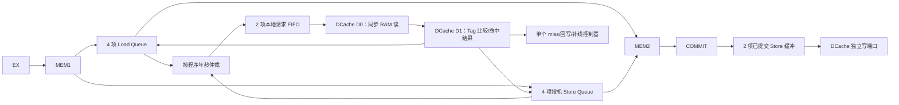

# EdRV32 LSU 重设计方案与验收条件

日期：2026-09-22。下文保留实施前的设计依据和验收条件；单路径 RTL 已实施，验收记录见 `docs/optimization/2026-09-22-lsu-single-path-results.zh.md`。

## 目标与已知事实

- 单发射八级流水，保留 MEM1、MEM2、COMMIT 的寄存边界、顺序退休、精确异常和 FPGA 同步 RAM。
- 预热后的独立 LW 与 SW，分别达到每周期接收、每周期退休一条（稳态 II=1）。单条 Load 命中延迟允许大于一拍；吞吐和延迟分开验收。
- 未命中允许阻塞后续 Cache 查找；本次不引入多 MSHR、乱序退休或非缓存 MMIO 投机执行。
- RTL 必须通过现有 100 MHz 板级时序约束。不能仅凭结构推断时序通过，必须在目标 FPGA 上完成综合和布局布线。

实施前的定向仿真：48 条预热后的独立 LW 退休跨度 94 拍（47 个间隔，II=2）；独立 SW 跨度 141 拍（II=3）；采样窗口 I/D Cache miss 均为 0。仅给 DCache 增加 Load 命中同拍周转，LW 仍为 93/47；再给两项 Load Queue 增加满队列同拍替换，LW 为 70/47，且 Load-use 用例退化。详见 `sim/cases/cpu/lsu-throughput/RESULTS.md`。这说明必须同时重做 Cache 命中通路与队列容量/流控。

## 开源实现取舍

| 参考 | 借鉴点 | 不直接照搬的部分 |
|---|---|---|
| [Rocket DCache](https://github.com/chipsalliance/rocket-chip/blob/master/src/main/scala/rocket/DCache.scala) | 连续请求的多级命中流水、待写 Store 缓冲、同地址相关检查 | TLB、相干性、原子操作及其复杂仲裁超出本核需求 |
| [CORE-V CV32E40X LSU](https://docs.openhwgroup.org/projects/cv32e40x-user-manual/en/latest/load_store_unit.html) | Store 提交后进入写缓冲，FENCE 等待缓冲排空 | 一项写缓冲主要隔离 OBI 响应；本核还需同时支撑 DCache 命中读写 |
| [CORE-V CV32E40P LSU](https://docs.openhwgroup.org/projects/cv32e40p-user-manual/en/latest/load_store_unit.html) | 请求授予与响应分离、允许多个在途请求 | 四级流水且无深 FIFO，不足以覆盖本核 MEM1 至 COMMIT 的在途距离 |

选择：**单未命中处理器 + 每拍一个命中查找 + 按年龄排序的 Load/Store 队列 + 已提交 Store 写缓冲**。这样把命中吞吐从未命中复杂度中分离，保持现有同步 RAM 和顺序退休模型。

## 数据通路

### 命中 Load

1. MEM1 完成地址、对齐和 PMA 检查，给 LQ 分配一个稳定的 `{generation, slot}` token。
2. 按年龄仲裁把请求送进本地请求 FIFO。FIFO 的 `ready` 只由本地占用决定，不透明连接到 COMMIT。
3. D0 在时钟沿读两路同步 RAM；D1 在下一拍比较 Tag、选字、符号扩展并向 LQ 返回 token 和结果。
4. 当 D1 是命中且结果可接收时，D0 在同一个时钟沿读下一条地址，形成 `D0(L1)` 与 `D1(L0)` 重叠。未命中时停止发射新读，由原来的单 miss 控制器处理。
5. LQ 记录结果，MEM2/COMMIT 按原有顺序退休。若数据相关，消费者按结果实际可用的拍数等待；不能用独立 LW 的 II=1 推断 Load-use 间隔。

四项 LQ 用容量覆盖 MEM1 分配至 COMMIT 释放的正常在途距离，避免两项队列反复满载。队列满时先停 MEM1；不采用 COMMIT `pop` 直通 MEM1 `ready` 的长组合路径。token 扩为三位，访存年龄序号扩为五位；任何年龄比较都以最大在途数小于半个序号空间为约束。

### 命中 Store

1. MEM1 分配投机 SQ 项，保存地址、字节使能、数据和年龄。D0/D1 对 Store 同样每拍查找一项；命中只给对应 SQ 项标记 `prepared`，不再占用一个全局 `STORE_RESERVED` 状态直到 COMMIT。
2. Store 的 Cache miss、补线及可能的访问错误必须在该 Store 退休前结束，错误写回 SQ，保持精确异常。已命中的 Store 在退休前不得被一个更年轻的 miss 淘汰；miss 控制器先排空需要保护的较老 Store，再选择 victim。
3. COMMIT 只能退休最老且 `prepared` 的 Store。成功退休时把数据、字节使能和定位信息复制到两项已提交 Store 缓冲（CSB），并释放 SQ 项。CSB 无空位时才阻塞 Store 退休。
4. CSB 每拍最多向 DCache 的独立写端口送一项，同时允许 D0 读下一项。缓冲要支持同拍排出旧项并写入新项，纯命中 SW 才能达到 II=1。

RAM 的同址读写模式不能决定软件可见结果。D1 需要对“本拍写入的影子记录”和仍在 CSB 中的较老写入按字节覆盖；投机 SQ 中的同址 Store 则在 MEM1 先做转发/冲突检查。先支持完整覆盖的直接转发；部分覆盖等待相关较老 Store 排出后再读取 Cache，不给年轻 Store 抢先占用查找通道。

### 年龄、冲突与进展

- 仲裁器按访存年龄选最老**未解决**请求，不能只比较当前 `valid`。被部分 Store 覆盖而暂时不能发出的老 Load 仍参与年龄阻挡。
- 已知死锁 `sb A; lw A; sb A; lw A` 的原因是第二个、较年轻的 `sb` 在老 `lw` 刚解除阻塞的同拍占了 DCache。新规则要求老 Load 先得到查找权；年轻 Store 不得越过它。
- 完整 Store→Load 覆盖直接转发；无重叠直接读 Cache；部分覆盖记录所依赖 Store 的**年龄 ID**，在它从 CSB 排出时唤醒。不能只保留会被 SQ 提前复用的槽 token。
- 重定向仅清除投机 LQ/SQ 与请求 FIFO 项；已提交 CSB 必须继续排空。已发出的 AXI 请求依现有协议排空并丢弃被取消结果。
- FENCE/FENCE.I 等待已提交写入和请求 FIFO 排空；FENCE.I 再清理 DCache、使 ICache 失效。MMIO/非缓存事务仍在 COMMIT 串行处理，先等更老的 CSB 写入排空，不经投机命中通路。
- Load、Store 准备阶段的补线错误及 MMIO 错误仍在该指令退休前报告。已退休脏行的后续写回错误属于现有的异步错误范畴，需要保持既有处理策略；本方案不把这种错误伪装成可回退的精确异常。

## 时序边界

| 路径 | 约束 |
|---|---|
| MEM1→队列 | PMA/地址检查、最多四项并行 Store 地址比较；只写本地寄存器，不接 COMMIT 组合 `ready` |
| 队列→D0 | 年龄选择在本地请求 FIFO 之前完成；D0 仅选择已登记请求的地址 |
| D0→D1 | FPGA RAM 同步读跨寄存边界，不改成组合读 |
| D1→结果队列 | Tag/way、字节选择、转发合并在本周期完成；若布局布线不满足 100 MHz，增加局部结果寄存槽而保持 II=1 |
| COMMIT→CSB | 只检查 CSB 本地容量；CSB 排出与接收同时发生，不把 RAM 写完成信号送回全流水 `ready` |

## 验收门槛

1. 预热后无 miss 的 48 条独立 LW、SW：47 个相邻退休间隔都等于 1；每拍最多且稳定接受一个 DCache 查找和一个已提交写入。ALU 基线保持 1。
2. 检查 LW-use、SW→无关 LW、完整转发、部分覆盖、连续同字节 Store、跨行/脏行 miss 的结果、异常和气泡数。`sb A; lw A; sb A; lw A` 必须完成，不允许靠超时兜底。
3. 通过 Load/Store Queue 单元测试、Cache 定向测试、RISC-V 架构测试、CoreMark 校验；记录 CoreMark 总周期、各类访存气泡及命中率，不能用纯 LW/SW 提升直接代替 CoreMark 收益。
4. FPGA 模式综合与布局布线：现有 100 MHz 约束 WNS≥0；核对 RAM 仍推断/例化为目标 IP，比较 LUT/寄存器和关键路径。未通过时调整局部寄存容量或转发路径，不能只在仿真中宣称“兼得”。

实施顺序：先修年龄仲裁死锁，再完成 Load 命中流水和 LQ，随后分离 SQ/CSB 并完成 Store 命中流水，最后做全量正确性与时序收敛。每一步保留可独立测量的仿真结果。
