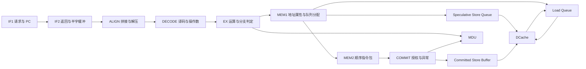

# EdRV32 指令执行、流水控制与特殊情况说明

**先读推导，再读实现：** 架构约束、参考八级模型、冲突与生命周期的自顶向下推导，见 [CPU 自顶向下分析](<G:/claude code/EdRV32-Competition-2026/docs/architecture/2026-09-26-cpu-first-principles-analysis.zh.md>)。本文只负责解释当前实现，不能据此认定所有现有逻辑都属于架构必需。

**阅读入口补充：** 本文是机制概览。相邻/间隔 1–6 条的真实旁路、Load hit/miss、dirty eviction、反压与队列满的逐拍解释，以及 365 个定向场景结果，见 [数据冲突与 Cache 周期矩阵](<G:/claude code/EdRV32-Competition-2026/docs/architecture/2026-09-26-cpu-hazards-cache-cycle-matrix.zh.md>)。不要从本文的简化主线推断固定 stall 拍数。

本文按 2026-09-26 的活动 RTL 解释 CPU，包括 queued LSU、I/D Cache 和单槽 MDU。目的不是再罗列优化技巧，而是建立“每个逻辑分支保护什么、等待什么、什么时候可以省掉”的统一认识。

范围是当前 RV32IMC、CSR/FENCE.I、M-mode 实现。不要套入本核尚未实现的分页/MMU、S/U-mode、浮点、原子扩展或乱序重命名状态；未支持的指令/CSR 走相应非法访问处理，而不是假设另有隐藏执行通路。

说明分为三层：**必须满足的正确性规则、当前实现方式、可尝试的性能优化**。当前实现不等于已经正确覆盖全部组合情形；特别是已复现的 cached Store/IRQ 提交问题，见 [CPU/Cache 审计](<G:/claude code/EdRV32-Competition-2026/docs/validation/2026-09-26-cpu-cache-rtl-audit.md>)。

## 1. 先区分正确性机制与性能机制

| 机制 | 解决的问题 | 不采用它时能否仍然正确 |
|---|---|---|
| 指令译码、算术、地址生成 | 实现指令语义 | 必须有等价实现 |
| 冒险检测与等待 | 消费者不能读到旧值 | 必须保证，具体实现可不同 |
| 旁路 forwarding | 不必等结果写回 RF 才使用 | 可以没有，但必须增加等待 |
| 分支预测 | 不必等 EX 得出真实 next PC 才继续取指 | 可以没有，但跳转吞吐下降 |
| 预测结果校验和恢复 | 猜错的指令不能产生架构效果 | 只要有预测，就必须有恢复 |
| valid/ready、队列所有权 | 阻塞时不丢失、不重复事务 | 必须保证 |
| 精确异常、提交与取消规则 | 只允许正确程序顺序中的效果生效 | 必须保证 |
| 请求 FIFO、Store buffer、解耦 MDU | 重叠工作、隐藏延迟 | 可以采用更简单的阻塞实现 |
| HPM | 观察执行情况 | 基础计时之外的详细统计可裁剪 |

旁路和预测主要是加速正常程序中非常常见的情况。它们不是异常处理本身，也不应该成为所有控制逻辑的解释。优化是减少不必要的等待，同时维持正确性规则。

## 2. 一条指令有多个“完成时刻”

依次区分：被取到、译码、获得正确操作数、执行单元接受、结果算出、结果可旁路、提交授权、实际写回/写入、外部可见。

| 指令 | 结果可用 | 架构授权与物理完成的关系 |
|---|---|---|
| ADD/ADDI 等 | EX 算出，寄存后的结果可供后继使用 | 普通 GPR 写入在正常 COMMIT |
| Branch | EX 得到方向和目标 | EX 可以恢复取指；该指令仍要走到 COMMIT |
| JAL/JALR | EX 得到目标和 link address | 取指重定向与 link register 写入是两件事 |
| Cacheable Load | LQ 收到命中/回填/Store 转发结果 | 数据可提前给消费者，正常 COMMIT 才写 rd |
| Cacheable Store | 地址、数据、Cache reservation 准备完成 | 正常 COMMIT 授权进入 committed buffer；随后写 DCache，dirty line 以后才写外存 |
| MUL/DIV | 独立 MDU 返回算术结果 | 当前 token 在 COMMIT 授权；授权和实际 MDU GPR 写回不一定同拍 |
| CSR | COMMIT 的 validation snapshot 形成后 | 合法正常退休才执行 CSR 更新 |

**结果完成不等于退休；退休也不等于数据已经到 DDR。** 讨论优化时必须说清楚缩短的是哪两个时刻之间的距离。

“older/younger”表示动态程序顺序的先后，不是 PC 数值大小。循环中同一个 PC 可以同时对应多个动态实例。

## 3. 八级的职责地图



图中是职责和主要事务关系，不是所有端口，也不表示每个箭头都恰好一拍。

| 阶段 | 正常工作 | 主要等待/额外情况 | 状态所有者 |
|---|---|---|---|
| IF1 | 生成 32-bit 对齐取指 block 地址；查询预测器；给请求附 PC/epoch/预测元数据 | I$ 不 ready；两项 tag 队列满；redirect | fetch PC、issue epoch、请求 tag 队列 |
| IF2 | 匹配有序响应，形成六 halfword FIFO；准备送 ALIGN 的窗口 | 下游反压；旧 epoch/错误 stream 返回；跨 word 指令；预测重定向 | 半字 FIFO、head/tail/count、目标流状态、两项窗口队列 |
| ALIGN | 识别 16/32-bit 指令；拼接；将 RVC 解成标准内部 32-bit 指令 | 缺少第二个 halfword；非法压缩编码；取指错误 | ALIGN→DECODE pipe |
| DECODE | 译码、立即数、读 RF、选择旁路、确定异常和副作用意图 | RAW/WAW；MDU 不可用；下游容量不足 | DECODE→EX packet；操作数待完成身份 |
| EX | ALU、地址加法、分支比较、JAL/JALR 目标；请求 MDU | late-load 等待；本地 operand capture；redirect slot/MDU/下游阻塞；地址不对齐 | EX→MEM1 packet、本地操作数捕获 |
| MEM1 | PMA 判权限及 Cache/TCM/MMIO 属性；分配 LQ/SQ token；Store byte formatting | 队列满；两项输出缓冲满；权限错误 | MEM1 两项 packet 缓冲；LQ/SQ 分别拥有访存事务 |
| MEM2 | 传递顺序指令包和 token，提供 resident hazard observation | COMMIT 反压 | 内部 owner + MEM2→COMMIT pipe |
| COMMIT | 选择正常退休、异常、中断；写 RF/CSR；授权 Store/MDU；执行串行访问 | LQ/SQ 未完成；串行总线响应；CSR snapshot；MDU 授权等待；FENCE/WFI | 架构副作用、阻塞 memory FSM、CSR validation |

来源：[IF1](<G:/claude code/EdRV32-Competition-2026/rtl/cpu/frontend/edrv32_if1_stage.v>)、[IF2](<G:/claude code/EdRV32-Competition-2026/rtl/cpu/frontend/edrv32_if2_stage.v>)、[ALIGN](<G:/claude code/EdRV32-Competition-2026/rtl/cpu/frontend/edrv32_align_stage.v>)、[DECODE](<G:/claude code/EdRV32-Competition-2026/rtl/cpu/decode/edrv32_decode_stage.v>)、[EX](<G:/claude code/EdRV32-Competition-2026/rtl/cpu/execute/edrv32_ex_stage.v>)、[MEM1](<G:/claude code/EdRV32-Competition-2026/rtl/cpu/lsu/edrv32_mem1_stage.v>)、[MEM2](<G:/claude code/EdRV32-Competition-2026/rtl/cpu/lsu/edrv32_mem2_stage.v>)、[COMMIT](<G:/claude code/EdRV32-Competition-2026/rtl/cpu/commit/edrv32_commit_stage.v>)。

## 4. “八级”不表示每条指令固定八拍退休

这是八个命名阶段，实际包含 Cache 同步读取、队列、内部 owner 和多周期单元。当前 MEM2 有内部 packet 寄存器和输出 pipe 两层；IF2 也有半字 FIFO 和输出窗口。

以一条已准备好输入的 ADDI 为例，从 DECODE 接收开始，在无反压、无 kill、无异常条件下，按当前 RTL 推导后端边沿如下：

| 时钟边沿 | 动作完成后 |
|---|---|
| E0 | DECODE→EX 寄存器获得译码与操作数 |
| E1 | EX→MEM1 寄存器获得 ALU 结果 |
| E2 | MEM1 输出队列获得指令包 |
| E3 | MEM2 内部 owner 获得指令包 |
| E4 | MEM2→COMMIT pipe 获得指令包 |
| E5 | 正常 COMMIT，写回 rd |

这是对寄存边界的推导示例，不是所有指令/所有队列占用下的固定延迟；从取指到 E0 的时间还取决于 I$、IF2 和 ALIGN。

流水线填满后仍可以每拍退休一条。延迟是单条走多久，吞吐是连续完成的间隔，二者不能混为一谈。

## 5. 普通整数指令与数据相关

### 5.1 无依赖路径

`ADD/SUB/ADDI/AND/OR/XOR/SLT/移位/LUI/AUIPC` 等经过前端，DECODE 获取输入，EX 产生结果，MEM1/MEM2 传递，COMMIT 正常写 rd。对于它们，MEM 阶段不是必须去读写内存，只是经过顺序通道。

NOP 仍是可退休指令。rd=x0 时丢弃 GPR 写入，不能把所有 rd=x0 指令都删除：`LW x0,...` 仍涉及访问与可能的异常，JAL x0 仍改变控制流。

整数 ADD/SUB 的结果按 32 位截断，不额外产生整数溢出异常；SLT/SLTU 和算术/逻辑右移要区分符号语义。RF 除 x0 外的 payload 没有整体复位，软件必须先建立需要的寄存器值，不能用上电恰好为零作为功能前提。

### 5.2 RAW：消费者要最新的 older writer

```asm
addi x5, x1, 1
add  x6, x5, x2
```

第二条不能读取尚未更新的 RF[x5]。最简单的正确实现是等第一条写回；旁路把第一条已经算出的结果提前交给第二条，从而减少等待。

```asm
addi x5, x0, 1
lw   x5, 0(x10)
add  x6, x5, x2
```

此时只能使用第二条 Load 的结果，即使第一条 ADDI 已就绪，也不能回退取其旧值。**先选最近的有效 older producer，再判断 ready；不能从所有 ready producer 中随便选一个。**

[operand_resolve](<G:/claude code/EdRV32-Competition-2026/rtl/cpu/decode/edrv32_operand_resolve.v>) 对外部流水记录按年轻到年老选择，MDU 记录有 scoreboard 约束下的特殊优先级；DECODE→EX resident 是另一条更年轻的记录，需在 DECODE 内单独处理。

### 5.3 当前三种取值方式

| 方式 | 原因 | 什么时候可用 |
|---|---|---|
| DECODE 直接取旁路值 | older 指令结果已经可观察 | 匹配结果 ready |
| resident bypass 标记带进 EX | 相邻 ALU 还在 DECODE→EX，下一拍其结果才出现在 EX 输出记录 | EX 确认对应 producer 并取值，阻塞时可本地保存 |
| late-load 标记带进 EX | 已知 cacheable Load 在未来返回 | LQ PC probe 找到对应完成项，EX 使用或捕获 |

不能把这三者当成三份任意优先级的“备用值”。它们都必须指向同一个正确动态 producer，并保证消费者在自身被 kill 后不再执行。

### 5.4 Load-use 的额外等待

当前相邻 Load 的 resident 检查会等待；EX 输出记录没有 cacheability，因此继续 hard-block；MEM1 已知 cacheable 后才能 soft-release。MEM2 的 hazard 又没有接通 LQ completion，可能继续等 COMMIT 旁路。详见 [core:335](<G:/claude code/EdRV32-Competition-2026/rtl/cpu/core/edrv32_core.v:335>)、[mem2_stage:178](<G:/claude code/EdRV32-Competition-2026/rtl/cpu/lsu/edrv32_mem2_stage.v:178>)。

EX 对 late-load 控制流指令要求先本地捕获、下一拍才比较/计算目标；普通 ALU 可以在匹配到数据的同拍消费。这是为分支关键路径做的时序折中。

这部分的优化对象应是 producer contract 与安全可见时机，而不是简单删除某个 stall 条件。

### 5.5 WAR/WAW

普通单发射顺序流通过按序读操作数、按序提交，通常不需要通用重命名机制来解决 WAR/WAW；但本核有延迟写回的 MDU，所以不能把“所有写入天然同序”当成前提。MDU scoreboard 阻止冲突 RAW/WAW，保存请求操作数避免后继改写 RF 影响已启动运算。多 outstanding MDU 会要求更完整的顺序管理。

## 6. Branch、JAL、JALR 与预测恢复

| 指令 | EX 计算 | 正常 COMMIT |
|---|---|---|
| BEQ/BNE/BLT/BGE/BLTU/BGEU | 比较 rs1/rs2；taken 目标 PC+imm；否则 PC+长度 | 退休，通常无 GPR 写入 |
| JAL | 目标 PC+imm；link=PC+原指令长度 | 有效 rd 写 link |
| JALR | 目标 (rs1+imm) 清除 bit0；link=PC+原指令长度 | 有效 rd 写 link |

RVC 解压后还保留 `is_compressed`，因此 link 和 fall-through 仍根据原始长度选 PC+2 或 PC+4，不能一律按解压后的 32-bit 长度加四。

### 6.1 不预测也能正确

可以一直顺序取指，等 EX 确定 taken 再清除后继并取目标；也可以遇到控制流就暂停取指。代价是等待。预测器提前猜 next PC，让未来几拍能继续工作。

当前 BTB 提供目标及类型，BHT 提供条件分支方向，RAS 帮助预测 return。IF1 查询并保存预测元数据，IF2 根据指令边界做较早的 prediction redirect。EX 是实际方向/目标的裁决者。

### 6.2 需要覆盖的分支情况

| 预测与实际 | 处理 |
|---|---|
| 均不跳 | 保留顺序流 |
| 均跳，目标一致 | 保留预测目标流 |
| 预测不跳，实际跳 | 取实际 target，kill 错误 younger 指令 |
| 预测跳，实际不跳 | 取实际 fall-through，kill 错误 younger 指令 |
| 均跳，但目标不同 | 取实际 target |
| BTB 陈旧，把普通指令当成跳转 | EX 也要修复错误预测 |
| 分支依赖未完成 Load/MDU | 等正确操作数，不能用旧值“先算一个结果” |
| 错误路径上的取指错误/非法指令 | 若被 older redirect kill，则不得成为架构异常 |
| EX 修复与 older COMMIT trap 同时发生 | older COMMIT 事件优先 |

当前 [redirect controller](<G:/claude code/EdRV32-Competition-2026/rtl/cpu/control/edrv32_redirect_ctrl.v>) 寄存 redirect 命令。EX 的恢复先关闭最近的 DECODE→EX 边界，注册后的 redirect 再清理前端；COMMIT 的恢复还要取消所有 younger 后端工作。

**EX 分支恢复不能把分支前已经执行的 older Load、Store、MDU 一并取消。** 前端预测 redirect 更不能清掉后端 older 正常工作。

### 6.3 已发出的取指怎么办

不能假设 redirect 能让总线撤回请求。IF1 保留请求身份，IF2 用 epoch/stream address 匹配，消费并丢弃旧响应。32-bit 指令从 block 上半字开始时必须等下一个 block 的半字，不能提前 redirect 把分支指令自身的后半部分丢掉。

epoch 是有限宽的流身份，token/generation 是队列事务身份，PC 是指令地址；三者职责不同。有限宽身份在旧请求仍可能返回时重用，需要由容量、排空及取消契约保证，不应把位宽有限的比较本身当成完整证明。

## 7. Load：地址、完成和退休分开走

### 7.1 路径分流在 MEM1

EX 计算 effective address，并检查 halfword/word 对齐；MEM1 根据 [PMA classifier](<G:/claude code/EdRV32-Competition-2026/rtl/cpu/lsu/edrv32_pma_classifier.v>) 判断映射、读写执行权限、Cache/TCM/device 属性。

| 地址与配置 | 当前主要执行路径 |
|---|---|
| 允许读取、cacheable 且 Cache 开启 | MEM1 分配 LQ，提前查 DCache |
| uncached 普通内存/MMIO | packet 到 COMMIT 后发串行请求 |
| 已启用 DTCM | 当前同样通过 COMMIT 阻塞数据请求接口，再由 cached_core 路由到 DTCM |
| TCM 区域但相应 TCM 未启用、无映射或无权限 | 携带 access fault，到 COMMIT 处理 |
| 地址不对齐 | EX 标记 misaligned，不分配正常 cacheable 事务 |

这里不能把“TCM 物理 RAM 很快”直接等同于“当前 CPU 的 TCM load-use 很短”：流水路径仍可能在 COMMIT 串行化。CoreMark 当前板级配置关闭 TCM。

### 7.2 Cacheable Load 的两条并行路线

```text
指令顺序路线：EX → MEM1 分配 token → MEM2 → COMMIT 等该 token
数据事务路线：LQ → 与 Store 仲裁 → DCache → LQ 保存 data/error
```

两条路线靠 token 关联。数据可以先于指令到 COMMIT 完成，也可以晚于它完成；COMMIT 必须同时拿到正确队列项、完成状态和无异常结果，才能正常写 rd。

LQ 有 4 项；每项保存地址、PC、类型、token generation、完成/错误/阻塞状态等。队列最老未发请求保有顺序优先权，不允许因它被阻塞就随意放行更年轻的 Store preparation，避免年龄关系形成死锁。

### 7.3 Load 与 older Store 的关系

| older Store 状态/覆盖 | Load 动作 | 必要性 |
|---|---|---|
| 没有相关 Store | 读 DCache | 无需等待无关写 |
| 最新相关 Store 覆盖所需全部字节 | SQ/committed buffer 直接转发 | DCache 中可能还是旧值 |
| 最新相关 Store 只覆盖部分所需字节 | 当前实现等待相关 Store release，再查 Cache | 不把部分新数据与不正确旧数据拼起来 |
| 多个 Store 写同一地址 | 按年龄选最新相关写；当前不做任意多个 entry 的 byte gathering | 避免取到旧写 |
| store drain 与 Cache 同地址读取相撞 | DCache 用 buffer/shadow 合并读值 | FPGA RAM read-first 可能返回写前内容 |

当前部分覆盖策略保守而有效；是否增加多 Store 按 byte 合并应依据工作负载收益和比较网络时序，不是缺了就一定功能错误。

### 7.4 DCache 命中与 miss

命中：同步读两 way tag/data → tag compare/选 way/选 word → 合并未落 RAM 的 Store → byte/halfword 符号或零扩展 → LQ completion。

miss：如果存在 reservation/Store buffer，则先等待安全 drain；必要时重新读取 metadata。选择 victim 后，clean victim 可直接 refill，dirty victim 必须先 writeback 并等待响应，再 refill。完整行安装后形成 completion；错误响应带 error，不能给消费者当作成功数据。

当前 DCache 是单 miss FSM，加请求 FIFO并不使它变成多 miss 并行 Cache。miss 可以占住数据端口，但前端/其他已在途执行并不必然当拍全部停止；容量耗尽或 oldest 指令不能提交时，反压逐步传回。

### 7.5 取消不等于撤回 AXI

队列项被 COMMIT flush 后可以失效，但已经发出的 AXI 请求仍需按协议完成/drain。到达的旧响应不能写入新占用同一槽的指令。generation、cancel_pending、请求所有权等逻辑是为此存在。

访问普通内存可能在尚未退休时产生 Cache refill、替换甚至旧 dirty line writeback；它们是微架构动作，不等于把本条 Load 的结果架构提交。MMIO 读取可能有读清零等外部副作用，不能照搬这一投机路径。

## 8. Store：准备、授权、落地三个阶段

```text
EX：地址 + store data
  ↓
MEM1：权限/属性 + byte lanes + SQ entry
  ↓
SQ prepare → DCache lookup/refill → reservation → prepared
  ↓
正常 COMMIT：转入 committed store buffer
  ↓
drain：DCache 接收 → 本地 store buffer → RAM byte write + dirty
  ↓
以后 eviction/clean：写回外部存储
```

reservation 表示已经为这条 Store 准备好了对应 Cache line/way 的使用关系，**不是把新数据已经写入 Cache**。地址准备与实际修改分开，才能让 older 异常取消年轻 Store 而不污染内存。

当前投机 SQ=4 项、committed buffer=2 项，DCache 还有 reservation FIFO 与本地 store buffer，分别拥有不同阶段的事务。它们不是四份可随意相互替代的缓存。

Store 的源依赖有两种：基址 rs1 未就绪，或待写数据 rs2 未就绪。不能只检查地址生成的 rs1，而让旧的 rs2 数据进入 SQ。

Store prepare 可能因 miss/writeback error 失败，应在该 Store COMMIT 时转为异常；正常退休前可以撤销。已经退休的 Store 必须继续 drain，不能因 younger 分支、中断、FENCE 清除。

**已知缺陷**：当前 COMMIT 的 `store_commit_fire` 使用包含 trap 接受的 `ready_o`，导致 IRQ 抢占的 Store 也能进入 committed buffer；同拍 cancel 清掉 reservation，后续 FENCE 卡住。这违反上面的授权边界，不能把现有行为当成合理的特殊分支。

另一个需保持明确的边界：retired Store 的后续 drain 错误不能当作该指令“尚未退休的精确异常”。当前 SQ 有 async_error 输出，但 core 未连接；完整系统需要另定义错误报告/恢复策略，不能笼统声称所有 Store 错误都已精确处理。

## 9. Uncached、MMIO 与 TCM 串行访问

这些访问不走 cacheable LQ/SQ 推测路线，而是将地址、size、data 携带到 COMMIT，由本地 memory FSM 处理：

```text
MEM_IDLE → 请求被接收 → MEM_WAIT → 响应到达 → MEM_DONE → 释放指令
                    ↘ 同拍有响应可直接进入 MEM_DONE
```

ready/valid 反压时必须保持请求稳定；请求被接受后不能重复发起；响应只能路由给记录的 owner。cached_core 再选择 DCache uncached AXI、DTCM 或 cache-maint MMIO。

特别注意：外设读取也可能不可撤销。COMMIT 在请求尚未接受的 MEM_IDLE 可允许中断抢占；接受之后要等事务完成，防止中断返回后重复读写外设。不能简单规定“中断一来把全部 valid 清零”。

## 10. MUL/DIV 的独立执行与授权

1. DECODE 检查 MDU 容量与 RAW/WAW。
2. EX 发射并保存操作数，MDU/scoreboard 占有单槽；主流水携带 `mdu_token`。
3. MDU 独立运算。当前板级 APM 乘法后端是三阶段，除法为迭代实现。
4. 结果算完可以提供旁路；算完并不代表可以无条件写 RF。
5. token 到 COMMIT 正常通过后发 `authorize`。**当前 `retire_o` 对 MDU token 可早于算术写回。** 不能用普通 ALU 的“退休与 rd 写回同拍”模型解释它。
6. 已授权 older MDU 尚未写回时，COMMIT 的 `authorized_mdu_wait` 阻止后继架构动作/中断越过；最后 MDU 获得 GPR 写口，清空 slot/scoreboard。

若 older trap 发生时 MDU 尚未授权，应取消；已授权的 MDU 则必须完成。普通 GPR 与 MDU 共享一个写口，不能同拍写两个目的寄存器。

当前算术 IP 有流水并不代表支持每拍一条 MUL：MDU slot 与 operation metadata 都按单 outstanding 设计。除数为零、signed 最小值除以 -1、零被除数等在 [divider](<G:/claude code/EdRV32-Competition-2026/rtl/cpu/mdu/edrv32_div_nonrestoring.v>) 中产生规定结果，不当成普通算术 trap。

## 11. CSR、ECALL/EBREAK、MRET、WFI

| 类型 | 当前处理 | 为什么需要额外支路 |
|---|---|---|
| CSR read/modify/write | DECODE 决定 op/source；COMMIT 先 snapshot 读值、合法性、写意图，下一拍提交 | CSR 影响中断/异常/计数等全局状态，必须按序；snapshot 切断读译码长路径 |
| CSRRS/CSRRC source=0 | 不执行 CSR 写入，仍按规则读取 | 读取只读 CSR 与尝试写只读 CSR 的合法性不同 |
| CSR immediate | 使用 zimm 而非 RF 值 | 不能把指令编码字段误判成普通 rs1 依赖 |
| ECALL/EBREAK | DECODE 标记同步异常，到 COMMIT trap | 不能在发现当拍越过 older 指令立即改变架构状态 |
| MRET | COMMIT 恢复中断使能状态，重定向 mepc，清除 younger | 它影响控制流和机器态 |
| WFI | COMMIT 等待可唤醒的 pending source，输出 sleep 观察信号 | 全局中断允许和唤醒条件不是完全同一个条件；当前 sleep 信号本身不证明有物理 clock gating |

当前 WFI 可由局部允许的 pending interrupt 唤醒，即使全局 MIE=0；若实际采取 interrupt，COMMIT 对 WFI 保存的返回 PC 有 fall-through 特例。

## 12. 异常与中断：发现、携带、最终裁决

| 情况 | 发现位置 | 正确处理方向 |
|---|---|---|
| 取指不可执行/总线 error | 取指路由/I$，随后经 IF2/ALIGN | 保存 fetch fault，错误路径被 kill 时一并丢弃 |
| 非法 RVC/普通编码 | ALIGN/DECODE | 记录原始指令供 trap 信息使用 |
| Load/Store 不对齐 | EX | 禁止正常访存副作用，传异常 |
| 数据地址权限/映射错误 | MEM1 PMA | 禁止正常队列分配，传 access fault |
| Cache refill/prepare error | Cache/LQ/SQ | 与原 token 关联，在对应 COMMIT 裁决 |
| uncached/MMIO 返回错误 | COMMIT memory response | 保存 error，随后 trap |
| 非法 CSR/不允许的写 | COMMIT validation | trap，禁止普通 rd/CSR 更新 |
| 外部/软件/定时中断 | COMMIT 对输入采样并结合 CSR enable | 在安全指令边界抢占；当前优先外部、软件、定时 |

同步异常属于某条指令；中断是外部请求，必须选择安全边界。某条年轻指令先发现错误，并不代表它能先于 older 指令陷入异常。

当前 COMMIT 中同步异常优先于普通中断，然后才是 MRET/FENCE/正常动作；redirect 仲裁中 COMMIT 事件比 EX 分支修复更老。这个优先级不能只做成“哪个信号来得早就处理哪个”。

精确性的目标是：在选定 trap 边界前的架构效果得到保持，边界上的 faulting/被抢占指令没有错误地执行普通副作用，后面的指令被撤销。保存 mepc/mcause/mtval，更新 mstatus，再取 mtvec 目标。已接受总线事务与已授权后台操作还需按其所有权规则排空。

## 13. FENCE、FENCE.I、软件 Cache 维护与 DMA

FENCE 解决访问顺序，FENCE.I 解决指令获取看到此前代码更新的问题；不能把 FENCE 理解成所有实现都必须全 Cache clean。

**本项目的具体实现较保守：** FENCE/FENCE.I 到 COMMIT 后，先禁止/清掉年轻投机 LSU 工作，等待 committed stores 排空，然后 redirect 到下一条；cached_core 在退休脉冲上启动 D$ clean-all，暂时关闭新取指，等待 maintenance 结束。FENCE.I 还 invalidate I$ 和预测器。

因此，本实现里 fence 的退休脉冲可能先于 clean-all 物理完成；后续指令获取仍被挡住，不能仅观察 retire 脉冲就认为所有外部可见动作都已结束。[cached_core:301](<G:/claude code/EdRV32-Competition-2026/rtl/cpu/core/edrv32_cached_core.v:301>)。

单独的 cache-maint MMIO 提供地址/size、invalidate、clean、clean+invalidate 和 I$ invalidation。CPU/DMA 共享缓存数据时还需要软件建立缓冲区所有权与正确的维护顺序；仅将地址设成某个 alias，不会自动形成硬件一致性。此处是系统接口契约，不能靠 CPU 旁路解决。

## 14. 所有级共同面对的握手与撤销组合

| 条件 | 所需行为 | 常见错误 |
|---|---|---|
| valid=0 | payload 对功能不可见 | 对无效 packet 译码后仍触发副作用 |
| valid=1、ready=0 | 保持当前事务/输入稳定 | 每拍重复发请求或重复更新计数/预测器 |
| valid=1、ready=1 | 本拍 transfer，且只 transfer 一次 | 同一条指令执行两遍 |
| 同拍输出并接收输入 | 根据容量更新 occupancy 与 payload | head/tail 移动错误、覆盖未消费数据 |
| full 且本拍 pop | 可以允许或禁止同拍 push，需明确契约 | valid/data/计数对 pop+push 的认定不一致 |
| stall 时旁路结果只出现一拍 | 本地捕获结果，或保证来源一直持有 | 下一拍 producer 已离开，消费者值丢失 |
| kill 与 capture 同拍 | 被 kill 的年龄域不能留下有效新指令/新副作用 | 只清 valid 却仍提交 Store |
| flush 与 response 同拍 | 旧事务不能使新 owner 变为 done | 旧 token 返回污染重用槽 |
| flush 时存在 committed Store | 保留、排空已授权工作 | 误删 older 副作用或 reservation |
| reset | 清控制可见性；RAM/RF payload 可不全部复位 | 依赖未定义的 payload；系统仍有旧 AXI 响应却无 owner |

复位与跨模块未完成事务需要系统级协调，不应把“CPU valid 全清零”视为外设/总线事务也自动消失。上述表是验收要求，不表示本次已验证每一种组合。

## 15. 怎样看懂一个 if/else 分支

给每个分支贴以下标签，并回答六个问题：

| 分支类别 | 例子 |
|---|---|
| 指令语义选择 | ALU op、signed/unsigned、byte/halfword |
| 结果可用性 | operand ready、LQ done、MDU complete |
| 容量与协议 | FIFO full、AXI ready、redirect slot available |
| 程序年龄与身份 | newest producer、sequence 仲裁、token/generation |
| 授权与撤销 | normal retire、kill、flush、cancel_pending |
| 特权/异常 | access fault、CSR legality、IRQ priority |
| 性能选择 | forwarding、预测、empty FIFO bypass |
| 可观测性 | HPM 分类、debug 输出 |

六个问题：**谁拥有当前事务？操作的是哪条动态指令？为什么不能立即前进？等哪个事实成立？谁最终释放状态？取消时保留什么？** 如果回答不清楚，先不要继续加优化支路。

尤其不要混淆这四个量：`valid`（有事务）、`ready`（允许转移）、`done`（工作完成）、`commit/authorize`（允许不可撤销效果）。上一轮发现的 Store/IRQ 缺陷，就是把 ready 当作正常提交许可。

## 16. 从梳理转向优化的顺序

| 优化候选 | 想消除的等待 | 必须保留的约束 | 应观察的结果 |
|---|---|---|---|
| 统一 Load completion/producer contract | 数据已好但消费者仍等 | 最新 producer、PMA/MMIO、fault/flush、重用身份 | 相邻及间隔 Load-use 延迟、CPI、关键路径 |
| MEM2 owner/输出 pipe 整理 | 纯传递延迟与宽寄存冗余 | 缓冲容量、提交顺序、反压切断 | 退休延迟、FF、ready 路径 |
| 注册请求候选/仲裁结果 | SQ→COMMIT→LQ→D$ 长控制链 | 老请求优先、取消、token/payload 同步 | Fmax 与新增请求延迟的实际取舍 |
| 更早提供 taken target | 正确预测仍有取指恢复气泡 | RVC 边界、旧响应丢弃、异常优先 | target 首条指令距离、CPI、IF 路径 |
| 精简/局部采样 HPM | 监控造成的面积/时序开销 | 不反压 CPU、事件相位一致 | HPM-on/off 实现对照 |
| MDU 多 outstanding | 独立乘法不能连续发射 | WAW/RAW、授权、取消、写口顺序 | 对真实 MDU workload 的收益 |

每次实验先固定 ELF/频率比较 cycles，再比较布局布线后的可实现频率与资源。加寄存器不自动提高整体性能，删等待也不自动保持正确。

## 17. 验证不应只按“指令种类”列测试

先按单条语义验证，再将下列维度交叉：

| 维度 | 需要覆盖的值 |
|---|---|
| 指令 | ALU、branch、JAL/JALR、Load、Store、MDU、CSR、系统指令、RVC |
| 依赖 | 无依赖、相邻/间隔 RAW、相同 rd 多 producer、rs1/rs2 同时依赖、MDU WAW |
| 数据路径 | cache hit/miss、dirty victim、full/partial Store forwarding、uncached、MMIO、TCM |
| 容量 | empty、部分占用、full、pop+push、长时间 backpressure |
| 恢复 | 无恢复、预测 redirect、EX 修复、COMMIT trap、IRQ、FENCE、reset |
| 重合时刻 | 分配、请求接受、响应到达、normal retire、授权、drain、槽位重用 |

不需要盲目枚举所有数学笛卡尔积，但必须覆盖最危险的交叉点：**IRQ×Store commit、flush×response、older blocked Load×younger Store prepare、同 PC/rd 多实例×旁路、dirty miss×store drain、CSR enable 更新×IRQ、MDU authorize×trap、跨 block 指令×prediction redirect**。

这些组合解释了为什么“每条指令单独都能跑、CoreMark CRC 也对”仍不足以证明整个 CPU 控制正确。

本文没有修改 RTL，也没有宣称已完成全部组合验证；它给出当前实现的执行地图与后续审查/验证的分类框架。已有仿真和物理数据以链接的审计报告为准。
