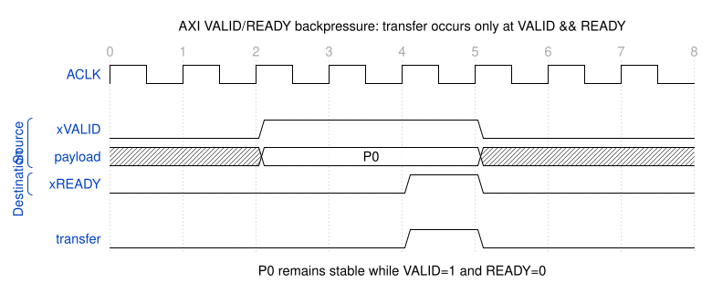
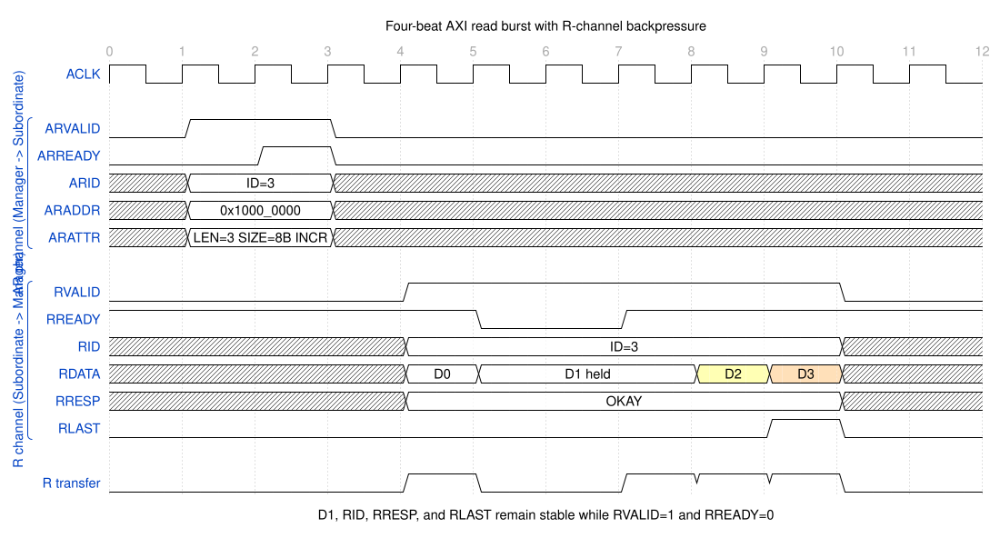
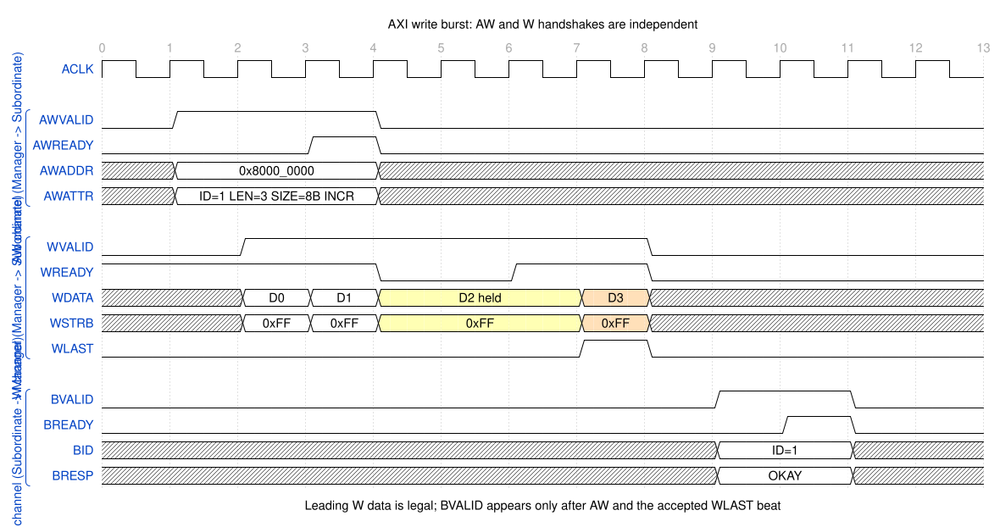
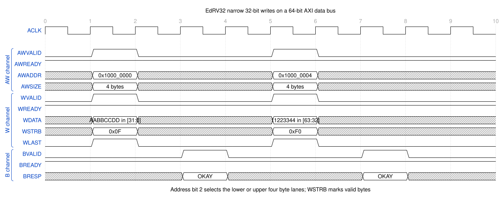
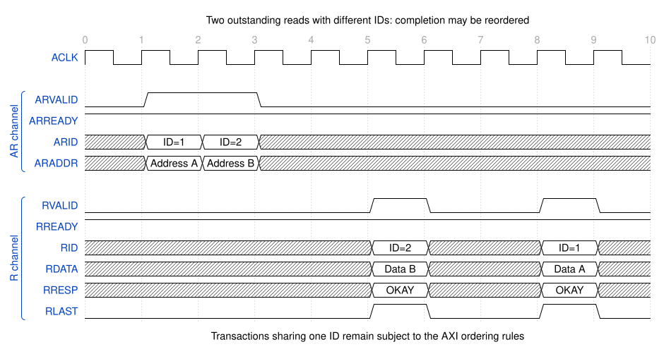
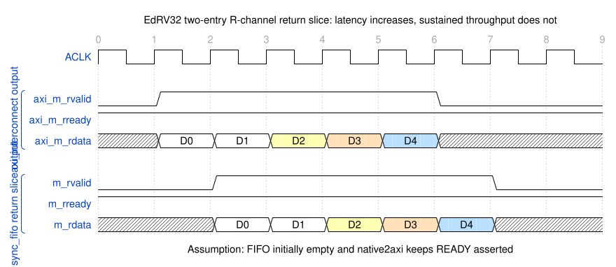

# AXI4 Full 完整教程与 EdRV32 当前子集

本文分为两个边界清晰的部分：

1. 标准 AXI4 Full：完整五通道信号、握手、burst、ID、排序、响应和低功耗接口。
2. EdRV32 当前实现：实际保留的信号、固定宽度、功能限制和 RTL 模块对应关系。

> 纠正：此前的简版教程只列出了 EdRV32 内部实际传递的核心信号，没有列出完整 AXI4 Full 的地址属性和 USER 边带信号。本教程不再把“工程子集”混写成“完整 AXI4”。

## 1. 资料范围和术语

主要协议依据：

- [Arm AMBA AXI and ACE Protocol Specification, IHI 0022H](https://developer.arm.com/-/media/Arm%20Developer%20Community/PDF/IHI0022H_amba_axi_protocol_spec.pdf)
- [Arm Introduction to AMBA AXI4](https://developer.arm.com/-/media/Arm%20Developer%20Community/PDF/Learn%20the%20Architecture/102202_0100_01_Introduction_to_AMBA_AXI.pdf)

Arm 新文档使用 Manager/Subordinate，很多 RTL 和旧资料仍使用 Master/Slave。本文采用 Manager/Subordinate，引用工程信号名时保留 `m_*`、`s_*`。

本文讨论 AXI4，不把以下协议的附加信号混进来：

- AXI3 的 `WID`：AXI4 已移除，AXI4 禁止不同写事务的数据交织。
- ACE 的 `AxSNOOP`、`AxDOMAIN`、`AxBAR`：属于一致性扩展。
- AXI5 的原子事务等新增信号：不属于基础 AXI4。

## 2. AXI4 的基本结构

AXI4 是点到点接口规范。互连可以把多个 Manager 和多个 Subordinate 连接起来，但每一侧接口仍按五个单向通道理解：

```text
写事务：

Manager                         Subordinate
   ├──── AW：写地址与属性 ──────────►
   ├──── W ：写数据与字节使能 ───────►
   ◄──── B ：写响应 ─────────────────┤

读事务：

Manager                         Subordinate
   ├──── AR：读地址与属性 ──────────►
   ◄──── R ：读数据与读响应 ─────────┤
```

五个通道分别握手。读写可以并行，AW 与 W 也没有固定的先后握手关系。

## 3. 全局信号

全局信号不属于五个事务通道，但完整接口必须先明确它们。

| 信号 | 方向 | 含义 |
|---|---|---|
| `ACLK` | 时钟源 → 双方 | 所有 AXI 通道的同步时钟，握手在上升沿判定 |
| `ARESETn` | 复位源 → 双方 | 低有效复位；复位期间必须撤销各通道输出 `VALID` |

通常允许异步拉低 `ARESETn`，但释放必须同步到 `ACLK`。工程内部可以改名为 `clk`、`rst_n`，只要语义一致。

## 4. 完整 AXI4 Full 五通道信号

### 4.1 写地址通道 AW

| 信号 | 宽度 | 方向 | 含义 |
|---|---:|---|---|
| `AWID` | 实现定义 | M → S | 写事务标识符，写响应通过 `BID` 返回 |
| `AWADDR` | 实现定义 | M → S | 首个传输地址 |
| `AWLEN` | 8 | M → S | burst 长度减一，0 表示 1 beat，255 表示 256 beats |
| `AWSIZE` | 3 | M → S | 每个 beat 最大传输字节数的 `log2` |
| `AWBURST` | 2 | M → S | `FIXED`、`INCR`、`WRAP` |
| `AWLOCK` | 1 | M → S | 普通访问或 exclusive 访问 |
| `AWCACHE` | 4 | M → S | bufferable、modifiable、read/write allocate 属性 |
| `AWPROT` | 3 | M → S | 特权级、安全属性、指令/数据属性 |
| `AWQOS` | 4 | M → S | 服务质量提示 |
| `AWREGION` | 4 | M → S | Subordinate 内部逻辑区域选择 |
| `AWUSER` | 实现定义 | M → S | 用户自定义边带信息，可选 |
| `AWVALID` | 1 | M → S | AW payload 有效 |
| `AWREADY` | 1 | S → M | Subordinate 可以接收 AW payload |

### 4.2 写数据通道 W

| 信号 | 宽度 | 方向 | 含义 |
|---|---:|---|---|
| `WDATA` | 实现定义 | M → S | 写数据 |
| `WSTRB` | `DATA_WIDTH/8` | M → S | 每个 byte lane 一个有效位 |
| `WLAST` | 1 | M → S | 当前 beat 是写 burst 最后一拍 |
| `WUSER` | 实现定义 | M → S | 写数据用户边带，可选 |
| `WVALID` | 1 | M → S | W payload 有效 |
| `WREADY` | 1 | S → M | Subordinate 可以接收 W payload |

AXI4 的 W 通道没有 `WID`。多个写地址被接受后，W burst 必须按照 AW 接受顺序发送，不能像 AXI3 那样交织不同事务的写数据。

### 4.3 写响应通道 B

| 信号 | 宽度 | 方向 | 含义 |
|---|---:|---|---|
| `BID` | 与 `AWID` 对应 | S → M | 被响应写事务的 ID |
| `BRESP` | 2 | S → M | `OKAY`、`EXOKAY`、`SLVERR`、`DECERR` |
| `BUSER` | 实现定义 | S → M | 写响应用户边带，可选 |
| `BVALID` | 1 | S → M | B payload 有效 |
| `BREADY` | 1 | M → S | Manager 可以接收写响应 |

一个写 burst 不论包含多少个 W beat，只产生一个 B 响应。AXI4 Subordinate 必须等 AW 已握手且最后一个 W beat 已握手后，才能宣告该事务的写响应有效。

### 4.4 读地址通道 AR

| 信号 | 宽度 | 方向 | 含义 |
|---|---:|---|---|
| `ARID` | 实现定义 | M → S | 读事务标识符，读数据通过 `RID` 返回 |
| `ARADDR` | 实现定义 | M → S | 首个传输地址 |
| `ARLEN` | 8 | M → S | burst 长度减一 |
| `ARSIZE` | 3 | M → S | 每个 beat 最大传输字节数的 `log2` |
| `ARBURST` | 2 | M → S | `FIXED`、`INCR`、`WRAP` |
| `ARLOCK` | 1 | M → S | 普通访问或 exclusive 访问 |
| `ARCACHE` | 4 | M → S | 存储类型和缓存分配提示 |
| `ARPROT` | 3 | M → S | 特权级、安全属性、指令/数据属性 |
| `ARQOS` | 4 | M → S | 服务质量提示 |
| `ARREGION` | 4 | M → S | Subordinate 内部逻辑区域选择 |
| `ARUSER` | 实现定义 | M → S | 用户自定义边带信息，可选 |
| `ARVALID` | 1 | M → S | AR payload 有效 |
| `ARREADY` | 1 | S → M | Subordinate 可以接收 AR payload |

### 4.5 读数据通道 R

| 信号 | 宽度 | 方向 | 含义 |
|---|---:|---|---|
| `RID` | 与 `ARID` 对应 | S → M | 当前读 beat 所属事务 ID |
| `RDATA` | 实现定义 | S → M | 读数据 |
| `RRESP` | 2 | S → M | 当前读 beat 的响应状态 |
| `RLAST` | 1 | S → M | 当前 beat 是读 burst 最后一拍 |
| `RUSER` | 实现定义 | S → M | 读数据用户边带，可选 |
| `RVALID` | 1 | S → M | R payload 有效 |
| `RREADY` | 1 | M → S | Manager 可以接收读数据 |

读响应不单独占一个通道，因为 `RRESP` 跟随每个 `RDATA` beat 返回。即使某一拍返回错误，也不存在提前终止 burst；约定的全部 beat 仍必须完成。

## 5. VALID/READY 握手

每个通道都遵守同一条传输条件：

```verilog
transfer = VALID && READY;
```

传输发生在 `ACLK` 上升沿，且该边沿采样到 `VALID=1`、`READY=1`。

必须遵守：

1. Source 不能等待 `READY` 后才拉高 `VALID`。
2. `VALID=1 && READY=0` 时，Source 必须保持 `VALID` 和全部 payload 稳定。
3. Destination 可以提前拉高 `READY`，也可以在看到 `VALID` 后拉高。
4. 一次握手只消耗当前通道的一份 payload，不代表其他通道同时完成。
5. AXI 接口输入与输出之间不能形成组合环；工程中常用 skid buffer 或 register slice 切断 READY 路径。



对应的可编辑源文件是 [01-valid-ready-backpressure.json5](01-valid-ready-backpressure.json5)。

## 6. 完整读事务

读事务从 AR 握手开始：

1. Manager 提供 `ARID/ARADDR/ARLEN/ARSIZE/ARBURST/...` 并拉高 `ARVALID`。
2. AR 握手后，该事务成为 outstanding read。
3. Subordinate 用相同语义的 `RID` 返回一个或多个 R beat。
4. 每一拍分别通过 `RVALID && RREADY` 传输。
5. 最后一拍必须同时给出 `RLAST=1`。

下面是一笔四拍读 burst。D1 遇到背压，因此 D1 以及 `RID/RRESP/RLAST` 在等待期间全部保持稳定。



参数为：

```text
ARADDR  = 0x1000_0000
ARLEN   = 3             -> 4 beats
ARSIZE  = 3             -> 8 bytes/beat
ARBURST = INCR
```

访问地址依次为：

```text
0x1000_0000
0x1000_0008
0x1000_0010
0x1000_0018
```

## 7. 完整写事务与 AW/W 解耦

写事务由 AW、W、B 三个独立通道组成。协议不要求 AW 和 W 同周期握手，也不要求 W 一定晚于 AW。

因此合法顺序包括：

```text
AW先于W
W先于AW
AW和W同周期
```

Subordinate 可以通过 `WREADY=0` 拒绝提前到来的 W，但不能假定 Manager 永远先给 AW。实现通常分别缓存 AW 和 W，再根据已接受的 AW 顺序把 W burst 路由到正确目标。



图中第一拍 W 数据早于 AW 握手，这是合法情况。D2 遇到 W 通道背压，`WDATA/WSTRB/WLAST` 必须保持。只有 AW 和带 `WLAST` 的最终 W beat 都完成后，Subordinate 才能返回 B 响应。

## 8. Burst 属性

### 8.1 AxLEN

```text
beats = AxLEN + 1
```

AXI4 的 `AxLEN[7:0]` 可以描述 1～256 beats。

### 8.2 AxSIZE

```text
bytes_per_beat = 2^AxSIZE
```

| AxSIZE | 每拍字节数 |
|---:|---:|
| 0 | 1 |
| 1 | 2 |
| 2 | 4 |
| 3 | 8 |
| 4 | 16 |
| 5 | 32 |
| 6 | 64 |
| 7 | 128 |

`AxSIZE` 不能超过物理数据总线每拍能承载的字节数。

### 8.3 AxBURST

| 编码 | 类型 | 地址行为 | 长度限制 |
|---|---|---|---|
| `2'b00` | FIXED | 每拍使用相同地址，适合 FIFO | 1～16 beats |
| `2'b01` | INCR | 每拍按 `2^AxSIZE` 增长 | AXI4 为 1～256 beats |
| `2'b10` | WRAP | 达到边界后回绕，适合 cache line | 2、4、8 或 16 beats |
| `2'b11` | Reserved | 禁止使用 | — |

所有 burst 都不能跨越 4 KiB 地址边界。一个实现即使只支持 INCR，也必须明确拒绝或在接口契约中排除其他类型，不能默默按 INCR 执行。

## 9. 窄传输、非对齐传输和 WSTRB

AXI4 允许物理总线宽于一次有效传输。例如在 64-bit 数据总线上执行 32-bit 访问：

```text
AxSIZE = 2    // 4 bytes
```

写通道通过地址低位和 `WSTRB` 指明有效 byte lane。64-bit `WDATA` 对应 8-bit `WSTRB`：

```text
WSTRB[0] -> WDATA[7:0]
...
WSTRB[7] -> WDATA[63:56]
```

EdRV32 的两个典型 32-bit 窄写如下：



```text
地址 0x...0000：addr[2]=0，使用 WDATA[31:0]，WSTRB=8'h0F
地址 0x...0004：addr[2]=1，使用 WDATA[63:32]，WSTRB=8'hF0
```

标准 AXI4 允许非对齐首地址，但 EdRV32 当前子集只产生对齐访问。读通道没有 `RSTRB`；Manager 根据地址和 `ARSIZE` 从 `RDATA` 中选取有效 lane。

## 10. 响应编码

| 编码 | 名称 | 含义 |
|---|---|---|
| `2'b00` | OKAY | 普通访问成功，或 exclusive 访问普通完成 |
| `2'b01` | EXOKAY | exclusive 访问成功 |
| `2'b10` | SLVERR | 地址命中 Subordinate，但访问无法正常完成 |
| `2'b11` | DECERR | 互连无法找到或不允许访问目标 |

典型划分：

```text
地址没有命中任何目标       -> DECERR
连接矩阵禁止该Manager访问  -> DECERR
写只读寄存器或尺寸不支持   -> SLVERR
访问成功                   -> OKAY
```

## 11. ID、outstanding 和排序

AR/AW 地址一旦握手，而最终 RLAST/B 尚未握手，该事务就是 outstanding transaction。ID 允许系统同时保留多笔事务，并在响应时指明归属。

不同 ID 的事务可以在实现允许时乱序完成：



需要牢牢记住：

- 同一个读 burst 内部的 R beat 必须按顺序返回。
- 同 ID 事务受 AXI 排序规则约束。
- 不同 ID 可以具有更自由的完成顺序。
- AXI4 没有 `WID`，W burst 必须跟随 AW 接受顺序，不能交织。
- `RID` 和 `BID` 必须与原始 `ARID`、`AWID` 对应。

ID 宽度大不等于实现真的支持很多 outstanding。队列深度、路由表和 Subordinate 接受能力才决定实际并发度。

## 12. 地址属性边带

### 12.1 AxPROT

`AxPROT[2:0]`：

| 位 | 0 | 1 |
|---|---|---|
| `[0]` | Unprivileged | Privileged |
| `[1]` | Secure | Non-secure |
| `[2]` | Data | Instruction |

### 12.2 AxCACHE

`AxCACHE[3:0]` 描述 memory type、bufferable/modifiable 属性以及 read/write allocate 提示。它影响互连、缓存和内存系统如何处理事务，不能简单理解为“是否经过CPU Cache”。不支持该功能的内部总线通常将其固定为系统约定值。

### 12.3 AxLOCK

AXI4 的 `AxLOCK` 是 1 bit，仅表示普通或 exclusive 访问。AXI3 的 locked transaction 已不属于 AXI4。

### 12.4 AxQOS、AxREGION 和 xUSER

- `AxQOS`：仲裁服务质量提示，不规定具体调度算法。
- `AxREGION`：让同一个物理接口暴露多个逻辑区域。
- `xUSER`：系统自定义边带；各通道可以定义不同宽度，也可以完全不实现。

## 13. 吞吐、延迟和气泡

当数据通道持续满足 `VALID=1 && READY=1` 时，AXI 可以每周期传输一个 beat。

```text
理论单向带宽 = DATA_WIDTH / 8 × 频率
```

64-bit、100 MHz 时：

```text
8 Byte × 100 MHz = 800 MB/s
```

寄存切片会增加首拍 latency，但只要流水线填满后仍能每周期握手，就不降低持续 throughput。



真正的气泡是：上下游本来都有数据和空间，却因为控制逻辑无必要地撤销 `VALID` 或 `READY`。

常见吞吐损失来源：

- 每个 burst 结束后强制空闲一拍。
- FIFO 满且同周期 pop 时仍不能 push。
- 地址通道必须等待数据通道完成才重新接收地址。
- 只允许一笔 outstanding，无法隐藏长延迟。
- 仲裁每拍重新切换所有者，导致 burst 中断。
- READY 组合链过长，为满足时序被迫加入过多级但没有足够缓冲容量。

## 14. 可选低功耗接口

AXI 规范还定义了与事务五通道分离的可选低功耗握手：

| 信号 | 典型方向 | 作用 |
|---|---|---|
| `CSYSREQ` | Clock controller → Peripheral | 请求进入或退出低功耗状态 |
| `CSYSACK` | Peripheral → Clock controller | 确认请求 |
| `CACTIVE` | Peripheral → Clock controller | 表示组件仍有活动事务 |

它们不是 AW/W/B/AR/R 通道的一部分，很多小型 SoC 不实现。EdRV32 当前没有实现。

---

# 第二部分：EdRV32 当前 AXI 子集

## 15. EdRV32 保留了哪些信号

公共定义见 [`rtl/include/edrv32_axi4.vh`](../../rtl/include/edrv32_axi4.vh)。

### 15.1 当前保留的接口

| 通道 | EdRV32 信号 |
|---|---|
| AW | `AWID AWADDR AWLEN AWSIZE AWBURST AWVALID AWREADY` |
| W | `WDATA WSTRB WLAST WVALID WREADY` |
| B | `BID BRESP BVALID BREADY` |
| AR | `ARID ARADDR ARLEN ARSIZE ARBURST ARVALID ARREADY` |
| R | `RID RDATA RRESP RLAST RVALID RREADY` |
| 全局 | 各模块使用 `clk`/`clk_i` 和 `rst_n`/`rst_n_i` |

### 15.2 当前省略的标准信号

```text
AWLOCK  AWCACHE  AWPROT  AWQOS  AWREGION  AWUSER
WUSER
BUSER
ARLOCK  ARCACHE  ARPROT  ARQOS  ARREGION  ARUSER
RUSER
```

因此它是“遵循 AXI4 核心事务语义的内部受限子集”，不是可以不加适配直接连接任意第三方 AXI4 Full IP 的完整物理接口。连接标准 IP 时，应使用 wrapper 补齐这些信号并为省略属性设置明确常量。

## 16. 固定宽度和功能限制

| 项目 | 当前值 |
|---|---|
| 地址宽度 | 32 bit |
| 数据宽度 | 64 bit |
| WSTRB | 8 bit |
| Manager 本地 ID | 4 bit |
| Slave 侧全局 ID | 5 bit，即 `{master_index, local_id}` |
| LEN | 8 bit |
| SIZE | 3 bit |
| burst | 只产生对齐 INCR |
| exclusive/locked | 不支持 |
| FIXED/WRAP | 宏中保留编码，当前系统不使用 |
| 非对齐首地址 | 当前不产生 |
| read interleaving | 不使用 |
| QoS/REGION/USER | 不实现 |
| 原子事务 | 不实现 |
| 当前 Manager outstanding | 每个方向最多 1 笔 |
| 当前每个 Slave 写队列深度 | 1 |

注意：`axi_interconnect` 模块参数可以配置更大队列，但当前 [`edrv32_soc_top.v`](../../rtl/soc/top/edrv32_soc_top.v) 明确设置：

```verilog
localparam AXI_M_MAX_OUTSTANDING = 1;
localparam AXI_S_MAX_WR          = 1;
```

所以不能因为 ID 有 4 bit，就认为当前 SoC 可以同时挂起 16 笔事务。

## 17. 当前拓扑

### 17.1 两个 Manager

| 编号 | 来源 | 能力 |
|---|---|---|
| M0 | I-Cache AXI master | 只读，只访问 Boot ROM 和 SRAM |
| M1 | D-Cache AXI master | 读写，可访问当前全部五个 Slave |

### 17.2 五个 Slave

```text
S0 Boot ROM
S1 SRAM
S2 CLINT（经 axi2native）
S3 PLIC（经 axi2native）
S4 APB bridge（经 axi2apb）
```

读写互连分别位于：

- [`axi_rd_fabric.v`](../../rtl/soc/fabric/axi_rd_fabric.v)
- [`axi_wr_fabric.v`](../../rtl/soc/fabric/axi_wr_fabric.v)
- 外层封装 [`axi_interconnect.v`](../../rtl/soc/fabric/axi_interconnect.v)

读写独立仲裁；未映射、连接矩阵禁止或地址窗口冲突的请求由互连内联响应器返回 `DECERR`。

## 18. Cache 直接生成 AXI 事务

CPU 流水线内部仍是 32-bit lookup/commit 接口，但 I-Cache 和 D-Cache 的总线侧已经直接使用 64-bit AXI，不再经过 `native2axi`。

### 18.1 单个 32-bit 访问

```text
AxLEN  = 0
AxSIZE = 2         // 4 bytes
AxBURST = INCR
```

`addr[2]` 选择 64-bit 总线的低 32-bit 或高 32-bit lane，写操作相应产生 `WSTRB=0x0F` 或 `0xF0`。

### 18.2 Cache line 访问

当前 I-Cache 和 D-Cache line 都是 16 Byte。Cache 控制器直接发出两个 64-bit AXI beat：

```text
AxLEN  = 1         // 2 beats
AxSIZE = 3         // 8 bytes/beat
AxBURST = INCR
```

I$/D$ refill 直接把两个 R beat 装入 128-bit line；D$ 脏行回写直接从 128-bit victim line 连续送出两个 W beat，因此 line 传输中间不需要 32-bit 请求重组状态。

### 18.3 ID与并发

当前两个 Cache master 都是 single-outstanding，并把本地 AXI ID 固定为 0。互连仍保留 ID 前缀和通用路由结构，但在当前 SoC 配置下不会出现图 4 那种由 CPU 发出的不同 ID 乱序返回。

## 19. 三个返回 FIFO

SoC 顶层在互连返回方向放置三个深度为 2 的 `sync_fifo`：

| 实例 | 通道 |
|---|---|
| `u_m0_r_slice` | M0 读响应 R |
| `u_m1_r_slice` | M1 读响应 R |
| `u_m1_b_slice` | M1 写响应 B |

它们将互连的组合选择逻辑与 Cache 状态机隔开。正常连续传输时增加一拍首包延迟，但可以维持每周期一拍。M0 是只读通道，因此没有 M0 B FIFO。

## 20. 标准 AXI4 与 EdRV32 子集对照

| 能力 | 标准 AXI4 Full | EdRV32 当前实现 |
|---|---|---|
| 五个事务通道 | 支持 | 支持 |
| VALID/READY 背压 | 支持 | 支持 |
| 多拍 burst | 支持 | 支持 INCR |
| FIXED/WRAP | 支持 | 不使用 |
| 非对齐首地址 | 支持 | 不产生 |
| 窄传输 | 支持 | 使用 32-on-64 |
| 多 outstanding | 支持 | 当前限制为 1 |
| 不同 ID 乱序完成 | 支持 | 当前 Manager 固定 ID 0，不使用 |
| Exclusive | 支持 | 不支持 |
| CACHE/PROT/LOCK | 标准地址属性 | 省略 |
| QoS/REGION/USER | 标准/可选边带 | 省略 |
| 低功耗接口 | 可选 | 未实现 |
| 直接连接通用第三方 AXI4 IP | 完整接口可以 | 需要 wrapper 补齐边带 |

## 21. 后续模块测试应重点观察什么

### 通用通道断言

```text
VALID && !READY 期间，payload必须稳定
VALID不能因为READY为0而撤销
每次计数只发生在VALID && READY
复位期间输出VALID必须为0
```

### 读事务

```text
R beat数量必须等于ARLEN+1
最后一拍必须RLAST=1
RID必须对应ARID
背压期间RDATA/RRESP/RID/RLAST稳定
错误响应不能提前结束burst
```

### 写事务

```text
AW与W分别握手、分别保存
W beat数量必须等于AWLEN+1
最后一拍必须WLAST=1
WSTRB只能覆盖合法byte lane
BVALID只能在AW和最终W beat完成后产生
BID必须对应AWID
```

### 性能

```text
READY持续为1时，数据通道能否每周期一个beat
连续burst之间是否存在无必要空拍
FIFO满后恢复时是否产生额外气泡
读写是否真正独立
地址仲裁是否只在事务边界切换所有权
```

## 22. 时序图文件

每张图都提供四种文件：

- `.json5`：可编辑 WaveJSON 源文件。
- `.svg`：Markdown 使用的矢量图。
- `.png`：便于普通图片查看器打开。
- `.html`：自包含离线 WaveDrom 编辑和查看页面。

| 图 | 内容 |
|---|---|
| 01 | VALID/READY 与背压 |
| 02 | 四拍读 burst 与 RREADY 背压 |
| 03 | AW/W 独立握手、写 burst 和 B 响应 |
| 04 | 不同 ID 的 outstanding 读事务乱序完成 |
| 05 | EdRV32 的 64-bit 总线 32-bit 窄写 |
| 06 | EdRV32 返回 FIFO 的延迟与持续吞吐 |

所有图都以 `ACLK` 上升沿为有效采样边沿。除第 06 图明确写出的 FIFO 初始状态假设外，其余图用于表达协议允许的概念时序，不代表某个具体 Subordinate 的固定响应延迟。
