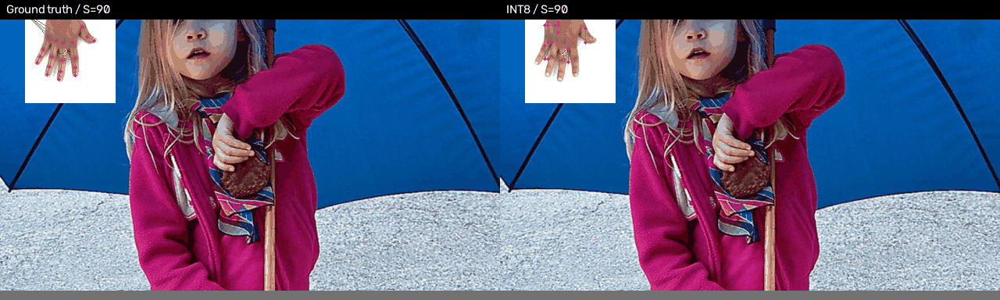

# 手部 21 点 INT8 离线评估

- 日期：2026-11-15 UTC；代码 commit：`d720885534228efcf4e17143a0292c3ee856ce53`；评估启动基线 `52857620` 加同一 hand 实现，权重为该基线卡 80 的 `best.pt`；已 rebase 到最新 `zc100116/b3`。
- 环境：本机 Linux x86_64 / AMD EPYC 7742，Python 3.12.3、torch 2.14.1+cpu、numpy 2.5.2、OpenCV 5.0.0、Ultralytics 8.4.160；torch/BLAS 1 线程。
- 数据：[Ultralytics hand-keypoints](https://github.com/ultralytics/assets/releases/download/v0.0.0/hand-keypoints.zip)，训练排序前 96 张标定，验证排序前 300 张、损坏跳过 0，均单手、21 点可见；COCO 本地 val2017 共 300 张作背景；数据在 `~/.local/share/edrv32/npu/`。
- 标定：种子 0，B 法循环 S=45/60/90/180，percentile 95、margin 1.05；未训练、未换模型、未调阈值。A 原图 letterbox；B 等比背景填满 1280×720、随机贴手、仅裁框外原图，半缩后上下各补 12 行 114；标定/评估分别固定 default_rng(0)。
- 命令：`export PYTHONPATH="$PWD/third_party/ultralytics" OPENBLAS_NUM_THREADS=1`；下列 `python` 指 `~/.local/opt/edrv32-py/bin/python`，下载与完整编译命令见 [README](../../tools/npu/README.md#手部-21-点-int8-离线评估t-hand-eval)。
- `python tools/npu/compile_yolo.py --task hand --image ~/.local/share/edrv32/npu/hand-keypoints/images/val/IMG_00000002.jpg --out build/npu/hand_eval/compiled`。
- `python tools/npu/hand_eval.py --out build/npu/hand_eval > build/npu/hand_eval/eval.log 2>&1`；完整评估仅一次，1299.76 s；首次启动的变量名冲突在首图 INT8 前报错，修复后重启，见 `eval-startup-error.log`。
- 三路径 confidence>0.25、NMS IoU>0.45、最多 100 手；INT8 执行描述符、硬件整数后处理参考、规格 2.6 排序/NMS、anchor 解码。FP384/INT384=640×384，FP640=640×640 参照；所有误差映射到 640×384 输入坐标。
- 框 IoU≥0.5 记检出，多余框单列（背景中的其他手不属于合成真值）；A 的 OKS/AP 使用 Ultralytics 匹配与 AP 积分、21 个 sigma=1/21、真值框面积×0.53；所有指标均对真值；FP640 为 17.39/45.11%，与卡 80 全量 7847 张、conf=0.001 的 73.50/88.01% 差异大，子集和阈值均不同，本次未定位差异归因。
- 捏合 d=|4−8|/|0−9|，真值 d<0.25 捏住、d>0.6 张开，35 张中间状态排除；预测 d<0.4 捏住。每组真值捏住/张开=26/239；判对率分母含漏检（漏检计错），括号为已检出样本数；|Δd|仅统计已检出的两类样本。

| 集合 | 路径 | 检出数/300（%） | 多余框 | OKS mAP50-95/50 % | 捏住判对 %（检出/26） | 张开判对 %（检出/239） | Δd 绝对误差均值/P95 |
|---|---|---:|---:|---:|---:|---:|---:|
| A | FP384 | 298（99.33） | 2 | 19.37/48.13 | 42.31（26） | 85.77（237） | 0.38/0.96 |
| A | INT384 | 299（99.67） | 1 | 17.44/42.71 | 38.46（26） | 85.36（238） | 0.39/0.98 |
| A | FP640 | 298（99.33） | 4 | 17.39/45.11 | 38.46（26） | 85.36（237） | 0.38/0.98 |
| B45 | FP384 | 3（1.00） | 38 | — | 0.00（0） | 0.00（0） | —/— |
| B45 | INT384 | 0（0.00） | 20 | — | 0.00（0） | 0.00（0） | —/— |
| B60 | FP384 | 47（15.67） | 61 | — | 23.08（10） | 2.51（19） | 0.57/1.25 |
| B60 | INT384 | 24（8.00） | 29 | — | 7.69（4） | 0.84（8） | 0.48/0.89 |
| B90 | FP384 | 250（83.33） | 35 | — | 46.15（25） | 60.67（190） | 0.46/1.08 |
| B90 | INT384 | 203（67.67） | 16 | — | 53.85（23） | 46.86（147） | 0.44/1.09 |
| B180 | FP384 | 299（99.67） | 14 | — | 34.62（26） | 86.19（238） | 0.39/1.02 |
| B180 | INT384 | 299（99.67） | 7 | — | 34.62（26） | 81.59（238） | 0.41/1.05 |

点误差仅统计检出手的真值可见点，不按预测可见性过滤；每格为 **均值/P95 px（均值/P95 %框长边）**；— 表示无检出可统计或不评估。

| 集合 | 路径 | 手腕 0 | 拇指尖 4 | 食指尖 8 | 其余指尖 12/16/20 | 指根 5/9/13/17 | 其余关节 |
|---|---|---:|---:|---:|---:|---:|---:|
| A | FP384 | 9.73/23.07（4.63/11.88） | 18.75/60.34（8.68/25.73） | 51.78/139.30（22.81/55.29） | 25.16/84.77（11.18/36.64） | 17.06/54.87（7.98/27.34） | 16.64/53.39（7.65/23.68） |
| A | INT384 | 10.83/25.03（5.21/12.75） | 19.15/54.34（8.93/26.45） | 53.82/141.20（23.79/55.71） | 25.76/87.07（11.45/36.96） | 18.80/58.51（8.81/29.02） | 17.58/55.56（8.12/24.98） |
| A | FP640 | 10.76/26.19（5.04/11.83） | 19.34/55.50（9.05/23.88） | 54.00/142.96（23.82/55.61） | 26.18/87.73（11.57/37.24） | 18.48/57.23（8.62/28.45） | 17.50/56.23（8.02/25.39） |
| B45 | FP384 | 6.74/10.32（14.99/22.94） | 16.50/20.93（36.66/46.51） | 9.14/13.88（20.31/30.83） | 3.34/8.14（7.42/18.09） | 13.30/18.56（29.56/41.24） | 10.99/19.74（24.42/43.86） |
| B45 | INT384 | —/—（—/—） | —/—（—/—） | —/—（—/—） | —/—（—/—） | —/—（—/—） | —/—（—/—） |
| B60 | FP384 | 10.69/28.11（17.82/46.86） | 17.47/33.83（29.11/56.38） | 15.31/38.47（25.51/64.12） | 12.03/27.84（20.05/46.40） | 14.06/27.26（23.43/45.44） | 13.74/28.78（22.89/47.97） |
| B60 | INT384 | 9.58/17.74（15.96/29.57） | 16.36/30.43（27.26/50.71） | 14.53/31.21（24.21/52.01） | 10.21/20.69（17.02/34.48） | 13.69/22.87（22.82/38.11） | 13.15/25.77（21.92/42.95） |
| B90 | FP384 | 8.59/27.96（9.54/31.07） | 14.63/39.57（16.25/43.97） | 23.34/52.87（25.93/58.74） | 17.22/46.10（19.14/51.22） | 13.40/34.06（14.89/37.84） | 13.41/33.61（14.90/37.34） |
| B90 | INT384 | 7.84/22.15（8.71/24.61） | 14.86/38.18（16.51/42.42） | 21.68/51.27（24.09/56.96） | 16.93/44.81（18.82/49.79） | 13.31/33.37（14.79/37.07） | 13.08/33.10（14.53/36.78） |
| B180 | FP384 | 8.87/18.30（4.93/10.17） | 16.11/50.12（8.95/27.84） | 41.26/100.55（22.92/55.86） | 20.94/65.47（11.63/36.37） | 15.25/48.48（8.47/26.93） | 14.24/43.07（7.91/23.93） |
| B180 | INT384 | 9.49/22.16（5.27/12.31） | 16.54/47.20（9.19/26.22） | 43.08/98.80（23.93/54.89） | 21.41/65.95（11.89/36.64） | 16.83/54.92（9.35/30.51） | 15.16/43.73（8.42/24.30） |

| 资源 | detect | pose | hand |
|---|---:|---:|---:|
| 模型镜像 / B | 3,248,896 | 3,505,408 | 3,505,408 |
| WORK / B | 5,867,520 | 5,867,520 | 5,867,520 |
| OUTPUT / B | 725,760 | 1,048,320 | 1,048,320 |
| 描述符条数 | 68 | 77 | 77 |
| MAC 日历周期 | 5,732,640 | 6,045,120 | 6,045,120 |

- hand/pose 的 OUTPUT 均为 1,048,320 B < 1 MiB（余 256 B）；关键点 C63→C64，类别 1→80（1–79 恒 −128），中间宽度 63→64；硬件后处理未改。
- 每帧 NPU 时间**估算**（所有集合相同）：Σ(C32输出块×输出高×输出像素对×K_COUNT)，含补齐、不含 DMA/控制/后处理；hand/detect 周期比 1.054509，乘 detect 实测 35.0 ms@180 MHz、41.2 ms@150 MHz，得 **36.91/43.45 ms**；与 pose 相同，非 hand 上板实测。
- 原始结果：`build/npu/hand_eval/{summary,measurements,predictions,oks}.json`、`eval.log`、`compile.log`；编译文件 `build/npu/hand_eval/compiled/`，量化缓存 `build/npu/quantized_hand/`。
- 验证：`python -m unittest discover -s tools/npu -p test_compile.py` 14/14 通过（`build/npu/hand_eval/unittest.log`），新增实标定 detect/pose 的 model.bin、quantization.json 和全部导出文件与 `52857620` 逐字节相同，hand 编译/OUTPUT 通过；py_compile、git diff --check、Verilog 风格 0 文件/0 告警；未改 RTL，lint 不适用；首图 FP640 与 Ultralytics predict 坐标最大差 0.000035 px，日志 `build/npu/hand_eval/fp32-api-check.log`。

结论：INT8 在受测四档中，**180 px 才支持稳定检出**（299/300=99.67%；90 px 仅 67.67%，60/45 px 为 8.00%/0）；90–180 px 之间未测，不能给出更细阈值。**至 180 px 仍不能稳定判别捏合**：捏住仅 9/26=34.62%、张开 195/239=81.59%，不存在已验证可用的最小尺寸；FP32 同样较差，不能把问题全部归于量化。A 的 INT8 比同尺寸 FP32 mAP50-95 低 1.93 个百分点；这批数据不支持当前模型和固定阈值直接用于可靠的捏合抓放演示。

 
 
