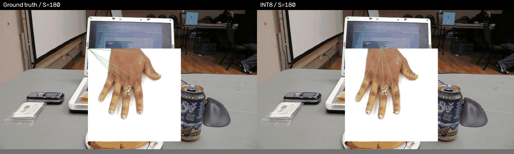
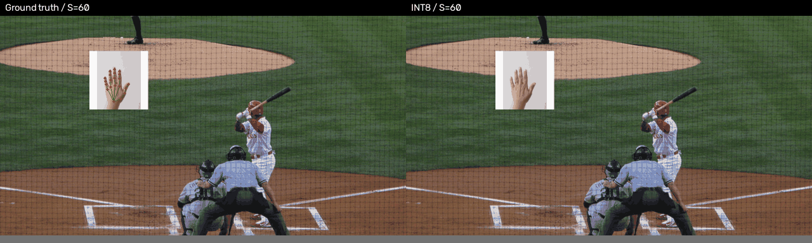

# 手部 21 点 INT8 随机样本离线评估

- 日期：2026-11-15 UTC；代码 commit：`b373811bee4c83dd6bb26e8ee61b99e1a4fcb0e8`；权重为 `52857620` 卡 80 的 `best.pt`；已 rebase 到最新 `zc100116/b3`。
- 环境：本机 Linux x86_64 / AMD EPYC 7742，Python 3.12.3、torch 2.14.1+cpu、numpy 2.5.2、OpenCV 5.0.0、Ultralytics 8.4.160；torch/BLAS 1 线程。
- 数据：[Ultralytics hand-keypoints](https://github.com/ultralytics/assets/releases/download/v0.0.0/hand-keypoints.zip)，Ultralytics 检查整池、跳过损坏图后，按文件名排序，训练/验证分别用独立 default_rng(0).choice(replace=False) 抽取 96/300 张；验证池跳过 145 张；COCO 本地 val2017 共 300 张作背景；数据在 `~/.local/share/edrv32/npu/`。
- 标定：删除旧 hand 缓存后重建，B 法循环 S=45/60/90/180，percentile 95、margin 1.05；评估 B45/60/90/120/180；抽样/标定合成/评估合成分别独立种子 0。A 原图 letterbox；B 背景等比填满 1280×720、随机贴手、仅裁框外原图，半缩后上下补 12 行 114；未训练、未调参。
- 上轮排序前 300 张导致样本偏差：A 的 FP640 为 17.39%/45.11%，官方 val 同批为 16.5%/42.1%；本次随机抽样 FP640 为 77.83%/89.38%，与卡 80 全集 73.50%/88.01% 的显著差异消除（评估阈值、子集不同）。
- 命令：`export PYTHONPATH="$PWD/third_party/ultralytics" OPENBLAS_NUM_THREADS=1`；下列 `python` 为 `~/.local/opt/edrv32-py/bin/python`；下载见 [README](../../tools/npu/README.md#手部-21-点-int8-离线评估t-hand-eval)。
- `rm -r build/npu/quantized_hand`；`python tools/npu/compile_yolo.py --task hand --image ~/.local/share/edrv32/npu/hand-keypoints/images/val/IMG_00000002.jpg --out build/npu/hand_eval_r2/compiled`。
- `python tools/npu/hand_eval.py --out build/npu/hand_eval_r2 > build/npu/hand_eval_r2/eval.log 2>&1`；完整模型评估仅一次，1498.85 s，无中断；发现真值缺点后按协调者口径从保存的 predictions.json 重算统计：`PYTHONPATH=tools/npu:third_party/ultralytics python build/npu/hand_eval_r2/recompute.py`，未重跑模型，`recompute.log` 确认框/点测量变化为 0；原除零警告来自真值缺点，最终预测塌缩均为 0。
- 三路径 confidence>0.25、NMS IoU>0.45、最多 100 手；FP384/INT384=640×384，FP640=640×640 参照；INT8 执行描述符、硬件整数后处理参考、规格 2.6 排序/NMS、anchor 解码。框 IoU≥0.5 一对一匹配，多余框单列（背景其他手不属合成真值）；A 的 Ultralytics OKS/AP：21 个 sigma=1/21、真值框面积×0.53，所有指标对真值。
- 捏合 d=|4−8|/|0−9|，真值 d<0.25 捏住、d>0.6 张开，中间 15 张排除；真值 0/4/8/9 中任一点无可见标注的 45 张只从捏合统计排除，预测 d<0.4 捏住；各组真值捏住/张开=3/237。判对率分母含漏检（漏检计错），括号为已检出数；预测腕/中指根重合的塌缩样本两类均判错且不计 Δd 误差，塌缩列计全部已匹配手；均值/P95 仅计其余已检出的两类样本（两项口径经协调者确认）。

| 集合 | 路径 | 检出数/300（%） | 多余框 | 预测塌缩 | OKS mAP50-95/50 % | 捏住判对 %（检出/3） | 张开判对 %（检出/237） | Δd 绝对误差均值/P95 |
|---|---|---:|---:|---:|---:|---:|---:|---:|
| A | FP384 | 297（99.00） | 8 | 0 | 76.68/90.21 | 66.67（3） | 98.31（236） | 0.21/0.77 |
| A | INT384 | 295（98.33） | 6 | 0 | 73.09/89.04 | 66.67（3） | 98.31（235） | 0.21/0.75 |
| A | FP640 | 296（98.67） | 12 | 0 | 77.83/89.38 | 0.00（3） | 98.31（236） | 0.19/0.70 |
| B45 | FP384 | 1（0.33） | 38 | 0 | — | 0.00（0） | 0.00（0） | —/— |
| B45 | INT384 | 0（0.00） | 11 | 0 | — | 0.00（0） | 0.00（0） | —/— |
| B60 | FP384 | 22（7.33） | 54 | 0 | — | 0.00（2） | 2.53（11） | 0.51/1.14 |
| B60 | INT384 | 13（4.33） | 19 | 0 | — | 0.00（1） | 1.27（4） | 0.43/0.86 |
| B90 | FP384 | 180（60.00） | 37 | 0 | — | 66.67（3） | 56.54（142） | 0.60/2.32 |
| B90 | INT384 | 125（41.67） | 24 | 0 | — | 66.67（3） | 43.04（105） | 0.69/1.89 |
| B120 | FP384 | 283（94.33） | 24 | 0 | — | 66.67（3） | 89.45（222） | 0.36/1.27 |
| B120 | INT384 | 229（76.33） | 14 | 0 | — | 66.67（3） | 74.68（184） | 0.45/1.47 |
| B180 | FP384 | 299（99.67） | 23 | 0 | — | 0.00（3） | 98.31（237） | 0.20/0.67 |
| B180 | INT384 | 296（98.67） | 10 | 0 | — | 33.33（3） | 97.89（235） | 0.23/0.84 |

点误差仅计检出手的真值可见点，不按预测可见性过滤；每格为 **均值/P95 px（均值/P95 %框长边）**；所有路径的误差均映射到 640×384 输入坐标；— 表示无检出可统计或不评估。

| 集合 | 路径 | 手腕 0 | 拇指尖 4 | 食指尖 8 | 其余指尖 12/16/20 | 指根 5/9/13/17 | 其余关节 |
|---|---|---:|---:|---:|---:|---:|---:|
| A | FP384 | 8.24/21.17（3.97/12.31） | 7.38/24.30（3.85/11.98） | 8.30/33.48（3.95/18.66） | 6.14/17.78（2.91/9.91） | 5.44/14.36（2.67/9.12） | 5.38/16.51（2.64/9.65） |
| A | INT384 | 8.62/22.25（4.16/12.36） | 7.92/23.69（4.04/12.96） | 8.85/31.88（4.13/19.56） | 6.76/17.76（3.13/10.28） | 6.29/14.77（2.98/9.21） | 6.14/16.67（2.94/9.62） |
| A | FP640 | 8.11/21.82（3.88/12.07） | 7.40/24.88（3.86/13.90） | 8.45/32.11（4.00/19.75） | 6.23/16.63（2.91/9.33） | 5.15/14.98（2.48/8.72） | 5.37/16.55（2.62/9.49） |
| B45 | FP384 | 8.34/8.34（18.54/18.54） | 14.64/14.64（32.54/32.54） | 10.16/10.16（22.57/22.57） | 11.10/11.32（24.68/25.15） | 7.07/8.31（15.70/18.47） | 7.13/11.22（15.84/24.94） |
| B45 | INT384 | —/—（—/—） | —/—（—/—） | —/—（—/—） | —/—（—/—） | —/—（—/—） | —/—（—/—） |
| B60 | FP384 | 10.59/29.77（17.65/49.61） | 13.59/30.66（22.65/51.11） | 10.28/27.15（17.14/45.26） | 9.41/27.98（15.68/46.63） | 8.09/21.69（13.49/36.16） | 9.26/27.31（15.44/45.52） |
| B60 | INT384 | 6.91/12.95（11.52/21.58） | 10.34/30.98（17.23/51.63） | 6.44/15.52（10.73/25.86） | 5.88/11.03（9.80/18.38） | 6.51/23.73（10.86/39.55） | 6.85/18.41（11.41/30.68） |
| B90 | FP384 | 9.87/38.05（10.97/42.28） | 18.23/65.37（20.26/72.63） | 14.34/44.38（15.93/49.31） | 11.55/47.96（12.83/53.29） | 12.65/53.22（14.06/59.13） | 13.04/53.52（14.49/59.46） |
| B90 | INT384 | 8.79/27.93（9.76/31.03） | 12.21/45.03（13.56/50.03） | 11.26/41.91（12.51/46.57） | 8.54/30.67（9.49/34.08） | 7.98/24.82（8.87/27.58） | 8.60/28.49（9.56/31.66） |
| B120 | FP384 | 11.44/36.33（9.53/30.28） | 16.60/65.02（13.83/54.18） | 15.31/53.53（12.76/44.60） | 12.91/51.90（10.76/43.25） | 13.11/43.70（10.92/36.41） | 13.25/48.77（11.04/40.64） |
| B120 | INT384 | 13.30/55.40（11.09/46.16） | 15.33/54.21（12.78/45.18） | 15.47/59.07（12.89/49.22） | 12.61/50.83（10.51/42.36） | 11.69/37.80（9.74/31.50） | 12.41/45.43（10.34/37.86） |
| B180 | FP384 | 8.78/19.72（4.88/10.95） | 7.52/25.06（4.18/13.92） | 8.64/40.74（4.80/22.64） | 6.32/20.41（3.51/11.34） | 5.73/16.34（3.18/9.08） | 5.86/17.45（3.26/9.70） |
| B180 | INT384 | 8.44/21.47（4.69/11.93） | 8.08/22.26（4.49/12.37） | 9.51/35.31（5.28/19.62） | 7.04/19.90（3.91/11.06） | 6.34/16.47（3.52/9.15） | 6.43/17.35（3.57/9.64） |

| 资源 | detect | pose | hand |
|---|---:|---:|---:|
| 模型镜像 / WORK / OUTPUT，B | 3,248,896/5,867,520/725,760 | 3,505,408/5,867,520/1,048,320 | 3,505,408/5,867,520/1,048,320 |
| 描述符条数 | 68 | 77 | 77 |
| MAC 日历周期 | 5,732,640 | 6,045,120 | 6,045,120 |

- hand/pose OUTPUT 均为 1,048,320 B < 1 MiB（余 256 B）；关键点及中间 C63→C64，类别 1→80（1–79 恒 −128），硬件后处理未改。每帧 NPU **估算**：Σ(C32输出块×输出高×输出像素对×K_COUNT)，含补齐、不含 DMA/控制/后处理；hand/detect 周期比 1.054509，乘 detect 实测 35.0 ms@180 MHz、41.2 ms@150 MHz，得 **36.91/43.45 ms**（各集合相同），非 hand 上板实测。
- 原始结果：`build/npu/hand_eval_r2/{summary,measurements,predictions,oks}.json`、`eval.log`、`compile.log`；编译文件 `build/npu/hand_eval_r2/compiled/`，重新标定缓存 `build/npu/quantized_hand/`。
- 验证：`python -m unittest discover -s tools/npu -p test_compile.py` 本轮运行一次、14/14 通过（`build/npu/hand_eval_r2/unittest.log`），detect/pose 的 model.bin、quantization.json 和全部导出文件与 `52857620` 逐字节相同，hand 编译/OUTPUT 通过；py_compile、git diff --check、Verilog 风格 0 文件/0 告警；未改 RTL，lint 不适用；缺真值点/预测塌缩的定向统计检查通过，见 `build/npu/hand_eval_r2/collapse-check.log`。

结论：INT8 在受测五档中，**180 px 才达到接近全检出**（296/300=98.67%；120 px 仅 76.33%，90/60/45 px 为 41.67%/4.33%/0）；120–180 px 之间未测，不能给出更细阈值。**未证实任何档位能稳定判别捏合**：180 px 张开判对 232/237=97.89%，捏住仅 1/3=33.33%；有效捏住真值仅 3 张，数量不足以支持稳定性结论。A 的 INT8 mAP50-95 较同尺寸 FP32 低 3.59 个百分点；随机样本改善了大手关键点表现，但当前结果仍不能证明可靠的捏合抓放能力。

   
