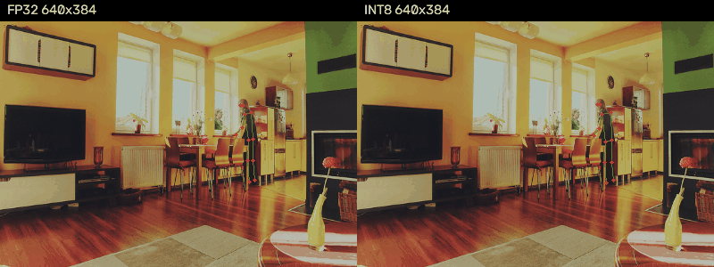
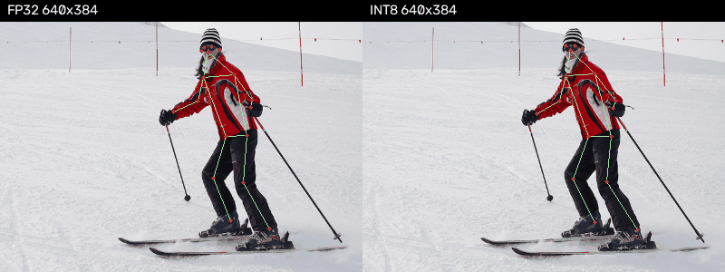
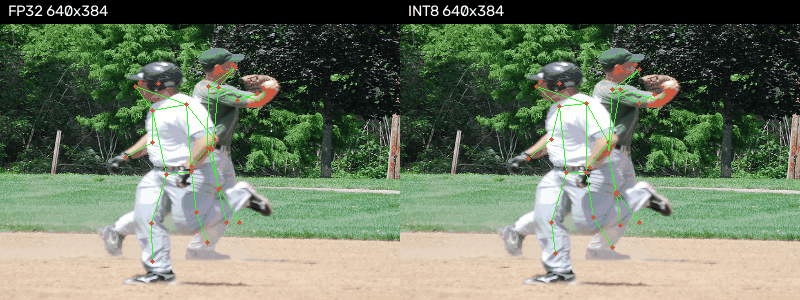
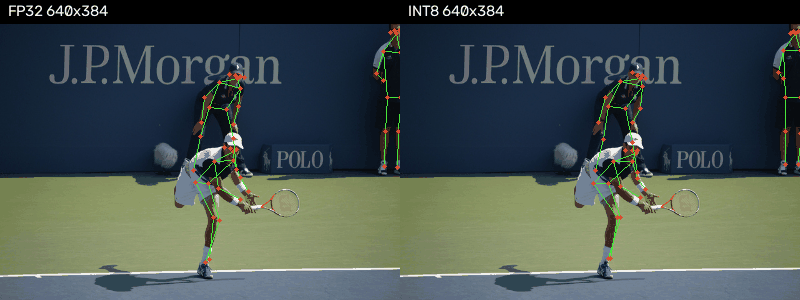

# YOLOv8n-pose INT8 离线评估

- 测量日期：2026-11-14 UTC；代码 commit：`8cbabba6d10cdad45d79ff39a48872e816705575`；detect 字节基线：`69e96488`。
- 环境：Linux x86_64 / AMD EPYC 7742，Python 3.12.3，torch 2.14.1+cpu，numpy 2.5.2，OpenCV 5.0.0.93，Ultralytics 8.4.160，pycocotools 2.0.11。
- 固定配置：COCO128 排序前 96 张标定，percentile 95、margin 1.05；torch/BLAS 均 1 线程；未训练、未调参。
- 数据：[COCO 官方 val2017](https://cocodataset.org/#download) 的 `person_keypoints_val2017.json`；有 person 标注、image_id 升序前 **300 张**（139–60886），仅下载这 300 张、约 48 MB。
- 权重：[Ultralytics 官方 yolov8n-pose.pt](https://github.com/ultralytics/assets/releases/download/v8.3.0/yolov8n-pose.pt)；数据和权重在 `~/.local/share/edrv32/npu/`，下载命令见 [README](../../tools/npu/README.md#yolov8n-pose-离线评估t-pose-eval)。

命令（环境安装、下载后；完成一次全量评估，耗时 314.22 s）：

```sh
export PYTHONPATH="$PWD/third_party/ultralytics" OPENBLAS_NUM_THREADS=1
~/.local/opt/edrv32-py/bin/python tools/npu/compile_yolo.py --task pose --image ~/.local/share/edrv32/npu/val2017/000000000139.jpg --out build/npu/pose_eval/compiled
~/.local/opt/edrv32-py/bin/python tools/npu/pose_eval.py --out build/npu/pose_eval > build/npu/pose_eval/eval.log 2>&1
```

三条路径均填充 114、confidence>0.25、NMS IoU>0.45、最多 100 人；640×640 仅作输入尺寸参照，非官方默认 confidence=0.001 的验证数字。
COCOeval 使用官方 17 点 OKS、0.50:0.05:0.95 阈值；人框仅评估 category=1。INT8 执行编译描述符，经硬件整数后处理参考和规格 2.6 排序/NMS，再按 anchor 解码关键点。

| 路径 | 关键点 mAP50-95 | 关键点 mAP50 | 人框 mAP50 |
|---|---:|---:|---:|
| FP32@640×384 | 44.07% | 73.10% | 48.15% |
| INT8@640×384 | 40.42% | 69.97% | 46.35% |
| FP32@640×640 | 47.83% | 75.68% | 51.09% |

上半身鼻/肩/肘/腕：按框 IoU≥0.5 一对一匹配 632 人；FP32 共 678 人、INT8 共 655 人，未配对人不计点偏差。
在匹配人的 3533 个 FP32 可见点（confidence>0.5）上，坐标分别按原图宽高缩放到 1280×720：**平均 7.46 px，P95 20.70 px**；其中 INT8 不可见 **64/3533=1.81%**，这些点仍计入偏差。

| 资源 | detect | pose |
|---|---:|---:|
| 模型镜像 / B | 3,248,896 | 3,505,408 |
| WORK / B | 5,867,520 | 5,867,520 |
| OUTPUT / B | 725,760 | 1,048,320 |
| 描述符条数 | 68 | 77 |
| MAC 日历周期 | 5,732,640 | 6,045,120 |

OUTPUT 小于 1 MiB（1,048,576 B），仅余 **256 B**；关键点 C51 补 C64，追加在原 box/cls 之后。类别中间宽度为 64，末层补成 80 类，通道 1–79 实测全部 −128。
关键点按线性头量化、不查激活表，三个头输出零点为 12/15/0；补齐输出及后续输入的权重为零。
性能**估算**：沿用 `eval/npu_model.py:conv_stages` 的 `Σ(C32块数×高×像素对数×K_COUNT)`，包含半块/补齐计算，不含 DMA、控制和后处理开销。
pose/detect 周期比 **1.054509**；乘 detect 实测 35.0 ms@180 MHz、41.2 ms@150 MHz，得到 **36.91 ms、43.45 ms**；并非 pose 上板实测。
原始结果：`build/npu/pose_eval/{summary,comparisons,fp32_384,int8_384,fp32_640}.json`、`eval.log`；模型和量化参数：`build/npu/quantized_pose/`；描述符/hex：`build/npu/pose_eval/compiled/`。
验证：`python -m unittest discover -s tools/npu -p 'test_compile.py'`（在上述 venv/PYTHONPATH 中）13/13 通过，含实际标定后的 detect model.bin、量化参数及全部导出文件逐字节不变；日志 `build/npu/pose_eval/unittest.log`。
`py_compile`、`git diff --check` 通过；Verilog 风格扫描 0 文件/0 告警，未改 RTL，Verilator lint 不适用。第一次运行在 75 图后被 SIGTERM 中断，日志为 `eval-interrupted.log`；同参数重启后仅完成这一次全量评估。

结论：INT8 较同尺寸 FP32 的关键点 mAP50-95 下降 3.64 个百分点；7.46/20.70 px 的均值/P95 和 1.81% 可见性损失支持**粗粒度上半身手势识别，进入单独上板验证**。未验证游戏闭环、运动抖动或细微手势；拥挤/小目标仍有漏检，不能据此保证所有场景稳定。





