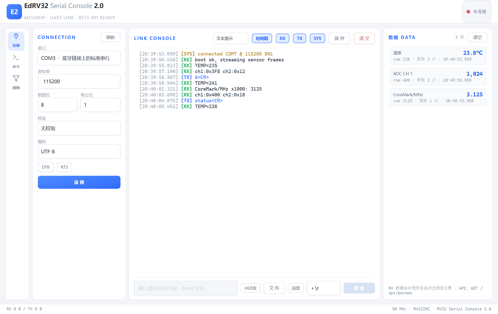

# EdRV32 调试工具

跨平台桌面串口工具（PySide6 / Qt），浅色主题。布局参考 VOFA+：
**左栏图标页签（连接 / 命令 / 规则）+ 中间控制台 + 右侧数据面板**，
三栏之间都是可拖拽的分隔条。GUI、终端 CLI、AI 代理三条通道操作
**同一个串口会话**——界面上看到的一切，都能通过 REST API 观察和操控。



## 快速开始

```bash
pip install PySide6 pyserial

# 桌面 GUI（同时内嵌 REST API，默认 127.0.0.1:8765）
python tools/debug_tool/main.py

# 无界面模式（纯引擎 + REST API，适合脚本/CI/AI 独占使用）
python tools/debug_tool/main.py --headless

# 启动即连接
python tools/debug_tool/main.py --connect COM7 --baud 115200
```

## 界面功能

**LINK CONSOLE（中栏）**
- 经典打印流 `[HH:mm:ss.fff][RX/TX/SYS] 内容`，RX 绿 / TX 蓝 / SYS 琥珀。
- 工具栏：**文本 / HEX 显示切换**（重渲染保留的历史行）、**时间戳开关**、
  **RX / TX / SYS 方向过滤**、保存、清空。
- 发送区：可选行尾 `＋\r ＋\n ＋\r\n 无`，**HEX 发送模式**（如 `01 03 FF`），
  Enter 快捷发送。
- **文件发送**：发送区「文 件」按钮选择文件后按原始字节分块（4KB）发送，
  控制台下方出现进度条并可中途取消；「回显」开关决定是否把文件内容
  也打印到控制台（每 4KB 一条 TX 条目，含 hex，可配合 HEX 显示查看）；
  开始/完成/取消记 sys 行。
- 性能：RX 线程 O(1) 入队 + GUI 50ms 分批渲染（单批 ≤400 行）+ 纯文本控件，
  8000 行洪峰实测不卡（`stress_test.py`）。界面保留 1500 行，引擎缓冲 5000 行。

**连接（左栏 · 连）**
- 串口枚举刷新、波特率（可自定义，如 5000000）、数据位/校验/停止位、
  **编码格式 UTF-8 / GBK / ASCII**（作用于 RX 解码与 TX 编码，即时生效）、
  **DTR / RTS 流控开关**；配置记忆到 `settings.json`。

**命令（左栏 · 令）**
- 点击即发送的快捷按钮，右键编辑/删除，「＋ 新建命令」，超出可滚动；
  头部「导入 / 导出」整体替换式加载 / 保存 JSON 配置；持久化 `commands.json`。

**规则（左栏 · 则）—— 数据匹配引擎**
- 每条规则 = 名称 + 正则 + 捕获组配置；RX 行命中即从捕获组提取数值，
  在右侧数据面板生成/更新一个参数（类似 VOFA 的数据通道）。
- 字段：`keyGroup`（0=单参数；>0 时以该捕获组为键展开多参数）、
  `valueGroup`、`base`（10/16 进制）、`scale`（缩放）、`unit`（单位）、
  `enabled`（勾选框即时启停）。
- 例：规则 `TEMP=(\d+)` + scale 0.1 + 单位 ℃ → 收到 `TEMP=235` 时
  数据面板显示「温度 23.5℃」；规则 `ch(\d+):0x([0-9a-fA-F]+)` +
  keyGroup=1 + base 16 → 自动展开成 CH 1 / CH 2 / … 多个参数。
- 数据面板每行显示：参数名、最新值（含单位）、raw 原值、更新次数、时间。

## 终端 / AI 控制

CLI 走 HTTP API，GUI 开着时也能用（看到同一会话）：

```bash
python tools/debug_tool/cli.py ports
python tools/debug_tool/cli.py status
python tools/debug_tool/cli.py connect COM7 --baud 115200
python tools/debug_tool/cli.py send "6"                  # 默认行尾 \r
python tools/debug_tool/cli.py send "01 03 FF" --hex     # HEX 发送
python tools/debug_tool/cli.py sendfile firmware.bin     # 发送文件（带进度）
python tools/debug_tool/cli.py sendfile firmware.bin --echo  # 同时回显到控制台
python tools/debug_tool/cli.py sendfile --cancel         # 取消传输
python tools/debug_tool/cli.py tail -f                   # 持续观察缓冲区
python tools/debug_tool/cli.py tail --dir rx
python tools/debug_tool/cli.py save / clear
python tools/debug_tool/cli.py config --encoding gbk     # 切编码
python tools/debug_tool/cli.py modem --dtr on            # DTR/RTS
python tools/debug_tool/cli.py cmd list / add / run / del / export / import
python tools/debug_tool/cli.py rules list
python tools/debug_tool/cli.py rules add TEMP 'TEMP=(\d+)' --scale 0.1 --unit C
python tools/debug_tool/cli.py rules set temp --off      # 停用/启用
python tools/debug_tool/cli.py rules del temp
python tools/debug_tool/cli.py params                    # 当前参数快照
python tools/debug_tool/cli.py params --clear
```

### REST API（默认 `http://127.0.0.1:8765`）

| 方法 | 路径 | 说明 |
| --- | --- | --- |
| GET | `/api/ports` | 枚举串口 |
| GET | `/api/status` | 连接状态、编码、DTR/RTS、字节计数、lastSeq |
| POST | `/api/connect` | `{port, baud, dataBits, parity, stopBits, dtr, rts}` |
| POST | `/api/disconnect` | 断开 |
| POST | `/api/send` | `{text, ending, hex}` |
| POST | `/api/file/send` | `{path, echo?}` 后台分块发送文件 |
| GET | `/api/file/status` | 传输进度（active/sent/total/error…） |
| POST | `/api/file/cancel` | 取消传输 |
| POST | `/api/options` | `{encoding: utf-8\|gbk\|ascii}` |
| POST | `/api/modem` | `{dtr?, rts?}` 连接中实时切换流控 |
| GET | `/api/buffer?since=N&limit=M&dir=rx\|tx\|sys` | 增量读取（条目含 hex 字段） |
| GET | `/api/buffer/download` | 下载整个缓冲区为 .log |
| POST | `/api/clear` / `/api/save` | 清空 / 保存日志 |
| GET/POST | `/api/commands` | 列出 / 新建命令 |
| PUT/DELETE | `/api/commands/{id}` | 更新 / 删除命令 |
| POST | `/api/commands/{id}/send` | 发送已存命令 |
| POST | `/api/commands/replace` | `{commands:[...]}` 整体替换 |
| GET/POST | `/api/rules` | 列出 / 新建匹配规则 |
| PUT/DELETE | `/api/rules/{id}` | 更新（支持部分字段）/ 删除 |
| GET | `/api/params` | 当前捕获的参数及最新值 |
| POST | `/api/params/clear` | 清空参数面板 |

缓冲区条目：`{seq, ts, dir, text, hex?}`，`seq` 全局单调递增——
AI 记住上次 `lastSeq` 后用 `?since=<lastSeq>` 轮询即可增量观测。

## 架构

```
tools/debug_tool/
├── main.py            # 入口：--gui(默认) / --headless / --connect / --api-port
├── core/
│   ├── engine.py      # SerialEngine：串口收发线程、seq 缓冲区、规则匹配、
│   │                  #   参数存储、命令/日志/配置持久化
│   └── api.py         # 嵌入式 REST API（stdlib http.server，守护线程）
├── gui/
│   └── app.py         # PySide6 主窗口（浅色 QSS，VOFA 式三栏）
├── cli.py             # 终端客户端（urllib 直连 REST API）
├── render_shot.py     # 开发辅助：渲染界面到 PNG
├── stress_test.py     # 压测：8000 行洪峰下事件循环响应率
├── commands.json      # 命令按钮（首次保存时生成）
├── rules.json         # 匹配规则（首次保存时生成）
├── settings.json      # 运行时生成的上次串口配置（不入库）
└── logs/              # 一键保存的日志
```

要点：引擎不依赖 GUI；API 与 GUI 注入同一个 `SerialEngine` 实例。
`connect()` 支持 pyserial URL（`loop://` 自环、`socket://` 等），无硬件可测。

## 后续打包 exe（release 时）

```bash
pip install pyinstaller
pyinstaller --noconfirm --windowed --name EdRV32DebugTool \
  tools/debug_tool/main.py
```

发布前把 `commands.json` / `rules.json` / `settings.json` 的存储路径从
工具目录切到 `%APPDATA%`（避免安装目录只读问题）。

## 与 1.0（PowerShell 版）的关系

`tools/serial-console/` 下的 1.0 仍保留可用（HPM 面板、CoreMark 解析）。
2.0 的规则引擎是通用的，不内置任何厂商协议；针对 HPM 遥测，用
`rules add` 配置相应正则即可（例如 `^HPM\s+cpi_x1000\s*=\s*(\d+)` +
scale 0.001 得到 CPI）。

## BIOS 烧录 SRAM

在“连接”页打开串口（115200、8N1），切到“烧录”页，选择
`build/sw/<程序>/<程序>.bin` 并点击“烧录 SRAM”。按住 KEY1 按复位，
工具收到 `BIOS menu: 1=Program SRAM` 后发送 `1` + CR，收到
`UART download ready` 后用 `tools/board/uart_tool.py:wire_bytes()` 发送
4 字节小端长度和镜像。进度包含 4 字节长度头，结果显示 BIOS 原始
`Program SRAM result` 与 `Program SRAM bytes`；串口输出仍显示在中栏。
出现 PASS 后松开 KEY1，按复位运行；BIOS 不自动执行程序。

```bash
python tools/debug_tool/cli.py program build/sw/monitor/monitor.bin
```

CLI 启动传输后等待结果，失败退出码为 1；文件路径由运行工具的主机读取。
REST：`POST /api/program {"path":"绝对路径.bin"}` 启动，
`GET /api/program/status` 观察 `active/phase/sent/total/programmedBytes/result/error`。
先启动烧录再按住 KEY1 按复位；等待提示或结果时不会自动超时、重试。
