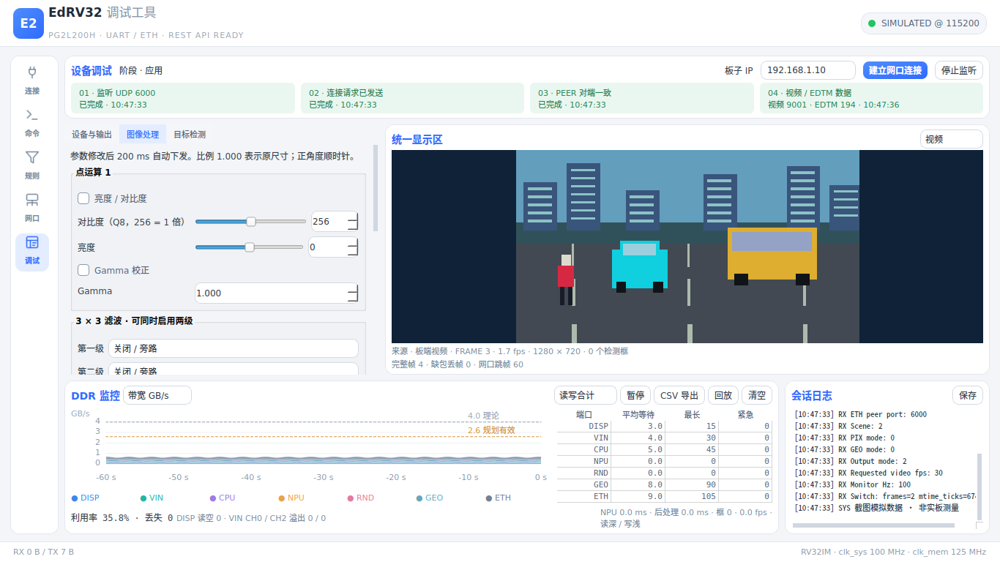
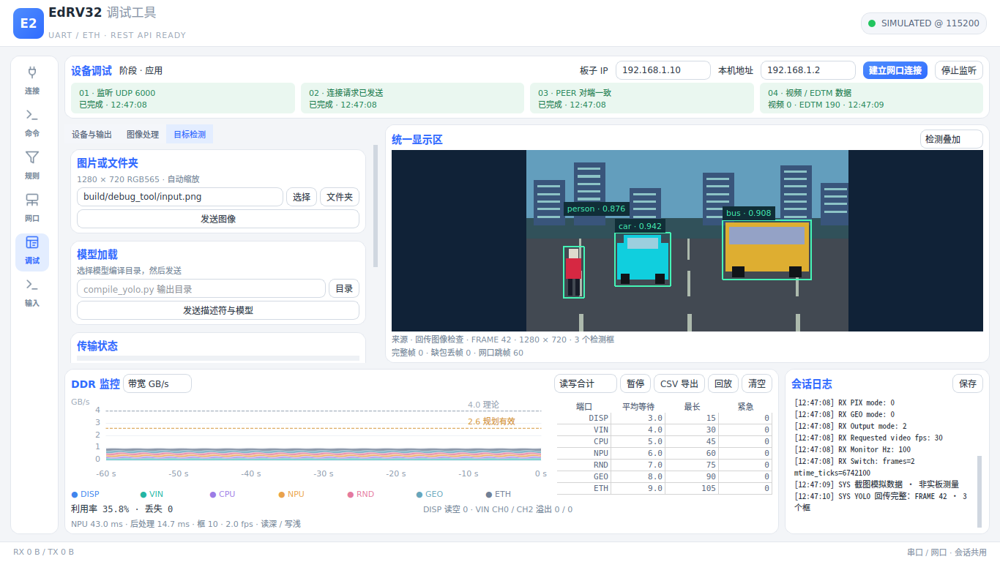
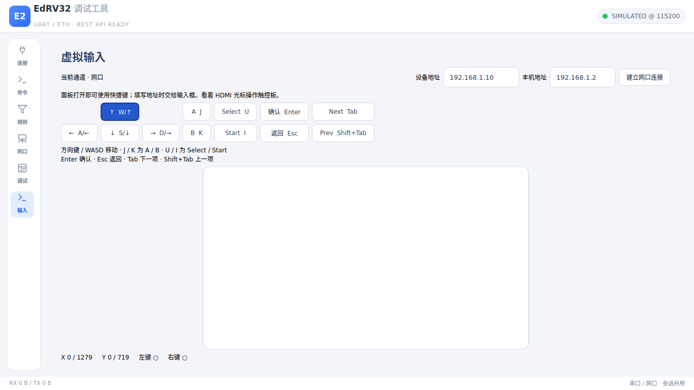
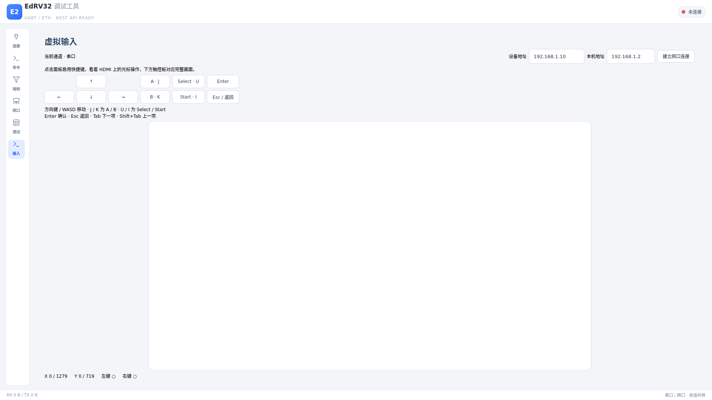

# EdRV32 调试工具

PySide6 桌面工具，GUI、CLI 和 REST 共用串口、UDP 接收端和会话状态。
全部功能始终提供，用户选择要烧录的镜像；工具不选择板型、不探测模块是否存在，
也不判断某项操作在当前硬件上是否有效。

“调试”导航中按功能分成三个页面：

- **设备与输出**：BIOS 烧录、摄像头功能、HDMI / 网口输出、视频目标帧率与监控采样率。
- **图像处理**：点运算、两级滤波和几何变换；修改后约 200 ms 自动下发。
- **目标检测**：模型加载、单张图片或文件夹、原图叠框、实测往返时间与 fps、可选参考比对。

右侧统一显示视频、原图或检测结果；底部显示 DDR 监控和会话日志。
控件过多时按页垂直滚动，每个分组保持完整；文件路径可编辑并悬停查看全文，
会话日志按可用宽度自动换行，规则正则可悬停查看全文。表头完整显示，长数值提供全文提示。


<!-- 截图：QT_QPA_PLATFORM=offscreen python tools/debug_tool/render_shot.py tools/debug_tool/assets/processing-1366x768.png --state vision --page 1 --width 1366 --height 768；telemetry_sim 合成数据，非实板测量。 -->

## 安装与启动

Windows 安装 `tools/requirements.txt` 中的 PySide6、pyserial，双击
`启动调试工具.bat`，或执行：

```sh
python tools/debug_tool/main.py
python tools/debug_tool/main.py --connect COM7 --baud 115200
python tools/debug_tool/main.py --headless
```

Linux 使用已安装同一 requirements 的 Python 环境；本次验收使用
`~/.local/opt/edrv32-py/bin/python`。NPU 参考执行另需 requirements 中已有的
numpy、torch 等依赖和 `third_party/ultralytics` 子模块。

## 连接、烧录与监控

1. PC 有线网卡设为同网段地址，例如 `192.168.1.2/24`；板子固定 `192.168.1.10`。
   允许 PC UDP 6000，板端 UDP 5000。网口连接区域填写“本机地址”（默认 `192.168.1.2`，须为有线网卡地址）；监听和发送均显式绑定该地址，PEER 检查也使用该地址。绑定失败显示错误，不改用其他地址。串口页选择端口、115200、8N1 并连接。
2. KEY1 + 复位进入 BIOS。“设备与输出”选择 ELF 或 `.bin`，选择串口 / 网口传输。
   `.bin` 显式填写烧录和运行地址，SRAM 通常均为 `0x10000000`；ELF 按 PT_LOAD
   加载并跳转 e_entry。网口传输填写本机 IP。烧录后自动运行，状态 / 失败原因见原位置和日志。
3. 点击“建立网口连接”，依次监听、发送连接短包、核对板端 PEER、累计视频 / EDTM 数据。
   四格分别记录时间；数据包数与完整视频帧数分开统计。同一个 socket 接收全部业务。
4. 按功能设置摄像头输入、输出、视频 fps、采样 Hz。视频 fps 是实收完整帧计算值；
   目标帧率受源帧率、推理和网口带宽限制。串口 `status` 摘要显示板端设置与计数。
5. DDR 曲线保留 60 s，提供带宽 / 利用率 / 可选读延迟；七端口表列平均等待、最长等待、
   紧急授权数，等待单位为 clk_mem 周期。暂停只暂停绘图，CSV 仍保留原始数据。
   导出 / 回放 / 清空按钮用于记录和复现；溢出、读空计数非零标红。
   带宽图按端口分别绘制读、写或读写合计曲线；图例显示端口颜色、名称和当前值。
   单击图例显示 / 隐藏曲线（隐藏项变灰并加删除线），悬停图例或曲线会加粗置顶并淡化其他曲线；
   双击图例只显示该端口，再双击恢复全部。鼠标在图内时显示时间竖线，图例改为该时刻读数。
   按住左键左右拖动平移时间轴，滚轮缩放到 5–60 s；范围始终受已保留数据限制。
   拖动或缩放后显示“已暂停跟随，双击恢复”，新数据继续采样，但窗口停在所选时间段；
   保留期外的数据移出后，窗口相应限制在仍保留的范围内。双击图内恢复最近 60 s 并跟随最新数据。
   带宽图和利用率图共用时间窗口，切换图表后保持对齐；CSV 和统计不受图例及时间窗口影响。
   带宽纵轴默认自动缩放，按当前时间窗口内可见曲线的最大值取 1、2、5 × 10ⁿ 的整齐上限；
   隐藏曲线不参与计算。“满量程”切到 0–4.4 GB/s，“自动”恢复自动缩放。
   Ctrl + 滚轮单独缩放带宽纵轴；双击图内同时恢复自动纵轴和时间跟随。
   理论 4.0 GB/s、规划有效 2.6 GB/s 参考线超出纵轴范围时，在图右上角标明数值。
   利用率纵轴始终为 0–100%。
6. 统一显示区、DDR 监控、会话日志和板端 status 摘要的标题右侧提供“放大”按钮。
   点击后面板占满中控台区域，点击“复原”或按 Esc 恢复原布局；双击标题也可切换。
   放大期间数据与视频继续刷新。输入页面中的 Esc 仍发送虚拟返回键。

DDR 交互截图（模拟数据，生成物位于 `build/`）：
[高亮 DISP、隐藏 VIN（1366×768）](../../build/debug_tool/ddrplot/highlight-1366.png)、
[暂停跟随（1920×1080）](../../build/debug_tool/ddrplot/paused-1920.png)。复现命令：

```sh
mkdir -p build/debug_tool/ddrplot
QT_QPA_PLATFORM=offscreen ~/.local/opt/edrv32-py/bin/python tools/debug_tool/render_shot.py \
  build/debug_tool/ddrplot/highlight-1366.png --state vision --ddr-view highlight
QT_QPA_PLATFORM=offscreen ~/.local/opt/edrv32-py/bin/python tools/debug_tool/render_shot.py \
  build/debug_tool/ddrplot/paused-1920.png --state vision --ddr-view paused --width 1920 --height 1080
```

面板放大与自动纵轴截图（模拟数据，非实板测量）：
[1366×768 自动缩放](../../build/debug_tool/uimax/auto-1366.png)、
[1920×1080 DDR 放大](../../build/debug_tool/uimax/ddr-1920.png)。复现命令：

```sh
mkdir -p build/debug_tool/uimax
flock /tmp/edrv32-debugtool.lock env QT_QPA_PLATFORM=offscreen \
  ~/.local/opt/edrv32-py/bin/python tools/debug_tool/render_shot.py \
  build/debug_tool/uimax/auto-1366.png --state vision
flock /tmp/edrv32-debugtool.lock env QT_QPA_PLATFORM=offscreen \
  ~/.local/opt/edrv32-py/bin/python tools/debug_tool/render_shot.py \
  build/debug_tool/uimax/ddr-1920.png --state vision --maximize ddr --width 1920 --height 1080
```

## 图像处理

点运算 1：亮度 / 对比度开关、对比度 Q8（256 = 1 倍）、亮度 −256–255、
Gamma 开关和任意正 Gamma 值。固件计算 Gamma 表，写入未使用的 bank 后切换。
两个 3×3 级独立选择关闭、均值、高斯、锐化、Sobel、腐蚀或膨胀。
点运算 2：灰度、二值化及 0–255 阈值、反色，各开关可同时启用。

几何变换：总开关，任意角度（精度 0.1°），独立 X/Y 缩放（精度 0.001），
“锁定比例”默认打开，关闭后两轴独立；X/Y 平移和水平 / 垂直镜像。
比例 1.000 为原尺寸、0.500 为缩小一半、2.000 为放大两倍，正角度顺时针。
放大没有人为倍率上限；固件按 GEO 2.4 检查实际 Q16.16 矩阵，超出范围明确报错且不下发。
连续编辑同一组参数会合并，停顿约 200 ms 后通过串口发送一条完整参数命令。
原有预设和 KEY 循环仍可使用；线格式及单位见[演示程序命令表](../../sw/apps/demo/README.md#串口命令)。

## 目标检测

选择 `compile_yolo.py` 输出目录并发送模型，等待界面显示设备处理完成。
选择任意尺寸图片后点击发送，工具统一缩放到 1280×720、小端 RGB565；
模型和图片均使用 showcase 的握手上传流程，上一条上传完成后才能开始下一条。
回传顺序统一为 CH2（983040 B）、OUTPUT（725760 B）、EDDT；最后的检测通知结束该图。
接收完成后在原图尺寸上叠框并显示与板端共用的 COCO 类名，记录从开始发送到最终通知的往返 ms 和平均检测 fps。

“文件夹”按文件名排序处理 png/jpg/jpeg/bmp，收到本张完整回传后才发下一张，
显示包含主机转换和传输开销的文件夹平均 fps。检测不要求安装参考模型依赖。
需要核对数值时选择配套量化 JSON 并点击“运行参考模型并比对”：CH2 使用实际发送的
RGB565 按 VIN 2.8 展开、平均、量化和 letterbox；OUTPUT 执行 NPU 参考模型；
EDDT 使用 Python 后处理逐项比较，显示差异字节数、首差异和框差异。


<!-- 截图：render_shot.py --state detection --page 2 --width 1366 --height 768；输入和检测结果由 telemetry_sim 通过真实 UDP 回环生成，非实板测量。 -->

## 游戏上传与游戏包

左侧“游戏”页选择 `.nes` ROM，名称默认取文件名，可自行修改；封面可留空，
或选择 PNG / JPG。填写设备地址和本机地址，点击“上传游戏”。进度条显示发送量，
完成后显示板端返回的游戏序号，可继续选择并上传下一款。上传内容复位或断电后清空。
所有功能始终可见；控件所在页面可滚动，路径与名称提供全文提示，状态文字自动换行。

GUI 与命令行共用 `tools/sw/game_record.py`：游戏名用仓库内 Noto Sans SC 20 px
渲染为 A8，超过 180 px 自动换行；UTF-8 名称最多 63 字节。封面等比缩放到
120×160 以内，在 120×160 白底上居中，不裁剪，按小端 RGB565 保存。

```sh
python tools/sw/game_record.py pack sw/apps/showcase/games/games.txt build/games.bin
```

`games.txt` 每行 `名字|ROM 路径|封面路径`，支持空行和 `#` 注释。
ROM 路径相对 `third_party/nes`，封面路径相对清单文件；无封面时第三项留空。
命令打印游戏数和总字节数。模块接口为 `build_record(name, rom, cover)` 和
`build_pack(records)`，分别生成 EDG2 v2 记录及 EDGP v2 游戏包；旧 v1 打包器已删除。

## showcase 网口通信与回环测试

模型、图片和游戏的上传统一为：发送 BULK_BEGIN，等待 READY，再连续发送数据，
最后等待 DONE；游戏序号来自 DONE。模型 DONE 表示加载完成；图片的识别结果会先于
DONE 到达，上传状态在 DONE 到达后才结束。模型保留 EDNM 布局（头偏移 0、描述符
0x1000、模型 0x100000，间隙补零）；图片为 1280×720 RGB565；游戏为一条 EDG2。
识别结果的 CH2 / OUTPUT / EDDT 回传解析保持原格式。

EDSC 消息位于 UDP 应用头后，字段为 `<4sHHI`：`EDSC`、类型、payload 长度、序号，
后跟 payload。控制消息使用窗口 3、偏移 0、NOTIFY=1；大块数据使用窗口 0，
偏移从 0 开始，仅最后一包 NOTIFY=1。完整协议见
[设计记录 4.5.4–4.5.5](../../docs/design/2026-11-03-showcase-ui.md#454-showcase-网口协议板端与调试工具共同遵守)。

“网口”页填写地址与端口，设置测试次数后点击“开始回环测试”。工具逐次发送
ECHO，检查 ECHO_REPLY 的序号与原样数据，显示次数、已返回数、丢失数和成功样本的
平均往返毫秒数。每次请求只发送一次，超时样本计为丢失后继续后续测试次数。
READY / DONE / ECHO_REPLY 等待上限为 5 s，超时、板端拒绝和协议错误显示在界面和日志中，
不重试、不切换协议。当前版本针对 showcase，不再发送旧的 ASCII 摄像头命令。

## CLI 与 REST

CLI 使用同一个本机 REST 引擎，默认 `http://127.0.0.1:8765`。
路径按工具所在主机解析，参数线单位为整数：角度 0.1°、比例/Gamma 千分值、平移像素。

```sh
python tools/debug_tool/cli.py connect COM7 --baud 115200
python tools/debug_tool/cli.py program app.bin --addr 0x10000000 --entry 0x10000000
python tools/debug_tool/cli.py program app.elf --elf --eth --local-ip 192.168.1.2
python tools/debug_tool/cli.py scene s2
python tools/debug_tool/cli.py processing pix '{"bc":1,"contrast":320,"brightness":24,"stage1":2}'
python tools/debug_tool/cli.py processing geo '{"enabled":1,"angle":123,"scale_x":1500,"scale_y":750}'
python tools/debug_tool/cli.py yolo model build/npu/yolo
python tools/debug_tool/cli.py yolo image image.png
python tools/debug_tool/cli.py telemetry latest
python tools/debug_tool/cli.py telemetry export build/debug_tool/capture.csv
python tools/debug_tool/cli.py tail -f
```

| 方法 | 路径 | 参数 / 结果 |
|---|---|---|
| GET | `/api/status`、`/api/board` | 串口 / 烧录状态；阶段、四步连接、数据计数、peer、摘要、错误 |
| POST | `/api/board/network` | `{boardIp?,boardPort?,localIp?}`；建立网口连接 |
| GET / POST | `/api/processing`、`/api/processing/pix`、`/api/processing/geo` | 读取两组设置 / 修改一组；省略项沿用该组当前值 |
| GET | `/api/ports` | 串口枚举 |
| POST | `/api/connect`、`/api/disconnect` | `{port,baud,dataBits?,parity?,stopBits?,dtr?,rts?}` / `{}` |
| POST | `/api/send`、`/api/options`、`/api/modem` | `{text,ending?,hex?}` / `{encoding}` / `{dtr?,rts?}` |
| GET | `/api/buffer`、`/api/buffer/download` | 增量日志 / 全部日志 |
| POST | `/api/clear`、`/api/save` | `{}` / `{path?}` |
| GET / POST | `/api/commands`、`/api/rules` | 列表 / 创建；PUT、DELETE `/{id}` 与命令 `/{id}/send` 保留 |
| POST | `/api/commands/replace` | `{commands}` |
| GET / POST | `/api/params`、`/api/params/clear` | 规则提取值 / 清空 |
| POST / GET | `/api/file/send`、`/api/file/status` | `{path,echo?}` / 串口文件状态，取消 `/api/file/cancel` |
| POST / GET | `/api/program`、`/api/program/status` | `{path,elf?,baud?,addr?,entry?,eth?,localIp?}` / BIOS 状态 |
| GET | `/api/ethernet/status` | 共用 UDP 传输状态 |
| POST | `/api/ethernet/send` | `{path,boardIp,boardPort,localPort,localIp?,window?,offset?,interval?}`；数据用途编号见本文件 showcase 协议说明 |
| POST | `/api/ethernet/receive/start`、`/api/ethernet/receive/stop` | `{localPort,localIp?,directory?,mode?}` / `{}`；mode=files/video/yolo/console |
| GET | `/api/telemetry`、`/api/telemetry/csv` | 监控最新值 / 原始 CSV |
| POST | `/api/telemetry/export`、`/api/telemetry/replay`、`/api/telemetry/clear` | `{path}` / `{path}` / `{}` |
| GET / POST | `/api/scenes`、`/api/scenes/send` | 预设映射 / `{name,rate?}` |
| POST | `/api/yolo/model`、`/api/yolo/image` | `{path,boardIp,boardPort,localPort,localIp?}`；showcase 握手上传 |

PIX 键：`bc,contrast,brightness,gamma_en,gamma,stage1,stage2,gray,binary,threshold,invert`。
GEO 键：`enabled,angle,scale_x,scale_y,translate_x,translate_y,mirror_x,mirror_y`。
GUI 比例锁定只联动输入控件，线上始终发送两个独立比例。
通用串口页保留文本 / HEX、行尾、保存、原始文件发送、快捷命令、规则和数据面板；
通用网口页按“大块数据、未使用、虚拟输入、控制与监控”选择用途，保留原始偏移收发。

## 测试、模拟与截图

```sh
python -m unittest discover -s tools/debug_tool/tests -v
python -m unittest discover -s tools/board/tests -v
make -C sw/apps/demo test
python tools/debug_tool/telemetry_sim.py --mode detection --host 127.0.0.1 --port 5000 \
  --model tasks/win/20261029-09-b3-software/src/npu \
  --quant tasks/win/20261029-09-b3-software/src/npu/quantization.json --frames 2
```

检测模拟板收到真实 RGB565，按 VIN 参考生成 CH2，执行真实 NPU / 后处理参考，
经 UDP 按三块协议返回。串口参数端到端测试使用 `telemetry_sim.run_processing` 与真实 PTY，
REST / CLI → SerialEngine → 模拟串口 → 状态摘要；只替换 PTY 不支持的 DTR/RTS ioctl。
`test_processing.py` 另测 200 ms 合并、比例锁定/解锁和同时启用全部 PIX 阶段。

全部页面截图如下；图像处理分顶端和几何区域，滚动可访问所有参数。

| 页面 | 1366×768 | 1920×1080 |
|---|---|---|
| 串口连接 | [截图](assets/connection-1366x768.png) | [截图](assets/connection-1920x1080.png) |
| 快捷命令 | [截图](assets/commands-1366x768.png) | [截图](assets/commands-1920x1080.png) |
| 规则与数据 | [截图](assets/rules-1366x768.png) | [截图](assets/rules-1920x1080.png) |
| 通用网口 | [截图](assets/network-1366x768.png) | [截图](assets/network-1920x1080.png) |
| 设备与输出 | [截图](assets/device-1366x768.png) | [截图](assets/device-1920x1080.png) |
| 图像处理 | [截图](assets/processing-1366x768.png) | [截图](assets/processing-1920x1080.png) |
| 点运算 2 | [截图](assets/point-1366x768.png) | [截图](assets/point-1920x1080.png) |
| 输出与状态 | [截图](assets/output-1366x768.png) | [截图](assets/output-1920x1080.png) |
| 检测参考比对 | [截图](assets/reference-1366x768.png) | [截图](assets/reference-1920x1080.png) |
| 网口接收 | [截图](assets/receive-1366x768.png) | [截图](assets/receive-1920x1080.png) |
| 几何区域 | [截图](assets/geometry-1366x768.png) | [截图](assets/geometry-1920x1080.png) |
| 目标检测 | [截图](assets/detection-1366x768.png) | [截图](assets/detection-1920x1080.png) |

截图统一由 `render_shot.py` 生成，使用 `--width/--height`、`--main-page 0..6`、
`--page 0..2`；`--state vision/detection` 注入模拟串口并通过 telemetry_sim 真实 UDP
回环生成数据，`--scroll-bottom` 显示几何区域。工具实际核对窗口尺寸、完整视频/检测与 EDTM。

## T-UI1 验收记录

- T-UI1 提交 `8587c47e`、`248b96c2`；T-UI1-R 为本修订提交（`git log -1 --format=%H -- tools/debug_tool/README.md`）。
- 环境：xPack GCC 15.2.0，主机 GCC 13.3，Python 3.12，PySide6 6.12.0、pyserial 3.5。
- `. ~/.local/opt/edrv32/env.sh` 后逐个 `make -C sw PROGRAM=<程序> MEMORY=sram -j1`，四程序均 0 warning。
- C11、`-Wall -Wextra -Werror`；摄像头程序 `-Os`，NPU 程序 `-O2`；data 均为 0 B。
- `riscv-none-elf-size` 的 text/bss，栈余量=`0x10010000-__bss_end`（来自 `nm`），单位 B：

| 程序 | text | bss | __bss_end | 栈余量 | text 相对评审基线增量 |
|---|---:|---:|---|---:|---:|
| demo | 48076 | 5568 | 0x1000d1c0 | 11840 | +1948 |
| demo_vision | 29988 | 1084 | 0x1000797c | 34436 | +3360 |
| demo_vnpu | 47060 | 5516 | 0x1000cd8c | 12916 | +1608 |
| demo_npu | 22572 | 1920 | 0x10005fc0 | 41024 | — |

- 三个 text 增量相对 46128/26628/45452 B，均 ≤4096 B；栈余量不是实板栈高水位测量。
- Gamma：整数 Q24 log2、Q30 exp2 单调线性插值；相对双精度公式最大误差 1 个灰度值。
- Gamma 完整范围 1..INT_MAX：枚举每个输入/输出量化转折，检查 27496 个边界 gamma 的完整表；单调性保证转折之间及饱和尾部全部整数也在误差范围内。
- 仿射：Q30 CORDIC 额外保留小数保护位，直至 Q16.16 量化；96 位整数乘积按 32 位 limb 计算，无浮点运行库。
- 扫描全部 3600 个 0.1° 角度 ×5 组比例/镜像/平移（含 INT_MAX 平移），另测大平移抵消，六系数相对双精度量化最大误差 1 LSB。
- 四 ELF 的 `nm | grep -E '__.*(df[23]|sf[23]|float|fixdf|fixsf|extend.*df|truncdf)'` 无匹配；未引入软件浮点符号。
- `make -C sw/apps/demo test`：原主机测试、参数应用、完整随机帧 CH2 及 Python 4 项通过，UBSan 无错误。
- `QT_QPA_PLATFORM=offscreen ~/.local/opt/edrv32-py/bin/python -m unittest discover -s tools/debug_tool/tests -v`：73 项通过，无跳过。
- T-UI1 的板级工具 10 项、参数 REST/CLI/PTY 和检测 RGB565/CH2/OUTPUT/EDDT UDP 端到端用例保留通过。
- GUI 新回归：读取板端同一张 80 类名称表，person/car/bus 标签；长日志自动换行且横向滚动范围为 0；两种尺寸下 NPU 页脚整行、位置和完整宽度检查。
- 24 张截图已刷新：1366×768 与 1920×1080 的所有页面及滚动区域；DDR/NPU 指标分行对齐，人工核对检测类名、长日志和完整页脚。
- 布局测试继续检查标签高度、按钮/数字宽度、滚动可达性、规则编辑按钮、完整七行端口表；长正则/路径/数值提供全文提示。
- `python -m compileall -q tools/debug_tool`、`git diff --check` 和 `python tools/check/verilog_style.py sw/apps/demo sw/lib tools/debug_tool` 通过；无 RTL 改动，Verilator lint 不适用。
- 日志：`build/t-ui1-r-{demo,demo_vision,demo_vnpu,demo_npu,host,tools,shots}.log`；未运行 RTL 仿真或实板测试。

## 虚拟输入（T-VIN1）

左侧「输入」打开虚拟输入面板，面板可见时键盘快捷键立即生效，无需先点击。
焦点在设备 IP、本机地址等文本输入框时，按键交给输入框，不发送虚拟输入。
按钮显示完整按键提示，键盘和鼠标按住时均以深蓝底白字显示，松开后恢复；
W 与 ↑ 等同一按钮的多个映射全部松开后才释放。方向键 / WASD、J=A、K=B、U=Select、
I=Start、Enter、Esc、Tab=Next、Shift+Tab=Prev。鼠标在白色 16:9 触控板内
移动即为绝对位置，左 / 右 / 中键分别发送对应按钮；滚轮切换焦点，中键确认。坐标与滚轮累计值显示在下方。
触控板映射 1280×720，使用时看 HDMI 光标，**不回传屏幕画面**。
离开面板或应用失去焦点时释放面板的按下状态。

「输入」面板或「调试」页建立网口连接且对端确认后，面板自动走网口；否则走串口，
当前通道显示在面板顶部。输入面板可填写设备 IP 并点击「建立网口连接」，
端点默认 `192.168.1.10:5000`。无串口连接时操作会明确报错。
所有入口建立网口时只发送 UDP 握手，不自动发送 UART 文本。
「调试 → 设备与输出」的「读取状态」按钮由用户显式发送 `status`。
向 S3/NES 发送文本会被当作原有单字符按键，使用这两个应用时不要点击读取状态。



<!-- 截图：QT_QPA_PLATFORM=offscreen ~/.local/opt/edrv32-py/bin/python tools/debug_tool/render_shot.py tools/debug_tool/assets/virtual-input-1366x768.png --state vision --main-page 5 --width 1366 --height 768；另一张使用 1920/1080；截图自动按住 W，深蓝色上按钮为按下状态；空白触控板，模拟数据，无实板画面。 -->

每帧为 8 字节小端完整状态（Python `<HhhBB`），每次覆盖全部状态：

| 字节 | 类型 | 含义 |
|---|---|---|
| 0–1 | u16 | bit0 上、1 下、2 左、3 右、4 A、5 B、6 Select、7 Start；8 Enter、9 Esc、10 Next、11 Prev，其余 0 |
| 2–3 | i16 | X：0–1279 |
| 4–5 | i16 | Y：0–719 |
| 6 | u8 | bit0 左键、bit1 右键、bit2 中键，其余 0 |
| 7 | u8 | 滚轮累计计数，u8 回绕，向下为正 |

串口发送 `0x1B 'V'` 后跟状态帧。板端遇 ESC 进入帧读取，帧内字节（包括
ESC 和原有按键字符）仅作数据，其余字节继续交给应用原有单字符输入。
UDP 使用既有 8 字节大端应用头 `!BBHI`：window=2、NOTIFY=1、保留=0、
offset=0，后跟 8 字节输入。接收窗口 2 物理地址 `0x0a010000`、大小 8 字节，
位于既有网络保留区，与 S3/NES 的窗口 3 对端建立区 `0x0a000000` 分离。
收到 NOTIFY 后从非缓存别名读取最新状态；S3 在既有 100 Hz ETH tick 回调读取，
NES 每帧轮询。状态变化立即发一次；任何按键或鼠标键按下时每 20 ms 重发。
板端只保留最后收到的完整状态，无校验、序号、输入超时、重试或释放推测。

可复现发包（`--emit` 输出带串口前缀的原始二进制文件；末帧为释放）：

```sh
python tools/debug_tool/virtual_input.py --emit build/debug_tool/input.bin --keys up,a --x 100 --y 200 --hold .2
python tools/debug_tool/virtual_input.py --udp 127.0.0.1:5000 --keys b,start --hold .2
```

REST `POST /api/virtual-input` 接受 `keys,x,y,mouse` 以及可选 `wheel`（默认 0）整数，共用 GUI 的
发送器与自动重发。`keys` 是位图，`mouse` 是鼠标键位图，`wheel` 是滚轮累计计数。
串口页激活时暂停串口虚拟输入，离开后恢复；网口虚拟输入不受影响。

## T-VIN1 验收记录

- 日期：2026-10-31；基线 `8edfca2d`，软件提交 `833a71ed`，工具复现版本为本节所在提交（`git rev-parse HEAD`）。
- `make -C sw PROGRAM=s3 MEMORY=ddr_app -j 1`：通过，0 warning。
- `make -C sw PROGRAM=nes MEMORY=ddr_app -j 1`：通过，0 warning。
- `python3 tools/s3/virtual_input_host.py`：512 源文件 C11/Werror 构建通过；串口帧与字符混合、网络覆盖、NES 八键逐位与原状态取或通过。
- 同一主机测试用真实 LVGL POINTER 左键点击按钮一次、KEYPAD Next 切换至第二按钮，并直接断言点击数与焦点对象。
- `python3 tools/s3/menu_capture.py`：原菜单导航与真实 RND 描述符执行通过（484 命令）。
- `QT_QPA_PLATFORM=offscreen ~/.local/opt/edrv32-py/bin/python -m unittest discover -s tools/debug_tool/tests -v`：78 项通过，无跳过。
- 新增工具测试覆盖完整 UDP 应用头/状态、串口 `--emit` 前缀/状态/末帧释放、约 50 Hz、闲置不发、联网优先、键盘/指针与两种尺寸标签完整宽度。
- 输入面板两张及设备页两张截图已刷新；`assets/virtual-input-{1366x768,1920x1080}.png` 使用 README 内命令刷新；实际窗口尺寸相符。
- ETH 共用接口仅增加 `eth_monitor_board_set_receive()`，在原 tick 清 NOTIFY 前回调，不改变原监控发送策略。
- 经协调者授权修改 `tools/s3/lvgl_host.py` 并新增 `tools/s3/virtual_input_host.{c,py}`；其余改动属于任务归属目录。
- `python3 -m compileall -q tools/debug_tool tools/s3/virtual_input_host.py`、`git diff --check` 通过。
- `python3 tools/check/verilog_style.py sw/apps/s3 sw/apps/nes sw/lib tools/debug_tool tools/s3`：0 warning；无 RTL，Verilator lint 不适用。
- 日志位于 `build/t-vin1/{s3,nes,host,menu,tools,rn17}.log`；RN-17 逐帧输出为 `build/s3/lvgl/rn17-results.md`。
- 未运行 SoC 仿真或实板测试；HDMI 光标、物理串口和网口板上验收留给后续任务卡。
- 协调者确认：连接网口不再自动发送 `status`；原设备页查询按钮改为「读取状态」，输入面板复用相同纯 UDP 握手；相关 REST/会话/GUI 测试覆盖。
- `python3 tools/s3/rn17.py`：原判据，16 帧中 15 PASS；仅既知 `benchmark-12-opa-containers` 为 20756 像素 / 2.252170%，runner 如实返回 1；无新增失败，未修改阈值或 runner。
- RN-17 真实参考执行 776 批 / 3895 命令 / 32683485 像素；benchmark 停止后菜单保留的两次检查均通过。


网口 API 的 `localIp` 默认为当前配置（初始 `192.168.1.2`）；更改地址后重新建立网口
连接会重新绑定监听 socket。`expectedPeer` 使用指定本机地址与实际监听端口，不再
通过系统路由猜测地址。CLI `listen` 和 `yolo` 支持 `--local-ip 192.168.1.2`，
回环模拟时显式使用 `--local-ip 127.0.0.1`。板端未连通时先使用
[eth_diag 与 eth_probe](../../sw/tests/eth_diag/README.md) 定位。


T-ETHDIAG 的网口/虚拟输入截图使用 `--main-page 3/5`；设备、处理、点运算、几何、
输出、接收、检测和参考页的共享网口栏也已更新，共 20 张，两种分辨率均核对窗口尺寸。
重现示例（另一分辨率将参数和文件名替换为 1920×1080）：

```sh
QT_QPA_PLATFORM=offscreen ~/.local/opt/edrv32-py/bin/python tools/debug_tool/render_shot.py tools/debug_tool/assets/network-1366x768.png --main-page 3 --width 1366 --height 768
QT_QPA_PLATFORM=offscreen ~/.local/opt/edrv32-py/bin/python tools/debug_tool/render_shot.py tools/debug_tool/assets/virtual-input-1366x768.png --state vision --main-page 5 --width 1366 --height 768
QT_QPA_PLATFORM=offscreen ~/.local/opt/edrv32-py/bin/python tools/debug_tool/render_shot.py tools/debug_tool/assets/device-1366x768.png --state vision --page 0 --width 1366 --height 768
```

### 视频接收与压力测量

接收 socket 固定请求 64 MiB `SO_RCVBUF`，状态 `rx.socketBufferBytes` 和视频页
显示系统实际授予的大小；Linux 会受 `net.core.rmem_max` 限制，读回值包含内核倍增。
Windows 上板时也须记录读回值，不能用请求值代替。
视频画面用独立 16 ms 定时器刷新，摆脱原状态轮询 500 ms（2 fps）的显示限制。
视频页分别显示完整帧接收帧率、送到画面的显示帧率、丢弃帧数和接收缓冲大小。
帧率按最近一秒的帧间隔计算，停止更新超过一秒显示为零。

video / console / yolo 模式将 socket 接收和视频、YOLO 组帧移到独立的 spawn 进程，
避免 Qt 和逐包接收争用 GIL；文件模式保留原接收线程。
接收进程用 `recvfrom_into` 写共享内存接收区，WIN 0 按 EDVF 尺寸从三个共享帧槽中
取一槽，通过 memoryview 按 OFFSET 写入；
按 eth-spec 的 1024 B 分包序号位图计数，末包长度由帧尺寸决定。
像素包在帧头之后可乱序，重复包不补齐缺失包，也不重复提交完整帧。
支持板端的独立 32 B 帧头描述符，也保留帧头与像素同描述符的接收行为。
仅完整帧交给画面，缺包帧在下一帧头或停止接收时丢弃并计数。
NOTIFY 标记批次末尾；若帧头丢失，看到像素起点 OFFSET=32 后在 NOTIFY 计一次丢弃。
已完成帧的重复末包不重复计帧；协议像素包不含 frame_id，孤立的相同末包无法区分
“重复”与“下一批只剩末包”，此时不额外推算丢帧。EDDT、EDTM 和文件窗口用途不变。
完整帧通过管道通知主进程；主进程每帧复制一次为独立只读快照，再归还帧槽，
保证 Qt 和之前持有的帧不受槽重用影响。停止接收时唤醒阻塞 socket、等待进程退出并释放共享内存。
EDDT 视频检测、EDTM 和普通文件数据转发到原处理路径；接收统计每 256 包、NOTIFY
和停止时更新，完整帧计数随帧通知立即更新。文件模式仍按可读事件排空 socket。

YOLO 的 WIN 0 / 1 / 2 同样在接收进程组装，完整 CH2 / OUTPUT 通过共享帧槽一次交付，
主进程继续保存回传文件并更新原结果。收到 EDDT 结束通知时若有缺包，按图片记录失败，
日志列出缺失窗口与字节数，文件夹队列继续下一张，socket 和 EDTM 接收保持运行；
magic / 版本等协议错误仍报错并停止。失败次数为 `YoloTool.failed`，最后错误为 `error`。
若结束的 EDDT / NOTIFY 本身丢失，从最后一个回传包起 1 s 后将该张记为
“回传未结束（超时 1 s）”；未收到任何回传包时从该图发送完成起算。
超时由接收桥接线程检查，不依赖 GUI 刷新或 EDTM 是否继续到达；文件夹队列继续下一张。

本机千兆节奏回环（固定 1280×720 RGB565、30 fps、900 帧、30 s）：

```bash
~/.local/opt/edrv32-py/bin/python tools/debug_tool/stress_test.py --udp-video
~/.local/opt/edrv32-py/bin/python tools/debug_tool/stress_test.py --udp-video --pattern uniform
~/.local/opt/edrv32-py/bin/python tools/debug_tool/stress_test.py --udp-video --pattern short
QT_QPA_PLATFORM=offscreen ~/.local/opt/edrv32-py/bin/python tools/debug_tool/stress_test.py --udp-video --pattern uniform --gui
~/.local/opt/edrv32-py/bin/python tools/debug_tool/stress_test.py --udp-yolo
```

每帧独立发送帧头和 1800 个像素包；像素包按 116 MB/s 的千兆有效负载速率间隔发送，
帧间按 30 fps 定时，无重试。发送进程与接收线程分离，输出完整帧数、接收帧率、
丢弃帧数、未收完整帧数、丢失包数、接收进程 CPU 秒数/单核占用和缓冲读回值。
uniform 将像素包起点至少间隔 18.518 µs，不追赶调度暂停期间积压的发送 deadline；
若实际发送帧率低于 29.5 fps，该组不能证明 30 fps 接收能力。
short 改用 1280×160 RGB565 的完整 400 包帧；Linux 缓冲还计 skb 开销，
425984 B 不能直接解释为可容纳 400 个 1032 B 数据报。
`--udp-yolo` 保留 telemetry_sim 的 CH2 / OUTPUT / EDDT 格式，将其慢速节奏替换为
116 MB/s 包间隔，分进程连续回传 30 张，输出完整、失败和未见结束的张数。
线速突发需要 ≥ 2 MiB 接收缓冲，上板时记录 Windows 读回值；Linux 还需留出 skb 开销。
Linux 回环结果不能替代 Windows 实际网卡上板结果。

### 图片批量停止与恢复摄像头（2026-11-03）

图片页“停止批量”清空未发送图片，保留当前上传和回传，等待完成或按原有 1 s
规则报错后回到空闲；随后可发送新单张、选择新文件夹或恢复摄像头。
下一张只在当前上传线程结束且回传完成/报错后发送，超时仍记录错误并继续未停止的队列。
图片页和视频画面均提供“回到摄像头检测”，发送 showcase 的 EDSC CAMERA 消息，
恢复摄像头检测而不重载模型。
在途图片完成或超时前，切换按钮禁用；发送图片仍自动进入图片识别模式。

## showcase 工具验收（2026-11-03）

实现版本见 `git log -1 --format=%H -- tools/debug_tool/core/showcase.py`。
仅修改调试工具和共享游戏打包器，删除旧的 `tools/sw/pack_games.py`，依赖保持不变。

- `QT_QPA_PLATFORM=offscreen ~/.local/opt/edrv32-py/bin/python -m unittest discover -s tools/debug_tool/tests -v`：129 项全部通过，无跳过，56.214 s；包含新增 8 项 showcase 测试。
- 新测试覆盖滚轮回绕及中键的串口/UDP 数据、EDSC 编解码、本地 UDP 的 READY/DONE 顺序、连续游戏上传与返回序号、拒绝/超时/序号错误、ECHO 往返及丢失、接收子进程转发控制回复、EDG2/EDGP 全字段和 PNG/JPG 封面。
- 现有检测端到端测试保留实际 CH2 / OUTPUT / EDDT 与参考模型比对；模拟板在识别结果全部发出后回复 DONE。模型 REST 测试检查保留原偏移并补零的完整 EDNM。大图/模型回环测试显式模拟包间隔，避免本地主机突发填满模拟板 socket；不包含重传。
- 游戏页测试检查文件名默认名称、进度、返回序号、错误与日志，以及 1366×768、1920×1080 下标签/按钮的完整尺寸。截图：`build/games-{1366x768,1920x1080}.png`；空白页面可用 `render_shot.py --main-page 6` 重现。
- `python tools/sw/game_record.py pack sw/apps/showcase/games/games.txt build/games.bin`：30 games，7,085,120 bytes。
- Python `compileall`、`git diff --check` 通过；目录风格检查 0 warning。本任务无 RTL，Verilator lint 不适用。
- 完整日志：`build/t-tool-show-tests.log`，打包日志：`build/t-tool-show-pack.log`。未运行实板验收；由后续 showcase 集成与上板任务验证。
