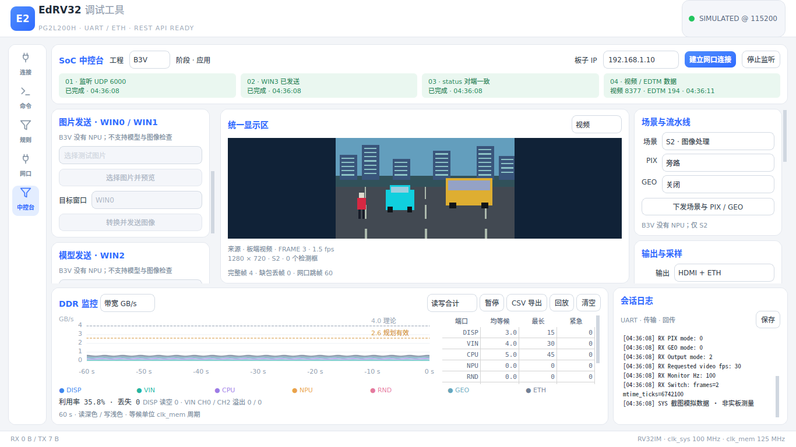
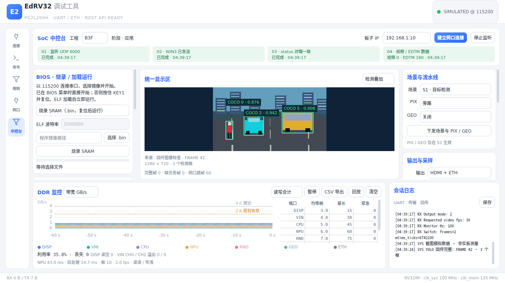

# EdRV32 调试工具 · SoC 中控台

PySide6 桌面工具，沿用浅色主题。启动后进入**中控台**：上方选择工程并查看板子阶段和
网口四步状态；左侧烧录 / 加载、图片与模型传输；中间切换视频、静态图片、检测叠加；
右侧控制场景、PIX、GEO、输出与采样并查看 `status`；底部查看 DDR 图表、端口等待和日志。
侧栏独立滚动，中间画布随窗口缩放；上下区域可拖动分隔条调整高度。


<!-- 截图命令：QT_QPA_PLATFORM=offscreen python tools/debug_tool/render_shot.py tools/debug_tool/soc-vision-1366x768.png --state vision --width 1366 --height 768；数据为 telemetry_sim 合成串口/UDP，不是实板测量。 -->

GUI、REST、CLI 共用一个 `SerialEngine.board` 板级会话：同一个串口、一个 UDP 接收端、
同一套工程 / 阶段 / 网口状态。没有自动重连、重传、重试或心跳；错误写入状态区和日志。
连接、命令、规则、通用串口控制台、数据面板和通用网口文件收发仍在原来的通用页面。
原烧录、DDR、场景、YOLO 页和独立视频页已并入中控台。

## 安装与启动

Windows 安装 `tools/requirements.txt` 中声明的 PySide6、pyserial，运行
`tools/debug_tool/启动调试工具.bat`，或：

```sh
python tools/debug_tool/main.py
python tools/debug_tool/main.py --connect COM7 --baud 115200
python tools/debug_tool/main.py --headless           # 只启动共享引擎和 REST
```

Linux 开发与截图使用 `build/` 中的虚拟环境，依赖版本以 `tools/requirements.txt` 为准：

```sh
python3 -m venv --system-site-packages build/debug-tool-venv
build/debug-tool-venv/bin/python -m pip install PySide6 pyserial
. build/debug-tool-venv/bin/activate
```

参考模型比对还需要 requirements 中已有的 NPU 依赖（torch、numpy、OpenCV 等），以及
`git submodule update --init third_party/ultralytics`。常规连接、视频、监控不需要执行参考模型。

## 工程能力

| 功能 | B3V | B3VN | B3R | B3F |
|---|---|---|---|---|
| SRAM `.bin` 烧录 / SRAM、DDR `.elf` 加载运行 | ✓ | ✓ | ✓ | ✓ |
| S2、PIX 五档、GEO 三档 | ✓ | ✓ | — | ✓ |
| S1、模型发送、YOLO 图像检查 / 参考比对 | — | ✓ | — | ✓ |
| 网口视频、DDR EDTM | ✓ | ✓ | — | ✓ |
| 对应程序 | `demo_vision` | `demo_vnpu` | 渲染器程序 | `demo` |

B3V 没有 NPU / RND，图像检查和模型控件灰显，原位置写明原因；S1 选项不可选。
B3R 只有渲染器，没有摄像头和网口，相关控件灰显并标明原因，烧录 / 加载仍可用。
B3VN 由 CPU 绘制 HDMI 检测框，B3F 由 RND 绘制；网口检测叠加都使用 EDDT。
工程选择用于界面能力说明，镜像由用户选择，不探测硬件、不添加镜像校验门禁。

## B3V：从上电到视频与 DDR

1. 连接板子串口和网线，给板子上电；将 PC 有线网卡设为同网段地址，例如
   `192.168.1.2/24`，板子固定 `192.168.1.10`。允许本机 UDP 6000 接收。
2. 在“连接”页选择串口、115200、8N1，连接后回到“中控台”，工程选 **B3V**。
3. 按住 KEY1 并复位，看到阶段 **BIOS**。左栏选择“烧录 SRAM”，选择
   `build/sw/demo_vision/demo_vision.bin`，点击烧录。已经在 BIOS 时可直接开始，
   无须再次复位；也可先开始，再按 KEY1 + 复位进入 BIOS。
4. 等待成功结果，松开 KEY1 并复位运行，串口出现 `Demo: demo_vision`，阶段变为**应用**。
5. 点击上方**建立网口连接**。工具依次监听 UDP 6000、从同一端口向板子 UDP 5000
   发 WIN3 短包、经串口发 `status`；前三格依次完成，第三格须有板端 peer 与本机一致的回应。
6. 右侧“输出与采样”选择 **HDMI + ETH**，视频 **30 fps**、采样 **100 Hz**，点击下发。
   场景保持 **S2**。中间选“视频”；第四格分别累计视频块包与 EDTM 包，画布显示完整帧、
   实际接收 fps，底部 DDR 显示带宽 / 利用率及端口等待。
7. 点击 **CSV 导出**保存原始 EDTM 记录。分别下发 HDMI、ETH、HDMI + ETH 检查输出：
   HDMI 时不发视频，DDR 仍可收到；ETH 时 HDMI 关闭；同时模式两端都输出。
   PIX / GEO 在右侧选择并下发；切换耗时 `Switch: frames=... mtime_ticks=...` 在日志和摘要中查看。

## B3VN：从上电到视频与 DDR

1. 连接串口、网线并上电，PC 有线网卡设 `192.168.1.2/24`，允许 UDP 6000。
2. 在“连接”页以 115200、8N1 打开串口；中控台工程选 **B3VN**。
3. 按 KEY1 + 复位进入 BIOS，选择 `build/sw/demo_vnpu/demo_vnpu.bin` 烧录 SRAM。
   看到成功结果后松开 KEY1 并复位，等待 `Demo: demo_vnpu` 和阶段“应用”。
4. 点击**建立网口连接**，核对监听、WIN3、peer 三格完成及各自时间。
5. 保持 **S2**，右侧选择 HDMI + ETH、30 fps、100 Hz 并下发；中间选“视频”，
   等待完整视频帧和 EDTM 计数，底部查看 DDR 曲线、端口等待、DISP / VIN 实时性计数。
6. 点击 CSV 导出保存数据。目标检测另在左侧选择本次 `compile_yolo.py` 输出目录并发送模型，
   日志出现 `EDNM: loaded` 后切到 **S1**。中间选“检测叠加”，摄像头视频按相同 frame_id
   叠加 EDDT 框；HDMI 检测框由 CPU 绘制。
7. 如需图像检查，选择原图，选 WIN0 或 WIN1 后转换发送。收齐 CH2 / OUTPUT / EDDT 后
   统一画布显示原图与框；参考比对入口在右侧向下滚动。检查后下发 S1 或 S2 恢复摄像头。

## B3F：从上电到视频与 DDR

1. 连接串口和网线，上电；PC 设 `192.168.1.2/24` 并允许 UDP 6000。
2. 在“连接”页以 115200、8N1 打开串口；中控台工程选 **B3F**。
3. 按 KEY1 + 复位进入 BIOS，选择 `build/sw/demo/demo.bin` 烧录；成功后松开 KEY1
   并复位运行，等待 `Demo: demo` 和阶段“应用”。
4. 点击**建立网口连接**，确认前三格完成，特别是串口 `ETH peer IP`、`ETH peer port`
   与本机实际路由地址 / 接收端口一致。
5. 保持 **S2**，下发 HDMI + ETH、30 fps、100 Hz。中间选“视频”，确认视频完整帧数和
   EDTM 包数都增加；切换底部带宽 / 利用率选项，检查端口等待，再导出 CSV。
6. 要看目标检测，发送本次编译模型，等待串口 `EDNM: loaded`，再下发 S1；中间选
   “检测叠加”。网口发送底图与对应 EDDT，由 PC 画框；HDMI 的 L1 框和标签由 RND 绘制。
7. 要做静态检查，左侧选择原图并发送 WIN0 / WIN1，等三块回传完整，再在右侧选择同次
   量化 JSON，运行参考比对。结果显示 CH2 / OUTPUT 差异字节数、首差异偏移和检测框差异；
   下发 S1 / S2 后画布恢复摄像头来源。模型与固件量化表的配套要求见
   [演示程序说明](../../sw/apps/demo/README.md)。

## 状态与数据的含义

- **阶段**由当前串口行判断：`BIOS menu:` → BIOS，`Demo:` / 渲染器启动行 → 应用；
  断开串口 → 未连接。刚连接、尚未收到启动行时仍等待阶段信息；已在运行时可复位以看到启动行。
- **四步网口**分别记录完成状态与最近时间。前三步完成后，若视频为 0、EDTM 增长，应检查
  输出是否包含 ETH；两者都为 0，则工具还未收到板端数据。没有 peer 回应时第三格保持未完成，
  不把“发送过 WIN3”当作板端确认；peer 不一致时状态和日志列出实际值与本机值。
- 第四格的视频 / EDTM 是 **UDP 包数**，不是完整帧数或 EDTM 记录数；画布下方另列完整帧、
  缺包丢帧、EDTM 中累计的 `vid_skip`。视频输出的实际 fps 由到达的完整帧计算，停流后归零。
- EDVF / EDDT 按 frame_id 对应；帧头在前、帧内像素包可乱序，跨帧不交错。缺包帧丢弃并计数。
  图片检查期间不发 EDVF，按主动发起的检查把 WIN0 / WIN1 / WIN2 分发给 YOLO；
  EDTM、视频、YOLO 和文件共用同一个接收端，不为不同显示模式重新绑定端口。
- DDR 的 60 s 图表保留读 / 写 / 合计、4.0 GB/s 理论与 2.6 GB/s 规划有效参考线、场景标记；
  下拉选择利用率 / 可选读延迟直方图。表中列平均等待、最长等待（clk_mem 周期）、紧急授权数，
  实时性计数非零标红；NPU 工程另列推理 / 后处理 ms、检测 fps 和框数。
  当前固件不启用延迟探针，没有探针命令；直方图无记录时明确等待 type 2。
- 暂停只暂停图表更新，CSV 仍保留所有原始字段；回放按钮停止监听并按记录时间回放 CSV。
- 烧录直接调用 `tools/board/uart_tool.py` 的 `BiosTransfer`。SRAM `.bin` 成功后复位运行；
  ELF 模式默认 2000000（可选 921600 / 115200），按 PT_LOAD 加载并跳转入口，DDR ELF 不以复位启动。
  BIOS FAIL、传输错误、参考模型失败在原位置显示原因并写日志。
- 图片缩放为 1280 × 720、小端 RGB565；EDNM 的 WIN2 偏移为头 `0`、描述符 `0x1000`、
  模型 `0x100000`，只在镜像最后一包置 NOTIFY。显示 `WIN2_BYTES` 期望值，板端结果见日志。
  图像检查回传按 OFFSET 保存到 `build/debug_tool/udp-rx/window0.bin`（983040 B CH2）、
  `window1.bin`（725760 B OUTPUT）、`window2.bin`（EDDT）。视频帧只驻留内存。

## 通用页面与 CLI

通用串口控制台保留文本 / HEX、时间戳、方向过滤、保存 / 清空、行尾选择、原始文件发送 / 取消。
“命令”页维护快捷按钮，“规则”页从正则捕获数值并在数据面板显示；“网口”页保留任意 WIN / OFFSET
的原始文件收发。中控台已经监听时，通用网口发送复用该 socket；停止监听会停止整个会话的 UDP 接收。
通用控制台截图见 [screenshot.png](screenshot.png)。

现有 CLI 名称保持不变，`status` 包含新增 `board` 状态：

```sh
python tools/debug_tool/cli.py ports
python tools/debug_tool/cli.py connect COM7 --baud 115200
python tools/debug_tool/cli.py status
python tools/debug_tool/cli.py program build/sw/demo_vision/demo_vision.bin
python tools/debug_tool/cli.py program build/sw/app/app.elf --elf --baud 2000000
python tools/debug_tool/cli.py scene s2
python tools/debug_tool/cli.py scene output_both
python tools/debug_tool/cli.py scene video_fps --rate 30
python tools/debug_tool/cli.py scene sample_rate --rate 100
python tools/debug_tool/cli.py send status
python tools/debug_tool/cli.py listen --port 6000 --mode video
python tools/debug_tool/cli.py telemetry latest
python tools/debug_tool/cli.py telemetry export build/debug_tool/capture.csv
python tools/debug_tool/cli.py yolo model build/npu/yolo --board-ip 192.168.1.10
python tools/debug_tool/cli.py yolo image image.png --window 0 --board-ip 192.168.1.10
python tools/debug_tool/cli.py tail -f
```

一键建立网口连接和工程选择也可经 REST 操作：

```sh
curl -X POST http://127.0.0.1:8765/api/board/project \
  -H 'Content-Type: application/json' -d '{"project":"B3V"}'
curl -X POST http://127.0.0.1:8765/api/board/network \
  -H 'Content-Type: application/json' -d '{"boardIp":"192.168.1.10"}'
```

## REST API

默认 `http://127.0.0.1:8765`，GUI 和 headless 均可用。路径和文件由工具所在主机解析。

| 方法 | 路径 | 输入 / 输出 |
|---|---|---|
| GET | `/api/status` | 原连接 / 配置 / RX、TX / lastSeq，增加 `board` |
| GET | `/api/board` | project、capabilities、phase、network 四步 done/time、counts、dataTimes、expectedPeer、peer、summary、error |
| POST | `/api/board/project` | `{project}`，B3V / B3VN / B3R / B3F |
| POST | `/api/board/network` | `{boardIp?, boardPort?}`，默认 192.168.1.10:5000；监听 6000 → WIN3 → status |
| GET | `/api/ports` | 枚举串口 |
| POST | `/api/connect`、`/api/disconnect` | `{port, baud, dataBits?, parity?, stopBits?, dtr?, rts?}` / `{}` |
| POST | `/api/send` | `{text, ending?, hex?}` |
| POST | `/api/options`、`/api/modem` | `{encoding}` / `{dtr?, rts?}` |
| GET | `/api/buffer`、`/api/buffer/download` | since / limit / dir 增量日志，或下载全部 |
| POST | `/api/clear`、`/api/save` | `{}` / `{path?}` |
| GET / POST | `/api/commands`、`/api/rules` | 列表 / 创建；原 PUT、DELETE `/{id}` 和命令 `/{id}/send` 保留 |
| POST | `/api/commands/replace` | `{commands}` |
| GET / POST | `/api/params`、`/api/params/clear` | 参数 / 清空 |
| POST / GET | `/api/file/send`、`/api/file/status` | `{path, echo?}` / 原始串口文件状态 |
| POST | `/api/file/cancel` | `{}` |
| POST / GET | `/api/program`、`/api/program/status` | `{path, elf?, baud?}` / BIOS 阶段与进度 |
| GET | `/api/ethernet/status` | 共享 UDP tx / rx 状态 |
| POST | `/api/ethernet/send` | `{path, boardIp, boardPort, localPort, window?, offset?, interval?}` |
| POST | `/api/ethernet/receive/start`、`/api/ethernet/receive/stop` | `{localPort, directory?, mode?}` / `{}` |
| GET | `/api/telemetry`、`/api/telemetry/csv` | 最新值 / 下载全部原始记录 CSV |
| POST | `/api/telemetry/export`、`/api/telemetry/replay`、`/api/telemetry/clear` | `{path}` / `{path}` / `{}` |
| GET / POST | `/api/scenes`、`/api/scenes/send` | 映射 / `{name, rate?}` |
| POST | `/api/yolo/model`、`/api/yolo/image` | `{path, boardIp, boardPort, localPort, window?}` |

接收 mode 保留 `files`（通用原始文件）、`video`、`yolo`，新增 `console` 统一分发。
`/api/board/network` 复用已监听 6000 的 socket 并切到统一分发；若通用页监听了其他端口，
先停止它再绑定 6000。首次使用直接绑定 6000。

## 测试与截图复现

在已安装 PySide6、pyserial 和 NPU 测试依赖的环境内，串行运行：

```sh
git rev-parse HEAD
python3 -m unittest discover -s tools/debug_tool/tests -v
python3 -m unittest discover -s tools/board/tests -v
python3 -m compileall -q tools/debug_tool
git diff --check
for size in 1366x768 1920x1080; do
  for state in disconnected vision detection; do
    QT_QPA_PLATFORM=offscreen python3 tools/debug_tool/render_shot.py \
      tools/debug_tool/soc-$state-$size.png --state "$state" \
      --width "${size%x*}" --height "${size#*x}"
  done
done
```

截图的串口启动行明确由 `render_shot.py` 合成，网络数据由现有 `telemetry_sim.py` 编码器、
视频 / YOLO 发送函数通过真实 UDP 6000 回环接收；日志标明“截图模拟数据 · 非实板测量”。
截图助手核对输出尺寸，并要求运行态收到完整 EDVF / YOLO 和 EDTM 后才保存。

| 状态 | 1366 × 768 | 1920 × 1080 |
|---|---|---|
| 未连接 | [截图](soc-disconnected-1366x768.png) | [截图](soc-disconnected-1920x1080.png) |
| B3V 视频 + DDR | [截图](soc-vision-1366x768.png) | [截图](soc-vision-1920x1080.png) |
| B3F 图像检查叠加 | [截图](soc-detection-1366x768.png) | [截图](soc-detection-1920x1080.png) |


<!-- 截图命令同上，--state detection；原图为 telemetry_sim.demo_pixels 的确定性 RGB565 图案。 -->

2026-10-30 本提交的回归：调试工具 **65 项通过**、板级工具 **7 项通过**，无跳过；
Python 3.12、PySide6 6.12.0、pyserial 3.5，虚拟环境位于 `build/debug-tool-venv/`，
复用已有 `edrv32-py` 的 NPU 依赖，退出码均为 0；compileall 与 diff 检查通过。

新增回归覆盖：一次绑定 6000 同时服务视频 / EDTM / YOLO / 文件、阶段判断、四步顺序与时间、
peer 比较、四工程能力表、错误日志、REST 新状态，以及两种尺寸下布局 / 灰显原因。
Python / Qt 改动不涉及 RTL，`tools/check/verilog_style.py` 和 Verilator lint 不适用。
真实板端的视频、DDR 数据和三种输出切换仍需按上述上电步骤验收；合成截图不代表上板通过。
