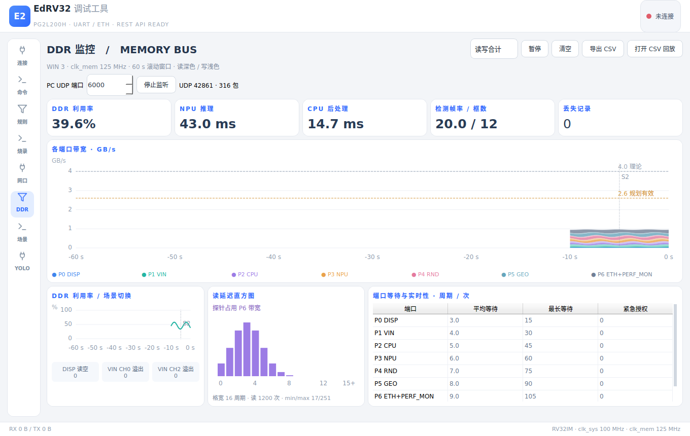
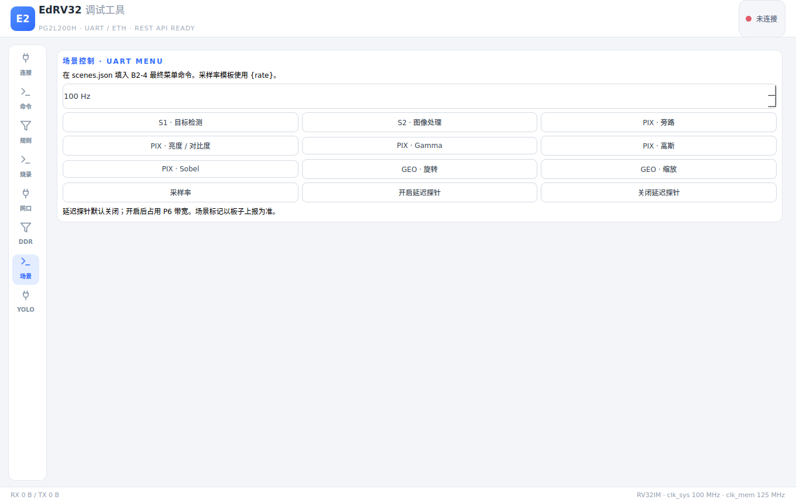
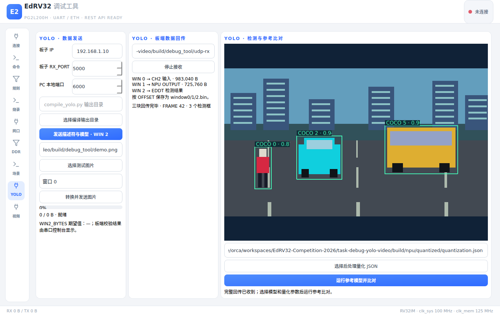
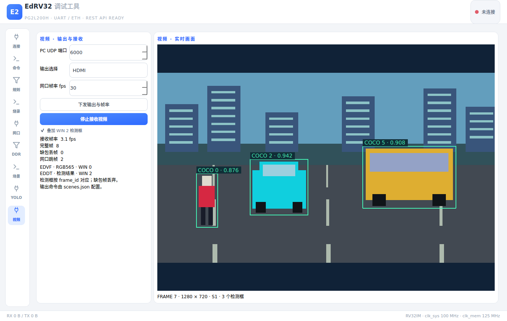

# EdRV32 调试工具

跨平台桌面串口工具（PySide6 / Qt），浅色主题。布局参考 VOFA+：
**左栏图标页签（连接 / 命令 / 规则 / 烧录 / 网口 / DDR / 场景 / YOLO）+ 中间控制台 + 右侧数据面板**，
三栏之间都是可拖拽的分隔条。GUI、终端 CLI、AI 代理三条通道操作
**同一个串口会话**——界面上看到的一切，都能通过 REST API 观察和操控。


## 快速开始

```bash
pip install PySide6 pyserial
# 或从仓库 tools/requirements.txt 安装声明的依赖

# 桌面 GUI（同时内嵌 REST API，默认 127.0.0.1:8765）
python tools/debug_tool/main.py

# 无界面模式（纯引擎 + REST API，适合脚本/CI/AI 独占使用）
python tools/debug_tool/main.py --headless

# 启动即连接
python tools/debug_tool/main.py --connect COM7 --baud 115200
```

## 界面功能

**LINK CONSOLE（中栏）**
- 经典打印流 `[HH:mm:ss.fff][RX/TX/SYS] 内容`，RX 绿 / TX 蓝 / SYS 琥珀。
- 工具栏：**文本 / HEX 显示切换**（重渲染保留的历史行）、**时间戳开关**、
  **RX / TX / SYS 方向过滤**、保存、清空。
- 发送区：可选行尾 `＋\r ＋\n ＋\r\n 无`，**HEX 发送模式**（如 `01 03 FF`），
  Enter 快捷发送。
- **文件发送**：发送区「文 件」按钮选择文件后按原始字节分块（4KB）发送，
  控制台下方出现进度条并可中途取消；「回显」开关决定是否把文件内容
  也打印到控制台（每 4KB 一条 TX 条目，含 hex，可配合 HEX 显示查看）；
  开始/完成/取消记 sys 行。
- 性能：RX 线程 O(1) 入队 + GUI 50ms 分批渲染（单批 ≤400 行）+ 纯文本控件，
  8000 行洪峰实测不卡（`stress_test.py`）。界面保留 1500 行，引擎缓冲 5000 行。

**连接（左栏 · 连）**
- 串口枚举刷新、波特率（可自定义，如 5000000）、数据位/校验/停止位、
  **编码格式 UTF-8 / GBK / ASCII**（作用于 RX 解码与 TX 编码，即时生效）、
  **DTR / RTS 流控开关**；配置记忆到 `settings.json`。

**命令（左栏 · 令）**
- 点击即发送的快捷按钮，右键编辑/删除，「＋ 新建命令」，超出可滚动；
  头部「导入 / 导出」整体替换式加载 / 保存 JSON 配置；持久化 `commands.json`。

**规则（左栏 · 则）—— 数据匹配引擎**
- 每条规则 = 名称 + 正则 + 捕获组配置；RX 行命中即从捕获组提取数值，
  在右侧数据面板生成/更新一个参数（类似 VOFA 的数据通道）。
- 字段：`keyGroup`（0=单参数；>0 时以该捕获组为键展开多参数）、
  `valueGroup`、`base`（10/16 进制）、`scale`（缩放）、`unit`（单位）、
  `enabled`（勾选框即时启停）。
- 例：规则 `TEMP=(\d+)` + scale 0.1 + 单位 ℃ → 收到 `TEMP=235` 时
  数据面板显示「温度 23.5℃」；规则 `ch(\d+):0x([0-9a-fA-F]+)` +
  keyGroup=1 + base 16 → 自动展开成 CH 1 / CH 2 / … 多个参数。
- 数据面板每行显示：参数名、最新值（含单位）、raw 原值、更新次数、时间。

## 终端 / AI 控制

CLI 走 HTTP API，GUI 开着时也能用（看到同一会话）：

```bash
python tools/debug_tool/cli.py ports
python tools/debug_tool/cli.py status
python tools/debug_tool/cli.py connect COM7 --baud 115200
python tools/debug_tool/cli.py send "6"                  # 默认行尾 \r
python tools/debug_tool/cli.py send "01 03 FF" --hex     # HEX 发送
python tools/debug_tool/cli.py sendfile firmware.bin     # 发送文件（带进度）
python tools/debug_tool/cli.py sendfile firmware.bin --echo  # 同时回显到控制台
python tools/debug_tool/cli.py sendfile --cancel         # 取消传输
python tools/debug_tool/cli.py tail -f                   # 持续观察缓冲区
python tools/debug_tool/cli.py tail --dir rx
python tools/debug_tool/cli.py save / clear
python tools/debug_tool/cli.py config --encoding gbk     # 切编码
python tools/debug_tool/cli.py modem --dtr on            # DTR/RTS
python tools/debug_tool/cli.py cmd list / add / run / del / export / import
python tools/debug_tool/cli.py rules list
python tools/debug_tool/cli.py rules add TEMP 'TEMP=(\d+)' --scale 0.1 --unit C
python tools/debug_tool/cli.py rules set temp --off      # 停用/启用
python tools/debug_tool/cli.py rules del temp
python tools/debug_tool/cli.py params                    # 当前参数快照
python tools/debug_tool/cli.py params --clear
```

### REST API（默认 `http://127.0.0.1:8765`）

| 方法 | 路径 | 说明 |
| --- | --- | --- |
| GET | `/api/ports` | 枚举串口 |
| GET | `/api/status` | 连接状态、编码、DTR/RTS、字节计数、lastSeq |
| POST | `/api/connect` | `{port, baud, dataBits, parity, stopBits, dtr, rts}` |
| POST | `/api/disconnect` | 断开 |
| POST | `/api/send` | `{text, ending, hex}` |
| POST | `/api/file/send` | `{path, echo?}` 后台分块发送文件 |
| GET | `/api/file/status` | 传输进度（active/sent/total/error…） |
| POST | `/api/file/cancel` | 取消传输 |
| POST | `/api/options` | `{encoding: utf-8\|gbk\|ascii}` |
| POST | `/api/modem` | `{dtr?, rts?}` 连接中实时切换流控 |
| GET | `/api/buffer?since=N&limit=M&dir=rx\|tx\|sys` | 增量读取（条目含 hex 字段） |
| GET | `/api/buffer/download` | 下载整个缓冲区为 .log |
| POST | `/api/clear` / `/api/save` | 清空 / 保存日志 |
| GET/POST | `/api/commands` | 列出 / 新建命令 |
| PUT/DELETE | `/api/commands/{id}` | 更新 / 删除命令 |
| POST | `/api/commands/{id}/send` | 发送已存命令 |
| POST | `/api/commands/replace` | `{commands:[...]}` 整体替换 |
| GET/POST | `/api/rules` | 列出 / 新建匹配规则 |
| PUT/DELETE | `/api/rules/{id}` | 更新（支持部分字段）/ 删除 |
| GET | `/api/params` | 当前捕获的参数及最新值 |
| POST | `/api/params/clear` | 清空参数面板 |

缓冲区条目：`{seq, ts, dir, text, hex?}`，`seq` 全局单调递增——
AI 记住上次 `lastSeq` 后用 `?since=<lastSeq>` 轮询即可增量观测。

## 架构

```
tools/debug_tool/
├── main.py            # 入口：--gui(默认) / --headless / --connect / --api-port
├── core/
│   ├── engine.py      # SerialEngine：串口收发线程、seq 缓冲区、规则匹配、
│   │                  #   参数存储、命令/日志/配置持久化
│   ├── api.py         # 嵌入式 REST API（stdlib http.server，守护线程）
│   ├── program.py     # BIOS 提示识别、wire_bytes() 下载、进度与结果
│   └── ethernet.py    # UDP 应用头、文件分包、按窗口/偏移还原
├── gui/
│   ├── app.py         # PySide6 主窗口（浅色 QSS，VOFA 式三栏）
│   ├── program.py     # 烧录页
│   └── ethernet.py    # 网口页
├── cli.py             # 终端客户端（urllib 直连 REST API）
├── render_shot.py     # 开发辅助：渲染界面到 PNG
├── stress_test.py     # 压测：8000 行洪峰下事件循环响应率
├── commands.json      # 命令按钮（首次保存时生成）
├── rules.json         # 匹配规则（首次保存时生成）
├── settings.json      # 运行时生成的上次串口配置（不入库）
└── logs/              # 一键保存的日志
```

要点：引擎不依赖 GUI；API 与 GUI 注入同一个 `SerialEngine` 实例。
`connect()` 支持 pyserial URL（`loop://` 自环、`socket://` 等），无硬件可测。

## 后续打包 exe（release 时）

```bash
pip install pyinstaller
pyinstaller --noconfirm --windowed --name EdRV32DebugTool \
  tools/debug_tool/main.py
```

发布前把 `commands.json` / `rules.json` / `settings.json` 的存储路径从
工具目录切到 `%APPDATA%`（避免安装目录只读问题）。

## 与 1.0（PowerShell 版）的关系

`tools/serial-console/` 下的 1.0 仍保留可用（HPM 面板、CoreMark 解析）。
2.0 的规则引擎是通用的，不内置任何厂商协议；针对 HPM 遥测，用
`rules add` 配置相应正则即可（例如 `^HPM\s+cpi_x1000\s*=\s*(\d+)` +
scale 0.001 得到 CPI）。

## BIOS 烧录 SRAM

在“连接”页打开串口（115200、8N1），切到“烧录”页，选择
`build/sw/<程序>/<程序>.bin` 并点击“烧录 SRAM”。
已在 BIOS 菜单时直接开始；否则按住 KEY1 并复位。
每次开始先发送一次 CR，BIOS 对空行打印 `Input error: type 1-4 then Enter` 并重印菜单；
工具收到 `BIOS menu: 1=Program SRAM 2=Load 3=Run 4=Baud` 后发送 `1` + CR，收到
`UART download ready` 后用 `tools/board/uart_tool.py:wire_bytes()` 发送
4 字节小端长度和镜像。进度包含 4 字节长度头，结果显示 BIOS 原始
`Program SRAM result` 与 `Program SRAM bytes`；串口输出仍显示在中栏。
出现 PASS 后松开 KEY1，按复位运行；BIOS 不自动执行程序。

```bash
python tools/debug_tool/cli.py program build/sw/monitor/monitor.bin
```

CLI 启动传输后等待结果，失败退出码为 1；文件路径由运行工具的主机读取。
REST：`POST /api/program {"path":"绝对路径.bin"}` 启动，
`GET /api/program/status` 观察 `active/phase/sent/total/programmedBytes/result/error`。
同一次 BIOS 会话中可再次烧录，每次都发送一次 CR 等待新菜单，不依赖历史菜单行；
等待提示或结果时不会自动超时、重试。

## 网口文件收发

“网口”页配置板子 IP、板子 `RX_PORT`、PC 本地 UDP 端口；界面初值
192.168.1.10 / 5000 / 6000 仅供填写，必须与板上软件和 PC 配置一致。
板上软件需配置 ETH 和接收窗口（`WINn_SIZE` 必须覆盖文件偏移与长度），
板子发送时的 `TX_DST_IP/TX_DST_PORT` 指向 PC 地址和本地端口。

- **发送**：选择文件、窗口 0–3、起始偏移（十进制或 `0x`）、包间隔（GUI 为 ms），
  点击“发送文件”。每包最多 1024 字节数据，头为网络字节序 `WIN, FLAGS, 00, 00,
  OFFSET[31:24], OFFSET[23:16], OFFSET[15:8], OFFSET[7:0]`。
  仅最后一包 FLAGS.bit0 为 NOTIFY，空文件发送一个只有头的通知包。
- **接收**：选择保存目录，点击“开始监听”，板子带应用头的数据按窗口分别写入
  `window0.bin` … `window3.bin`，文件位置为头中的原始 OFFSET；未收到的偏移保留为空洞。
  同一窗口本次监听首次收包时覆盖旧文件；收到乱序包或重复偏移时按收到的顺序写入。
  默认目录是仓库的 `build/debug_tool/udp-rx/`。界面显示包数、数据字节数、
  NOTIFY 次数与最后一包的窗口、偏移和 NOTIFY。NOTIFY 不停止监听，点击“停止监听”结束。
- 先监听再发送可同时收发，发送复用监听端口；仅发送时也绑定所填的 PC 本地端口。
  不提供重传、数据校验或应答协议；核对字节数等由板上应用和软件测试负责。

网口同样可通过 REST 使用（`main.py --headless` 可用）：

| 方法 | 路径 | 内容 |
| --- | --- | --- |
| POST | `/api/ethernet/send` | `{path, boardIp, boardPort, localPort, window?, offset?, interval?}` |
| POST | `/api/ethernet/receive/start` | `{localPort, directory?}` |
| POST | `/api/ethernet/receive/stop` | `{}` |
| GET | `/api/ethernet/status` | `{tx, rx}` 进度、统计与明确错误 |

REST 的 `interval` 单位是秒，默认为 0；`window/offset` 默认为 0。
监听期间发送时 `localPort` 使用监听的本地端口，修改端口需停止监听再启动。
路径均在运行调试工具的主机上解析；收到的数据不会剥除起始偏移。

## 来源与验证

串口工具取自 `origin/win/20261028-06-board-b1` 的提交
`a7b8cf2f87ef2af1ffe55789ccff7a56b1865d84`，导入该提交下完整的
`tools/serial-console-2/`（README、main/cli、core/、gui/、rules、settings、
screenshot、render_shot、stress_test 和启动 bat），再改名为 `tools/debug_tool/`。
窗口标题、应用名、CLI 说明、README 路径和 bat 名称/说明改为调试工具；
`screenshot.png`、`render_shot.py`、`stress_test.py` 均保留。
`settings.json` 是原工具运行时保存的个人串口配置（源文件为 COM7），已移除并忽略；
首次保存连接参数时生成。`commands.json` 与 `logs/` 同样是本机运行数据，不入库。

Linux 验证（2026-10-28）：

```bash
python3 -m unittest discover tools/debug_tool/tests
python3 -m compileall -q tools/debug_tool
git diff --check
```

14 个 unittest 全部通过：内存假串口经真实读线程识别分段 BIOS 提示，下载字节与
`wire_bytes()` 完全相同，解析 PASS / FAIL length 和字节数；CLI 与 REST 烧录成功/
失败返回值；UDP 头逐字节核对、长度边界、4 个窗口、参考模型收发交叉核对、
127.0.0.1 文件还原、非零偏移、乱序收包、NOTIFY 及监听端口复用。
另从 `/tmp` 启动真实 `main.py --headless`，REST status 正常响应，SIGINT 正常退出。
本机 Python 与项目 Python 环境均没有 PySide6，因此未执行 GUI offscreen 启动。
安装 PySide6 后可用保留的辅助脚本启动 GUI 并自动退出（输出置于 build）：

```bash
mkdir -p build/debug_tool
QT_QPA_PLATFORM=offscreen python3 tools/debug_tool/render_shot.py build/debug_tool/gui.png
```

Windows 需实际确认：

1. 安装 PySide6/pyserial，双击 `启动调试工具.bat`，确认九个页签、串口连接、
   原有发送/HEX/文件/命令/规则功能和 CLI / REST 共同操作会话。
2. 选择 make 生成的 .bin 开始烧录，按住 KEY1 按复位，确认 BIOS 菜单自动选 1、
   进度、`Program SRAM bytes` 和 PASS；松开 KEY1 后按复位，确认新程序运行。
3. 板上 ETH 软件配置 IP、端口和接收窗口后发送文件；再让板子向 PC 本地端口
   发回带应用头的 UDP 数据，确认各窗口文件、偏移、包数、字节数和 NOTIFY。
   Linux 回环不代替真实 Windows 串口或 PHY 上板验证。

## DDR 监控、场景控制与 YOLO（B2）

新增左栏 **DDR / 场景 / YOLO / 视频** 页签，打开后使用整个工作区。
GUI、CLI、REST 共用 `SerialEngine.telemetry / ethernet / yolo / scenes`；
全部网络接收页共用一个 UDP 监听端口。已有监听时发送复用该端口。
YOLO 与视频页在启动接收时分别选择 WIN 0 的 CH2 / EDVF 用途，切换用途先停止监听。
图表使用 PySide6 的 QPainter，不引入其他依赖。



### 监控与 CSV

1. 在 DDR 页设置 PC UDP 端口（默认 6000），点击「开始监听」，板端发送目的地指向 PC。
2. 接收带 ETH 应用头的 WIN 3 数据，每条 EDTM v1 记录为 320 B，小端。
   记录跨 1024 B UDP 数据分包时按 OFFSET 重组，缺失片段不与后续字节拼接。
   `seq` 为 type 1/2 共用的 u32 序号，按模 2³² 计算丢失记录数（包括回绕）。
3. 读、写按端口分别堆叠（深色读、浅色写），可切换只读/只写/合计，滚动显示最近 60 s；
   虚线为 DDR 理论 4.0 GB/s、规划有效 2.6 GB/s。利用率和场景变化同步绘制。
   等待表单位为 clk_mem 周期；DISP 读空、VIN CH0/CH2 溢出、紧急授权非零标红。
4. 「暂停」冻结画面，UDP 接收及 CSV 记录继续；「继续」回到最新数据。
   「清空」清除当前采集记录、曲线和统计；「导出 CSV」保存本次全部记录，保留原始字段。
   「打开 CSV 回放」停止 UDP 监听，从文件第一条起按 mtime 实时回放，可暂停/继续。
   CLI/REST 的 replay 导入整个 CSV 后立即提供最后一条及最近 60 s 数据。
5. magic/version 不匹配时计数并明确报错，监听停止；错误原因显示在页面和 REST 状态中。
   网络错误同样在接收/发送状态中明确显示，不自动重传。

换算依据 `docs/design/2026-10-29-b2-software.md` 3.5：

- 字节带宽 = `beat × 32 × 125e6 / window_cyc`，图中除以 10⁹ 得 GB/s。
- DDR 利用率 = `ds_busy / window_cyc`；平均等待 = `wait_sum / (rd_txn + wr_txn)`。
  无事务的平均等待显示为 0。
- mtime 和后处理周期按记录的 `clk_sys_hz` 换算，推理周期按 `clk_npu_hz` 换算。
- REST 的 `detection_fps` 是本窗口推理完成次数 / 窗口时长；GUI 对最近 1 s 的窗口求和，
  避免 10 ms 采样下完成事件呈现 0/100 fps 的跳动。
- 硬件 MEM_XBAR SNAPSHOT|CLEAR 结果已经是窗口值，PC 不重复做差分。
  VIN/软件累计计数由发送端转换为 u32 回绕后的增量；`counter_delta()` 给出同一换算。
- type 2 包含格宽、读次数、min/max/sum、16 格延迟直方图；格 k 范围为
  `[k × hist_width, (k+1) × hist_width)` clk_mem 周期，最后一格包含 ≥15 倍格宽。
  页面标明「探针占用 P6 带宽」。

无板演示（先打开 GUI 并监听，或使用 headless + CLI 启动监听）：

```bash
python3 tools/debug_tool/telemetry_sim.py --port 6000 --seconds 10
# 默认 100 Hz；--hz 10..1000。每 16 条发一批，每秒加入 type 2，5 秒切换场景。

python3 tools/debug_tool/main.py --headless
# 另一个终端
python3 tools/debug_tool/cli.py listen --port 6000
python3 tools/debug_tool/telemetry_sim.py --seconds 10
python3 tools/debug_tool/cli.py telemetry latest
python3 tools/debug_tool/cli.py telemetry export build/debug_tool/capture.csv
python3 tools/debug_tool/cli.py telemetry replay build/debug_tool/capture.csv
```

### 场景控制



`scenes.json` 是演示程序菜单命令映射，包含 S1/S2、PIX/GEO、采样率、探针开关。
B2-4 菜单尚未定稿，`command` 明确留为 `null`；点击时报告需配置的命令名，
不会发送猜测的字符。B2-4 定稿后填实际串口命令及 `ending`，不需修改程序；
采样率命令可以写成 `"实际前缀 {rate}"`，界面和 core 均限制为 10–1000 Hz。
场景标记以板端记录中的 scene 变化为准。

```bash
python3 tools/debug_tool/cli.py scene s1
python3 tools/debug_tool/cli.py scene sample_rate --rate 100
```

### YOLO 检测与参考比对



选择 `compile_yolo.py` 输出目录，读取 `regs.txt`、`mem_desc.hex`、`mem_model.hex`。
hex 每行按编译器的 256 位 readmemh 顺序还原为 DDR 字节，按 3.5a 发三个稀疏块：

| WIN 2 偏移 | 内容 |
| --- | --- |
| 0 | 32 B EDNM 头：magic、version=1、DESC_COUNT、desc_bytes、model_bytes、WORK/INPUT/OUTPUT_BASE |
| 0x1000 | 描述符 |
| 0x100000 | 模型 |

每包数据 ≤1024 B，只有整个镜像最后一包置 NOTIFY；不发送偏移间的填充字节。
页面显示 `WIN2_BYTES` 期望值 `32 + desc_bytes + model_bytes`，板端实际校验结果由串口
控制台显示（待 B2-4 固定输出文本后可对接匹配规则）。

图片由 Qt 解码并平滑缩放为 1280×720，RGB888 量化为 RGB565，逐像素小端写入，
一对像素的左像素位于低 16 位。例如红、绿为 `00 f8 e0 07`。图片可发送到 WIN 0 或 1。

点击「开始接收」，按应用头 OFFSET 落盘：WIN 0 → `window0.bin`（CH2，983040 B），
WIN 1 → `window1.bin`（NPU OUTPUT，725760 B），WIN 2 → `window2.bin`（EDDT 检测结果）。
板端按 WIN 0、1、2 的顺序返回，WIN 2 末包 NOTIFY 表示三块发送完毕。
收齐三块后解析 EDDT，在缩放为 1280×720 的原图上画框，显示 COCO 类别编号及千分比分数。
回传缺包时明确报告缺失窗口并停止监听；不以文件空洞中的零代替缺失数据。

选择本次模型的编译输出目录、原图与 `quantize.py` 的 `quantization.json`，点击
「运行参考模型并比对」。量化 JSON 默认位置为 `build/npu/quantized/quantization.json`。
后台线程执行以下三项，完成后在页面显示结果：

- 把**板端回传的 CH2** 写入 `npu_ref.py` 的 INPUT_BASE，执行编译描述符，读出
  725760 B OUTPUT，与板端 OUTPUT 逐字节比较，显示差异字节数及首个差异的十进制/十六进制偏移。
- 对所选原图调用 `input_pack.py`，与 CH2 逐字节比较，显示差异字节数。
- 调用 `yolo_post_ref.run(reference_output, quant_params)`，其中 `quant_params` 是量化
  JSON 经 `json.loads` 得到的 dict；返回的坐标、class、score 单位均与 EDDT 相同，按输出顺序
  逐项相等比较，显示差异框数、参考框数和板端框数。坐标为 1280×720 整数，分数为 0–1000 整数。

NPU 参考使用仓库已有 `tools/requirements.txt` 中的 torch/numpy/OpenCV 等依赖，
并需要 `git submodule update --init third_party/ultralytics`；本任务没有新增第三方库。
B2-4a 的 `tools/npu/yolo_post_ref.py` 已接入确认的调用契约；回归同时保留 mock 参数检查，
并实际执行 npu_ref、input_pack、yolo_post_ref 的完整比对。缺少模块或模型文件时页面明确报错，
不替换为其他算法。

```bash
python3 tools/debug_tool/cli.py yolo model build/npu/yolo --board-ip 192.168.1.10
python3 tools/debug_tool/cli.py yolo image image.png --window 0 --board-ip 192.168.1.10
```

新增 REST 接口（路径均由运行工具的主机解析）：

| 方法 | 路径 | 输入 / 输出 |
| --- | --- | --- |
| GET | `/api/telemetry` | latest（含 ports 带宽/等待）、histogram、lost、errors、error、records |
| GET | `/api/telemetry/csv` | 下载当前全部原始记录 CSV |
| POST | `/api/telemetry/export` | `{path}` 保存 CSV |
| POST | `/api/telemetry/replay` | `{path}` 导入 CSV 并提供最后一条 |
| POST | `/api/telemetry/clear` | `{}` 清空 |
| GET | `/api/scenes` | 命令映射 |
| POST | `/api/scenes/send` | `{name, rate?}` 经同一串口发送 |
| POST | `/api/yolo/model` | `{path, boardIp, boardPort, localPort}` |
| POST | `/api/yolo/image` | `{path, boardIp, boardPort, localPort, window?}` |

发送状态和错误使用已有 `GET /api/ethernet/status`，不另外创建会话。

### B2 验证与截图复现

```bash
python3 -m unittest discover tools/debug_tool/tests
python3 -m compileall -q tools/debug_tool
git diff --check
QT_QPA_PLATFORM=offscreen python3 tools/debug_tool/render_shot.py \
  tools/debug_tool/ddr-monitor.png --page ddr --simulate-seconds 10
QT_QPA_PLATFORM=offscreen python3 tools/debug_tool/render_shot.py \
  tools/debug_tool/scenes.png --page scene
QT_QPA_PLATFORM=offscreen python3 tools/debug_tool/render_shot.py \
  tools/debug_tool/yolo.png --page yolo
```

实现提交：核心 `eb045a6`、GUI `e4080ce`、测试与模拟器 `da918e9`。

2026-10-29：系统 Python 回归 33 项（32 通过，1 项因未安装 PySide6 跳过）；
在 `build/debug-tool-venv/` 安装现有声明的 PySide6 6.12.0 / pyserial 3.5 后，
33 项全部通过，无跳过。新增 **19 项**：

- `test_telemetry.py` 10 项：手工 type 1/2 偏移字节串、带宽/利用率/等待/时钟、
  零 beat/事务、u32 回绕/丢失、协议错误计数、两类 CSV 往返、60 s 历史、
  UDP 批次分片/丢包、坏 magic 停止并上报。
- `test_yolo.py` 5 项：RGB565 左像素小端、真实编译器 hex 格式和 EDNM 头、
  稀疏镜像 UDP 发送/仅末包 NOTIFY/字节总数、场景映射和采样率、Qt 图片缩放。
- `test_telemetry_api.py` 4 项：REST 最新值/导出/导入/CSV 下载、CLI 同会话、
  REST 镜像发送及回传偏移、真实 `main.py --headless` 子进程接收 UDP 后 REST 最新值。

DDR 截图由独立 `telemetry_sim.py` 向实际 UDP 监听器推送 10 s 数据生成；
场景/YOLO 页也经 offscreen 启动并正常关闭。脚本在事件循环中销毁截图窗口，
避免将带有演示数据和信号连接的 Qt 对象留到解释器退出时清理。
本次均为 Python 改动，仓库 `tools/check/` 的 Verilog 风格检查和 Verilator lint 不适用。

Windows 上仍需随 B2-4 联调确认：填入菜单命令后验证 S1/S2、PIX/GEO、10/100/1000 Hz、
探针开关；接收真实板端遥测，确认 scene、错误计数和直方图；加载编译输出，核对板端
WIN2_BYTES 结果；发送图片并收齐三份原始回传。后处理 Python 接口已用实际模块联调。


### 视频接收与输出控制（B2-5b）



视频页使用共享 UDP 监听器，以 WIN 0 接收 EDVF v1 的 32 B 小端帧头与 RGB565 像素，
Qt 直接显示 RGB565。每帧按头中的 frame_id 关联 WIN 2 EDDT 检测结果；勾选项控制叠加，
后一帧的检测结果提前到达时，当前显示帧继续使用自己的框。

接收约定由协调者确认：**帧头在前，帧内像素包允许乱序，帧与帧之间不交错**。
ETH 应用 OFFSET 不带 frame_id，不能支持任意跨帧交错。只有像素字节完整覆盖该帧时才显示；
缺包帧在下一帧头到达或停止监听时丢弃并计数，帧头丢失的像素批次按末包 NOTIFY 计数丢弃。
没有重传、重试或像素校验和。视频像素与检测块只保存在内存，不持续写入原始文件。

页面同时显示完整帧数、接收帧率、缺包丢帧数及网口跳帧累计值。帧率按最近约 1 s 内完整帧的
接收时间间隔计算，停流 1 s 后归零，并保留计算 1 fps 所需的前一个时间戳。
网口跳帧来自 EDTM type 1 的 `vid_skip`（偏移 292，u32，本窗口增量），对收到的有效记录累计；
与摄像头 frame_id 的间隔分开统计，避免将配置降帧误算为跳帧。清空 DDR 监控记录也会清空此累计值。
CSV 和 REST `/api/telemetry` 保留 `vid_skip`，REST `video_skipped` 为累计值。

输出选择为 HDMI / 网口 / 同时，网口帧率范围 1–60 fps，点击「下发输出与帧率」通过
同一 UART 场景通道发送 `output_hdmi` / `output_eth` / `output_both` 和 `video_fps`。
`scenes.json` 中这四项的 command 按协调者确认暂为 null，待 B2-4 菜单确定后填入；
`video_fps` 的模板使用 `{rate}`。未配置时明确报错，不发送猜测的菜单命令。

共享接收 REST `POST /api/ethernet/receive/start` 新增 `mode` 参数：
`files`（默认，保持原文件收发）、`yolo`（三块回传）或 `video`（EDVF/EDDT）。
终端使用 `cli.py listen --mode video` 或 `--mode yolo`，场景通道仍为
`cli.py scene video_fps --rate 30` 等已有命令。

模拟器保留原遥测默认模式，新增视频和 YOLO 模式：

```bash
# 在视频页开始接收后，发送 720p RGB565、对应的三框 EDDT 与含 vid_skip 的遥测。
python3 tools/debug_tool/telemetry_sim.py --mode video --port 6000 --seconds 10 --fps 3

# 在 YOLO 页开始接收后，发送零填充 CH2/OUTPUT 与三框 EDDT，供界面和传输自测。
python3 tools/debug_tool/telemetry_sim.py --mode yolo --port 6000
# 也可发送指定的真实原始数据；检测结果仍为示例三框。
python3 tools/debug_tool/telemetry_sim.py --mode yolo --port 6000 \
  --ch2 build/ch2.bin --output build/output.bin
```

模拟器每 4 包作 1 ms 发送节拍，避免 PC 回环瞬间突发；不重传丢包。
`--fps` 表示目标发送帧率，受 PC 发送与接收速度约束，不能作为硬件吞吐率测量。
示例图像来自模拟器内确定性的 RGB565 图案，YOLO 页的 demo.png 仅生成在 build 目录。

### B2-5b 验证

本次 50 项 unittest 全部通过，无跳过，其中新增 17 项覆盖：EDVF 小端头、像素乱序、
缺中包/末包/帧头、frame_id 间隔、EDDT 有符号坐标/空结果/类别/分数、检测与显示帧对应、
帧率与停流、vid_skip 解析累计、真实 UDP 视频和 YOLO 模拟回传、字节差异及首位置、
框顺序和数量差异、参考调用契约、缺失回传报错、实际 npu_ref UPSAMPLE、实际 input_pack
的 letterbox 与 INT8_C4，以及调用实际 yolo_post_ref 的完整比对流水线。
后者用已知红图/UPSAMPLE 描述符，在 CH2 最后一字节及 OUTPUT 第 125 字节各注入一处差异，
实际后处理预期空结果而板端模拟回传一个框，三项报告均准确定位为一处差异。
原 EDTM 手工偏移测试及 CSV 往返也覆盖了非零 vid_skip。

复现环境使用既有 NPU Python 环境，并把已有声明的 GUI/串口依赖放在 build 目录：

```bash
pip install --target build/debug-tool-deps PySide6 pyserial
PYTHONPATH=build/debug-tool-deps ~/.local/opt/edrv32-py/bin/python \
  -m unittest discover tools/debug_tool/tests
python3 -m compileall -q tools/debug_tool
git diff --check
QT_QPA_PLATFORM=offscreen PYTHONPATH=build/debug-tool-deps python3 \
  tools/debug_tool/render_shot.py tools/debug_tool/video.png --page video --simulate-seconds 3
QT_QPA_PLATFORM=offscreen PYTHONPATH=build/debug-tool-deps python3 \
  tools/debug_tool/render_shot.py tools/debug_tool/yolo.png --page yolo --simulate-seconds 2
```

两张截图均来自 `telemetry_sim.py` 子进程经真实 UDP 监听器回环收包，视频截图在模拟发送
仍进行时采集。截图助手的视频模拟为 3 fps；界面的接收帧率和丢帧数取自实际收包，受共享机器负载影响。
本次全部为 Python/Qt 改动，Verilog 风格检查与 Verilator lint 不适用；compileall 和 diff 检查无错误。
已 rebase 到协调者集成分支并接上 B2-4a；实际 Python 后处理联调通过。
实现基础提交 `1d8dff1`，联调基线含 B2-4a 提交 `c748c78`。
Windows 串口菜单和真实板端网口仍需上板验证。

## BIOS 加载 ELF 并运行

烧录页现在可选两种模式：原有“烧录 SRAM（.bin，复位后运行）”，以及
“加载 ELF 并运行（SRAM / DDR）”。先以 115200 连接串口，选择模式和相应文件，
点击开始；已在 BIOS 菜单时直接开始，否则按住 KEY1 并复位。
ELF 模式同样先发送一次 CR 询问菜单，默认先用 BIOS `4` 提速至 2000000，
也可选 921600 或 115200（不切换）；主机收到完整 `Baud result` 后同步切换串口。
程序串口输出继续显示在同一个控制台。

每个非空 PT_LOAD 以物理地址 `p_paddr`、文件长度 `p_filesz` 执行一次 `2`；
全部 PASS 后以 ELF 入口执行 `3`，立即运行。BSS 和数据运行环境由 BSP 启动代码处理。
界面和命令行共用 `tools/board/uart_tool.py` 的 ELF 解析和提示驱动协议。
任一 BIOS FAIL 会显示原文并停止；不加校验和或重试。

DDR 程序在加载后直接运行，不能通过复位启动；复位后恢复 115200 并按正常流程从
SRAM 启动。Boot ROM 更新随下一次 bitstream 生效，DDR 实际下载仍需上板验证。

同一串口会话的脚本接口：

```sh
python tools/debug_tool/cli.py program build/sw/<程序>/<程序>.elf --elf --baud 2000000
```

`POST /api/program` 仍接受原来的 `{"path":"app.bin"}`；ELF 可使用
`{"path":"app.elf","elf":true,"baud":2000000}`，状态仍从 `/api/program/status` 读取。

```sh
python3 -m unittest discover -s tools/debug_tool/tests -v
```
