<!--
==================== 写入 Word 的格式要求（给 Windows 端 Codex） ====================
模板：仓库 win/20261103-52-showcase-v2-board 分支的 `初赛/技术文档.docx`。在模板上替换内容，保留模板的页眉、页脚、页面设置和样式。
1. 作品名称：模板第一行的样式（标题 2），18 磅（小二），加粗，居中。删除模板中的红字"（不要出现任何涉及学校名称等内容）"。
2. "摘要"和"第一部分 作品概述"等部分标题：沿用模板，宋体/Times New Roman 14 磅（四号），加粗。从"第一部分"起，每个部分另起一页。
3. 二级标题（1.1、2.1 等）：13 磅加粗。三级标题（2.2.1 等）和"（1）…"小标题：12 磅加粗。标题与下文同页（段落设置"与下段同页"）。
4. 正文：中文宋体、西文 Times New Roman，12 磅（小四），1.5 倍行距，首行缩进 2 字符，两端对齐。删除模板中"400字内（可加重要图）"之类的提示文字。
5. 表格：表题在表格上方，居中，10.5 磅（五号），加粗；表格居中、全框线，表头浅蓝底（#D9E2F3）、加粗，内容 10.5 磅。
6. 图片：居中，宽度不超过版心宽度；图题在图片下方，居中，10.5 磅。图片文件在 `figures/<编号>.png` 或 `.jpg`（两种扩展名都可以）；对应文件不存在时，插入一个虚线框占位，框内红字写"【待补…】"。
7. 参考文献：10.5 磅，悬挂缩进 2 字符，编号 [1]…[20]。
8. 红色文字（Markdown 中以"【"开头的待补、待核对、待实测内容，以及 4.2 节的要点提示）在 Word 中保持红色，提交前由作者删除或替换。
9. 写完后逐节核对字数限制：摘要 ≤800；1.1、1.2、1.3 ≤400；1.4 ≤200（表格）；1.5、1.6 ≤200；4.1 ≤300；4.2 ≤1000。
==================================================================================
-->

# EdRV32：基于自研双发射 RISC-V 处理器的边缘视觉 SoC

## 摘要

本作品在紫光同创 PG2L200H FPGA 上设计并实现了一颗以自研 RISC-V 处理器为核心的边缘视觉片上系统 EdRV32 SoC，自主设计了处理器、总线、存储子系统、多媒体引擎、神经网络加速器，以及引导程序、驱动、演示系统和上位机工具。

处理器 EdRV32 实现 RV32IM 指令集，采用 6 级顺序双发射流水线，配备 gshare 分支预测、返回地址栈和各 32 KiB 的两路组相联指令/数据 Cache，工作在 125 MHz，CoreMark 达到 4.390 CoreMark/MHz。围绕 CPU 构建了控制面与数据面分离的异构架构：CPU 经 APB 配置各引擎，像素、特征图和网络数据由各引擎的 DMA 经 7 端口 256 位 DDR 交叉开关直接访问 DDR3，模块之间以 DDR 中的 Surface 零拷贝交接。

系统集成了双路 OV5640 视频采集与流式像素处理（VIN/PIX）、DDR 到 DDR 的仿射几何变换引擎（GEO）、面向 YOLOv8n 的 INT8 推理加速器（NPU，512 MAC/周期）、作为 LVGL 绘制后端的 2D 渲染引擎（RND）、双图层合成的 720p60 HDMI 显示（DISP），以及硬件 UDP 收发直通 DDR 的千兆以太网引擎（ETH）。NPU 在 150 MHz 下完成 640×384 输入的 YOLOv8n 推理，单帧 41.7 ms；CPU 后处理与下一帧推理并行，实时识别帧率由 NPU 决定。

软件方面，自研了 Boot ROM 引导与 BIOS 网口/串口烧录、外设驱动、协作式调度器与应用管理器，以及基于 LVGL 的演示系统，提供实时目标检测、图片识别、图像处理、图形引擎测试、经典游戏、性能浮窗、芯片信息和通信调试等应用；PC 端调试工具支持虚拟键盘鼠标、模型与图片上传、检测结果比对和游戏上传。整个开发遵循“规格先行、分级验证”的流程，RTL 经 Verilator 仿真、指令级模拟器逐条比对和 Python 参考模型逐位比对后上板验证。

## 第一部分  作品概述

### 1.1 功能与特性

EdRV32 SoC 是一个完整可用的边缘视觉计算平台，单个比特流同时提供以下功能：

（1）通用计算：自研 RV32IM 双发射处理器运行系统软件、LVGL 图形界面、NES 游戏模拟器和 CoreMark；（2）视频采集与处理：两路 720p 摄像头输入，采集通路上实时完成亮度对比度、伽马、3×3 滤波、灰度二值化等处理，DDR 中完成任意角度旋转、缩放、平移和镜像；（3）目标检测：硬件加速 YOLOv8n，实时框出画面中的 80 类目标，并可在界面上调整显示门槛和类别白名单；（4）图形与显示：2D 渲染引擎加速 LVGL 界面绘制，视频与界面分两层由显示控制器硬件叠加后输出 HDMI；（5）网络：千兆以太网硬件收发 UDP，支持程序烧录、模型和图片上传、检测结果回传以及虚拟输入设备。

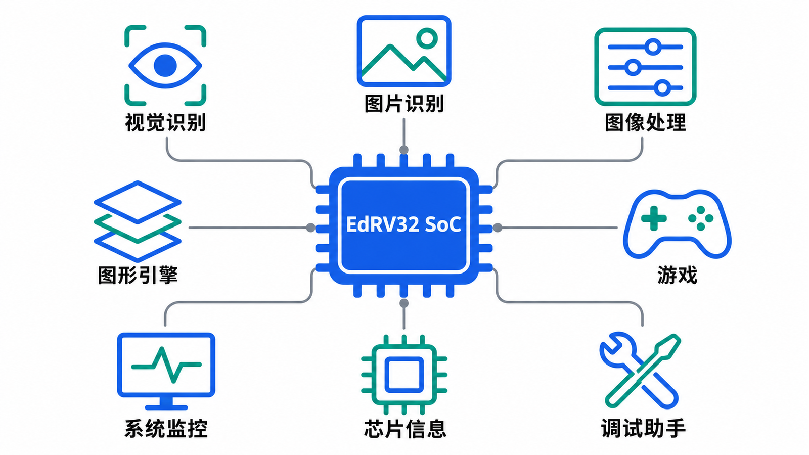

图1-1 EdRV32 演示系统功能总览

### 1.2 应用领域

作品面向需要“低功耗、低延迟、可控可信”的边缘视觉场景：

智能安防与门禁：摄像头本地完成人、车等目标检测，只上传结果，降低带宽并保护隐私；工业检测：采集通路上的滤波、二值化与几何校正可直接用于产线零件定位和缺陷初筛；智能交通与无人设备：多路视频输入加实时检测，可用于路口感知、巡检机器人和无人机前端；教学与科研：处理器、总线、加速器和软件全部自研、源码可见，可作为 RISC-V 体系结构和 SoC 设计的实验平台。由于全部逻辑运行在国产 FPGA 上且不依赖第三方处理器 IP，作品也适合对供应链自主可控有要求的应用。

### 1.3 主要技术特点

（1）自研高性能处理器：6 级顺序双发射流水线，两条执行管线，32 项 BTB、512 项 gshare 和 4 项返回地址栈，误预测代价 3 个周期；指令/数据 Cache 各 32 KiB，配写缓冲；提供 8 个可编程性能计数器、16 类事件。

（2）面向实时视频的存储子系统：7 主 1 从的 256 位 DDR 交叉开关按硬实时、低延迟、软实时和尽力而为四类服务等级仲裁，显示和采集带紧急信号，保证 720p60 显示不断流。

（3）零拷贝数据流：各引擎通过 DDR 中的 Surface 交接，帧边界由硬件原子切换，释放由中断通知软件；视频直接作为显示底层，不经 CPU 搬运。

（4）专用加速器：NPU 每周期 512 个 INT8 乘加，支持卷积、池化、上采样和融合残差加；RND 作为 LVGL 的硬件绘制单元；GEO 以逆映射加双线性插值实现仿射变换。

（5）硬件网络协议：ETH 硬件完成 UDP 接收直写 DDR（支持乱序）、发送分包和 ARP 应答。

### 1.4 主要性能指标

**表1-1 主要性能指标**

| 项目 | 指标 |
|---|---|
| 处理器 | RV32IM，6 级双发射，125 MHz；CoreMark 4.390 CoreMark/MHz |
| Cache | I$ / D$ 各 32 KiB，2 路组相联，32 B 行 |
| NPU | 512 INT8 MAC/周期 @150 MHz；YOLOv8n（640×384）41.7 ms/帧；实时识别【待实测】fps |
| 视频 | 2 × OV5640，720p30 输入；HDMI 720p60 双图层输出 |
| 存储 | DDR3 32 位 1000 MT/s，1 GB；256 位 AXI，理论 4.0 GB/s |
| 网络 | 千兆以太网，硬件 UDP 收发 |
| 资源（完整版 SoC） | LUT 87151（54.5%）、FF 96124、DRM 277、APM 372 |
| 资源（CPU 子系统：处理器核＋I$＋D$） | LUT 15585、FF 9564、DRM 18、APM 4 |
| 时序 | clk_sys 125 MHz、clk_npu 150 MHz 布局布线后时序收敛（慢角 setup WNS +0.087 / +0.048 ns） |

### 1.5 主要创新点

（1）全栈自研：处理器、总线、DDR 交叉开关、六类多媒体与 AI 引擎、引导程序、驱动、调度器和上位机工具均为自主设计，不使用第三方处理器 IP。第三方组件只有 LVGL 图形库、nofrendo NES 模拟器内核、CoreMark、YOLOv8n 模型，以及 PDS 的 DDR3 控制器和 PLL IP。

（2）双发射 RISC-V 处理器在国产 FPGA 上达到 125 MHz、4.390 CoreMark/MHz。

（3）视频与界面分层、引擎间零拷贝交接，CPU 只做编排不搬数据。

（4）2D 渲染引擎作为 LVGL 硬件绘制后端，与软件渲染逐像素比对验证。

### 1.6 设计流程

开发遵循“规格 → 验证方案 → 实现 → 审查”的流程（图1-2）：先编写系统和各模块规格，明确端口、寄存器、时序和性能指标；再按规格编写验证方案和参考模型；RTL 和软件按规格实现，经单元级、模块级和 SoC 级回归验证后，在 PDS 中综合、布局布线和时序分析，最后上板测量。测量结果再回填到规格，形成闭环。

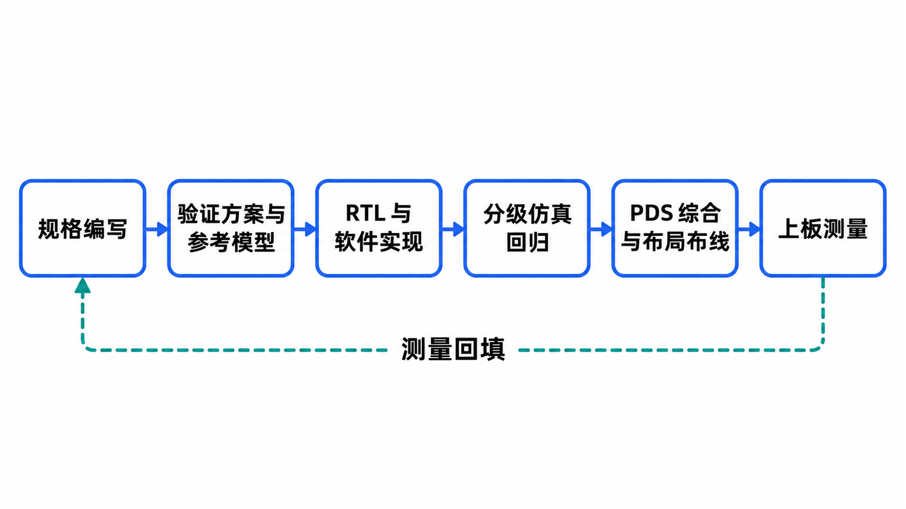

图1-2 设计流程

## 第二部分  系统组成及功能说明

### 2.1 整体介绍

EdRV32 SoC 的整体结构如图2-1 所示，分为 CPU、系统总线、存储、媒体、NPU 和网络六个子系统，工作在 4 个主要时钟域：CPU 与系统总线 clk_sys（125 MHz），存储与媒体 clk_mem（125 MHz，与 DDR 控制器用户接口同源），NPU clk_npu（150 MHz），显示像素 clk_pix（74.25 MHz）。跨时钟域只经过统一的同步原语（异步 FIFO、握手、格雷码计数器和异步总线桥）。

控制面上，CPU 通过 64 位系统 AXI 访问 Boot ROM、SRAM、中断控制器和外设，并经媒体 APB 桥配置各引擎的寄存器。数据面上，VIN、DISP、NPU、RND、GEO、ETH 六个引擎和 CPU 的 DDR 网关共 7 个主端口汇集到 256 位 mem_xbar，统一访问 DDR3。引擎之间通过 DDR 中的 Surface 交接数据：生产者写完一帧后中断 CPU，CPU 把它交给消费者，消费者用完后由硬件报告释放。以实时目标检测为例（图2-2）：摄像头图像经 VIN 写入 DDR 的显示底图，同时经 CH2 缩放为 640×384 的 INT8 输入；NPU 完成推理后 CPU 进行后处理，检测框由 LVGL 绘制在 UI 层；DISP 每帧把视频底层和 UI 层硬件叠加后输出 HDMI。

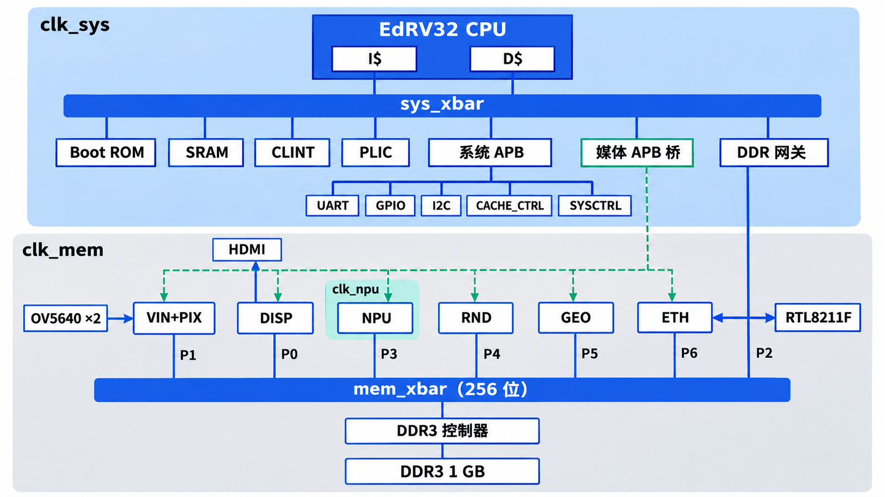

图2-1 EdRV32 SoC 整体框图

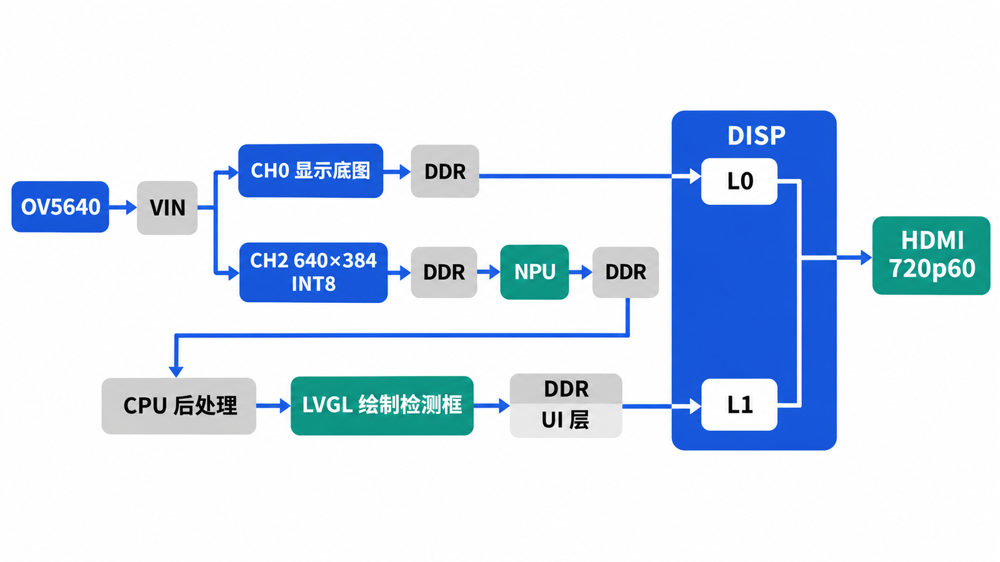

图2-2 实时目标检测数据流

### 2.2 硬件系统介绍

#### 2.2.1 硬件整体介绍

作品运行在紫光同创 PG2L200H 开发板上（图2-3），板载两片 16 位 DDR3（共 32 位、1 GB）、两路 OV5640 摄像头接口、HDMI 发送接口、RTL8211F 千兆以太网 PHY、QSPI Flash、按键、LED 和 UART。FPGA 内的设计分为 SoC 层和板级层：SoC 层（edrv32_soc_top）包含全部自研逻辑；板级层负责 PLL 时钟生成、DDR3 控制器与 PHY、HDMI 的 TMDS 串化和 RGMII 接口时序，这些由 PDS IP Compiler 生成的 IP 和少量板级适配逻辑组成。

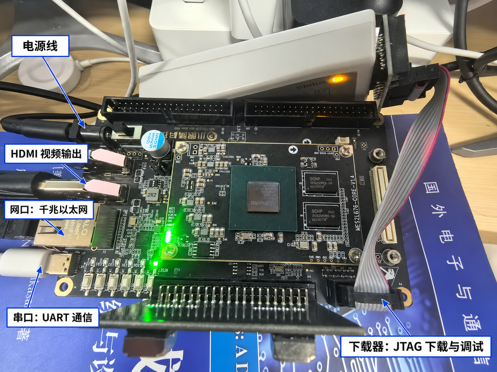

图2-3 PG2L200H 开发板及外设

#### 2.2.2 机械设计介绍

本作品基于现有开发板实现，不涉及机械结构设计。

#### 2.2.3 电路各模块介绍

SoC 顶层（edrv32_soc_top）的关键输入、输出信号见表2-1；板级层负责 RGMII 与 8 位单沿接口的转换、TMDS 10:1 串化和 IO 三态缓冲。下面按 SoC 子系统逐级介绍各硬件模块。

**表2-1 SoC 顶层关键信号**

| 信号组 | 主要信号 | 方向 / 位宽 | 时钟域 | 连接对象 |
|---|---|---|---|---|
| 时钟与复位 | clk_sys_i、clk_mem_i、clk_npu_i、clk_pix_i、rst_n_i、mem_ready_i | 输入 | — | PLL、DDR 控制器、复位键 |
| DDR 主口 | AXI256 的 AW、W、B、AR、R 五个通道：ddr_awaddr_o[31:0]、ddr_wdata_o[255:0]、ddr_rdata_i[255:0] 等 | 双向 | clk_mem | DDR3 控制器 |
| 摄像头 ×2 | camN_pclk_i、camN_vsync_i、camN_href_i、camN_data_i[7:0] | 输入 | camN_pclk | OV5640 |
| 摄像头配置 | i2c0_scl/sda（两对开漏）、camN_pwdn_o、camN_rst_n_o | 双向 / 输出 | clk_sys | OV5640 |
| 显示 | tmds_sym_o[3×10] | 输出 | clk_pix | TMDS 串化 → HDMI |
| 以太网 | eth_rxd_i[7:0]、eth_rx_dv_i、eth_txd_o[7:0]、eth_tx_en_o、eth_mdc_o、eth_mdio | 双向 | eth_rx_clk / eth_tx_clk | RGMII 适配 → RTL8211F |
| 系统外设 | uart0_tx_o、uart0_rx_i、gpio[15:0]（4 键、5 LED、摄像头控制） | 双向 | clk_sys | 串口、按键、LED |
| 调试 | debug_o | 输出 | clk_sys | ILA（流水线观察） |

**（1）EdRV32 处理器**

处理器实现 RV32I 基础指令集及 M、Zicsr、Zicntr、Zifencei 扩展，只有机器模式。微架构如图2-4：F1、F2 两级取指，F1 查询 BTB、gshare 和 RAS 给出预测，F2 把指令写入 4 项指令缓冲；D 级每周期取出最老的 1–2 条，完成译码、配对检查和冒险检查；E 级执行 ALU、分支判定和访存地址计算；M 级接收数据 Cache 结果并处理 CSR 和异常；W 级写回寄存器堆。管线 0 支持全部指令，管线 1 支持 ALU 指令；相邻周期的相关 ALU 指令经前递零停顿执行。条件分支或 JALR 预测错误在 E 级重定向，代价 3 个周期；BTB 未命中的 JAL 在 D 级重定向，代价 2 个周期。

异常和中断在 M 级统一处理：取指错误、非法指令、地址不对齐、访存错误、ECALL、EBREAK 均为精确异常；CLINT 提供定时器和软件中断，PLIC 汇集各引擎的外部中断；支持 MRET 和 WFI。

指令 Cache 和数据 Cache 均为 32 KiB、2 路组相联、32 字节行，经 64 位 AXI 访问系统总线；数据 Cache 为写回、写分配，带写缓冲，并提供 Cache 维护寄存器供软件在 DMA 前后清理和失效。

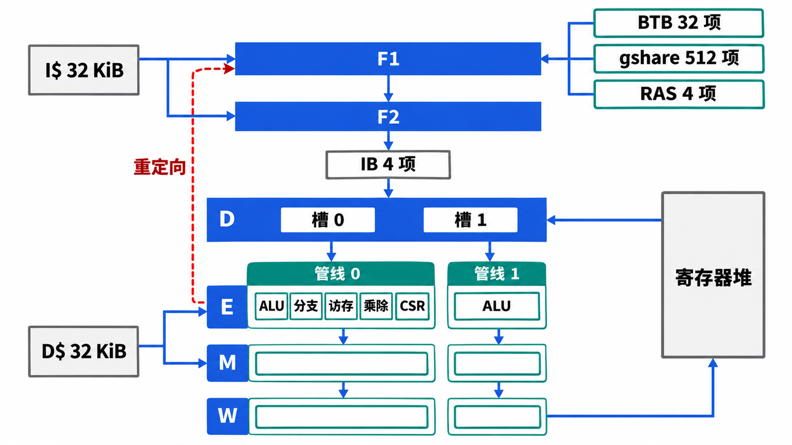

图2-4 EdRV32 处理器微架构

**（2）系统总线与外设**

64 位 sys_xbar 连接 2 个主设备（I$、D$）和 7 个从设备：16 KiB Boot ROM、64 KiB SRAM、CLINT 定时器、PLIC 中断控制器、系统 APB（UART、GPIO、I2C、Cache 控制、系统控制）、媒体 APB 桥和 DDR 网关。DDR 地址空间同时提供可缓存和不可缓存两个别名，方便软件与 DMA 共享数据。

**（3）存储子系统 mem_xbar**

mem_xbar 是 7 主 1 从的 256 位交叉开关（图2-5）：P0 DISP、P1 VIN、P2 CPU、P3 NPU、P4 RND、P5 GEO、P6 ETH。端口按服务等级分为硬实时（DISP、VIN，带紧急信号）、低延迟（CPU）、软实时（RND、GEO）和尽力而为（NPU 有保底份额，ETH 限速），按等级仲裁，保证 720p60 显示和摄像头采集不断流。内置统计计数器记录每个端口的读写事务数、拍数和等待周期，软件以快照加清零的方式读取，供性能浮窗显示实时带宽。

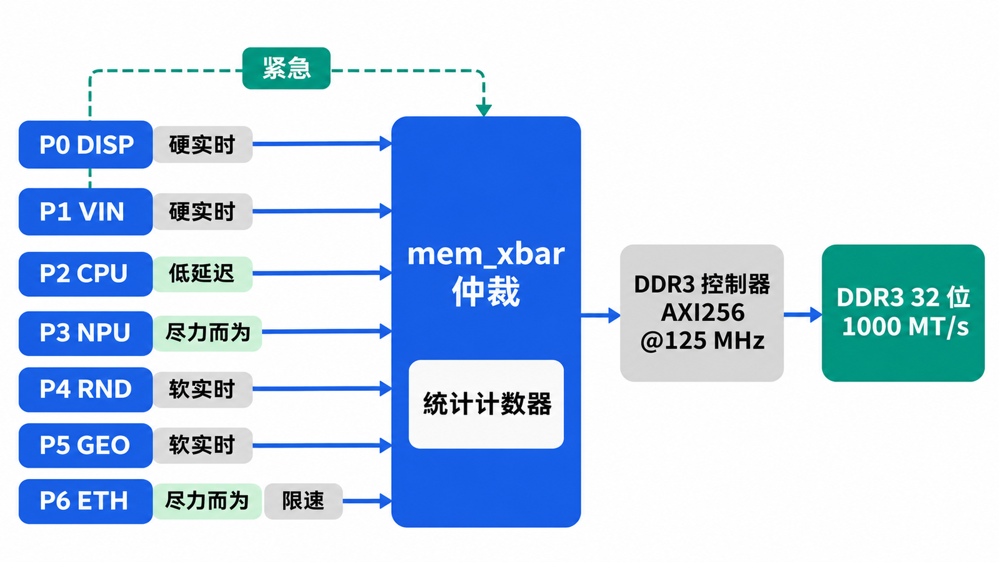

图2-5 存储子系统与 DDR 端口分配

**（4）视频采集 VIN 与像素处理 PIX**

VIN 有两路 DVP 前端和一个 DDR 内存源，图像经选路分到三个通道：CH0 经 PIX 处理后写入显示 Surface 环，CH1 直接写入 Surface 环，CH2 把图像缩放并加黑边（letterbox）到 640×384，转换为 NPU 需要的 INT8 四通道格式。PIX 是采集通路上的流式处理流水线：亮度/对比度、伽马查找表、两级 3×3 空间运算（均值、高斯、锐化、Sobel、腐蚀、膨胀任选）、灰度、二值化和反色，配置在帧边界原子生效，不增加额外的 DDR 访问。

**（5）几何变换 GEO**

GEO 是命令式 DDR 到 DDR 引擎：对输出矩形中的每个像素，按软件给出的逆映射矩阵求出源图位置，取 4 个邻点双线性插值。按块读入片上缓冲后再插值，支持任意角度旋转、缩放、平移、镜像和一般仿射变换。

**（6）神经网络加速器 NPU**

NPU 面向 YOLOv8n 设计（图2-6），每周期完成 32 输出通道 × 8 输入通道 × 2 像素共 512 个 INT8 乘加，INT32 累加，每输出通道独立量化。支持 1×1 和 3×3 卷积（步长 1、2）、5×5 最大池化、2 倍上采样和融合残差加；通道拼接通过特征图在工作区中的连续布局实现，零拷贝。软件在 DDR 中准备描述符表、模型镜像和工作区，写门铃后 NPU 依次执行全部描述符，完成后中断 CPU。检测头输出由 CPU 做解码、阈值和按类别 NMS 后处理。

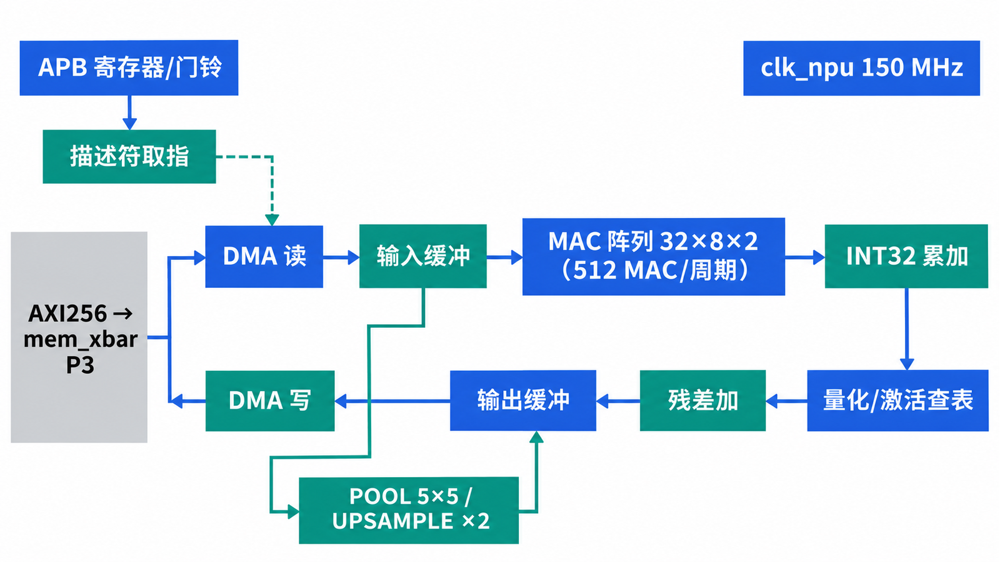

图2-6 NPU 结构

**（7）渲染引擎 RND 与显示 DISP**

RND 从 DDR 读取命令列表，在 DDR 图像缓冲上执行五条命令：填充（纯色或线性渐变，可带圆角）、边框、字形着色、位图贴图（缩放、翻转、颜色键、重新着色和透明度）和搬运。目标格式为 RGB565 和 ARGB8888；字形为 A1/A2/A4/A8；位图可用 I8 调色板（NES 画面）。它以 LVGL 绘制单元的形式接入，界面中能由硬件完成的绘制任务自动交给 RND。

DISP 每帧从 DDR 读取两层 Surface：L0 底图层（RGB565，支持卷轴）和 L1 界面层（ARGB8888，支持位置、尺寸和全局透明度），逐像素 alpha 混合后按 CEA-861 720p60 时序输出 TMDS 信号（图2-7）。新 Surface 在帧边界生效，旧 Surface 读完后由中断通知软件释放。

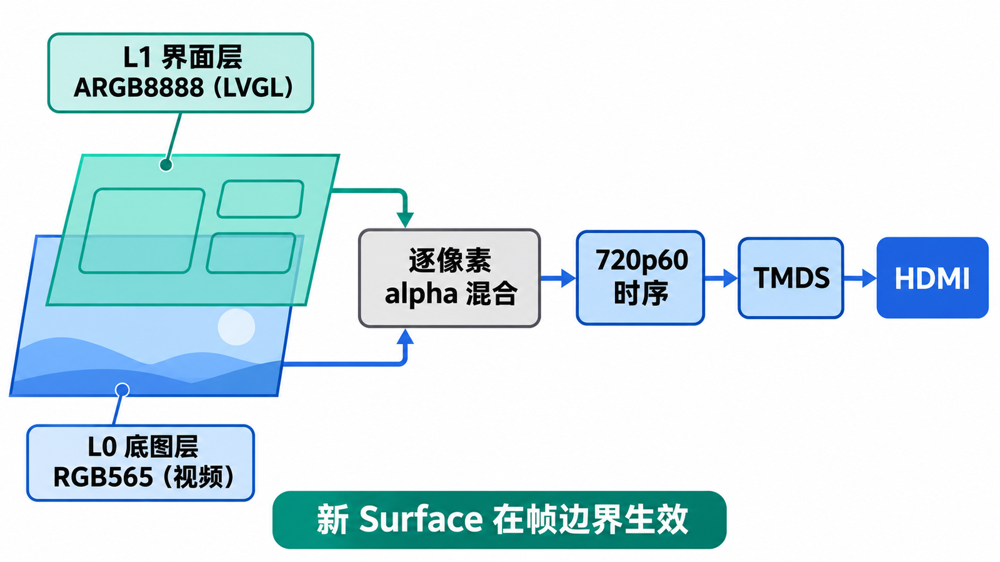

图2-7 显示双图层合成

**（8）以太网 ETH**

ETH 实现千兆 MAC、IPv4/UDP 和 ARP 应答。接收时，UDP 载荷开头的 8 字节应用头指定窗口号和偏移，硬件把数据直接写入 DDR 中对应窗口，包可以乱序到达；带通知位的包写完后中断 CPU。发送时，软件准备描述符，硬件把任意长度的数据切分成 UDP 包发出。硬件提供四个接收窗口，演示程序用窗口 0、2、3 分别接收大块数据、虚拟输入和控制消息。

### 2.3 软件系统介绍

#### 2.3.1 软件整体介绍

软件分为板端和 PC 端两部分（图2-8）。板端自下而上为：Boot ROM 引导程序与 BIOS、板级支持包与外设驱动、公共库（调度器、虚拟输入、YOLO 后处理、仿射矩阵等）、LVGL 图形库及 RND 绘制后端、NES 模拟器，以及顶层演示程序。PC 端调试工具基于 Python 和 PySide6，通过串口和千兆网口与板子通信。

上电后 CPU 从 Boot ROM 执行引导程序，打印芯片信息；按住启动键复位进入 BIOS，可经串口或网口把 ELF 程序烧录到 SRAM 和 DDR 并自动运行。演示程序由协作式调度器驱动三个任务：通信服务（优先级最高）处理网口和串口消息、EDSC 协议和遥测；当前应用任务分发输入、运行应用管理器和当前媒体应用；图形界面任务运行 LVGL，刷新节奏跟随显示帧切换，最快 60 Hz。媒体应用（实时识别、图片识别、图像处理、图形测试、游戏、CoreMark）同一时刻只运行一个，切换时先等前一个应用释放全部硬件资源。中断只记录事件，耗时处理全部在任务中完成。

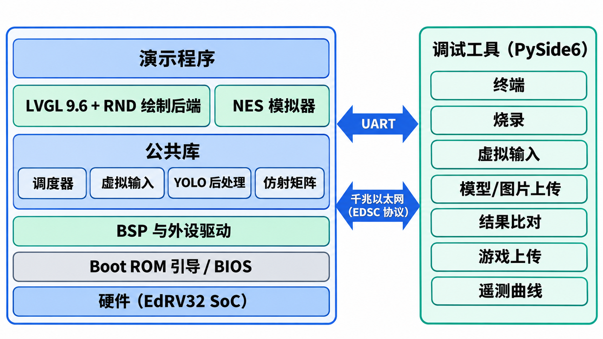

图2-8 软件架构

#### 2.3.2 软件各模块介绍

**（1）引导程序与 BIOS**

引导程序初始化 UART 和 GPIO，打印启动标志和芯片信息，采样启动键决定进入 BIOS 或运行 SRAM 中的程序。BIOS 菜单提供串口烧录、网口烧录、指定地址运行和切换波特率；网口烧录时程序段经 ETH 直写 DDR，以接收字节计数判定完整性。

**（2）协作式调度器与应用管理器**

调度器按固定优先级选择就绪任务，记录每个任务的 CPU 占用和最长单次运行时间（图2-9）。长计算（YOLO 后处理、伽马表计算、模型加载）切成小片，每片目标不超过 2 ms，片间返回调度器；界面有待刷新内容时，应用让出 1 ms，保证界面每 16.7 ms 至少运行一次。实时识别的后处理是例外：一帧的后处理连续做完再让界面刷新，避免被界面刷新切碎。

应用管理器为每个媒体应用维护 IDLE、STARTING、RUNNING、PAUSED、STOPPING、FAILED 六种状态，并管理 VIN 通道、NPU、PIX/GEO、RND、DISP L0 和 DDR 分区等硬件资源的归属。参数越界、状态不符等操作错误只让当前请求失败，应用继续运行；规格定义的硬件错误则打印原因并停机，便于定位。

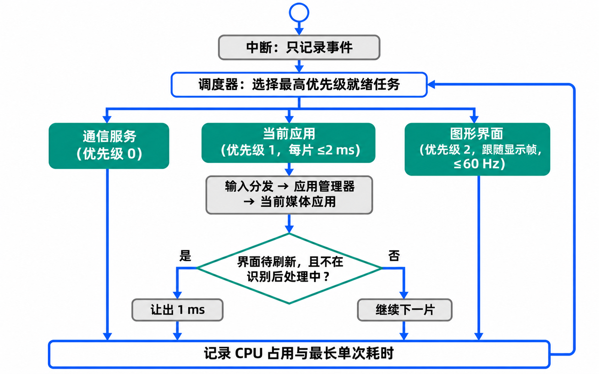

图2-9 协作式调度流程

**（3）视觉流水线**

实时检测（图2-10）：VIN 的 CH0 每帧写入显示 Surface，直接作为 DISP 底层显示，视频刷新不等待推理；CH2 同时输出 640×384 的 INT8 输入。NPU 完成一帧后，RND 立即把输出搬到后处理缓冲，NPU 随即在最新的输入帧上开始下一帧推理；CPU 对上一帧做解码、排序和按类别 NMS，按门槛和类别白名单过滤后交给界面绘制检测框。推理和后处理因此并行，识别帧率由 NPU 决定。

图片识别时，PC 工具把图片等比缩放并补边到 1280×720 后逐张上传，每张图带请求号；图片经 VIN 内存源送入 CH2 推理，检测结果带同一请求号回传 PC，与 Python 参考模型逐项比对。

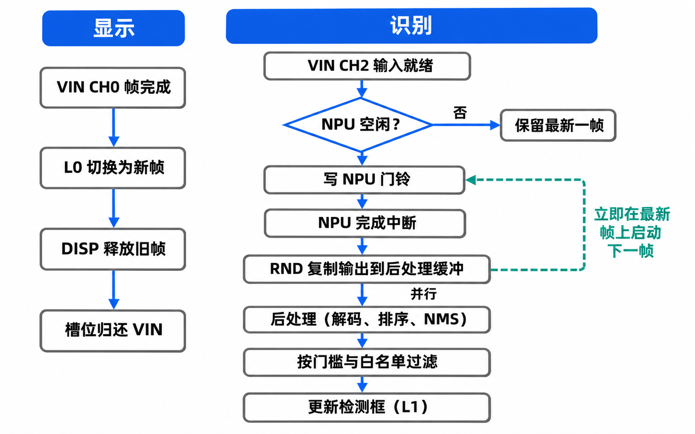

图2-10 实时检测软件流程

**（4）图形界面与应用**

界面基于 LVGL 9.6，采用浅色简洁风格，支持四种输入：板载按键、虚拟键盘、虚拟鼠标和滚轮（作为编码器）。虚拟设备经网口传输；只用四个板载按键也能完成全部操作，返回键逐级返回上一级。首页包含视觉识别、图片识别、图像处理、图形引擎、游戏、系统监控、芯片信息、调试助手八个应用。系统监控以浮窗形式叠加在任意页面上，显示渲染帧率、显示帧率、CPU 总占用和各任务占用、DDR 各端口带宽，以及 NPU、RND 忙碌率。识别和图像处理页可以一键隐藏界面，只留画面和检测框。游戏应用移植 nofrendo NES 模拟器，内置 30 款游戏，并可从 PC 上传。芯片信息页运行 CoreMark，同时用性能计数器采集 16 类流水线事件，以中文逐项显示。

**（5）网口应用协议**

板端与 PC 之间定义了 EDSC 消息协议，模式以板端为准。PC 发出连接请求，板端回复 HELLO（协议版本、程序版本和当前状态）后连接才建立；此后板端在状态变化时以及每 1 s 发送一次 STATE，PC 工具的界面完全按 STATE 刷新。PC 的每条命令（打开应用、图像处理参数、检测门槛和类别、取消等）都带序号，板端用 ACK 回复“已收到”“完成”或“错误”。模型、图片和游戏等大块数据先发 BULK_BEGIN 声明类型和长度，板端回复 READY 后 PC 把数据发往窗口 0，处理完成后板端回复 DONE；同一时刻只进行一个传输，保证数据不被覆盖（图2-11）。

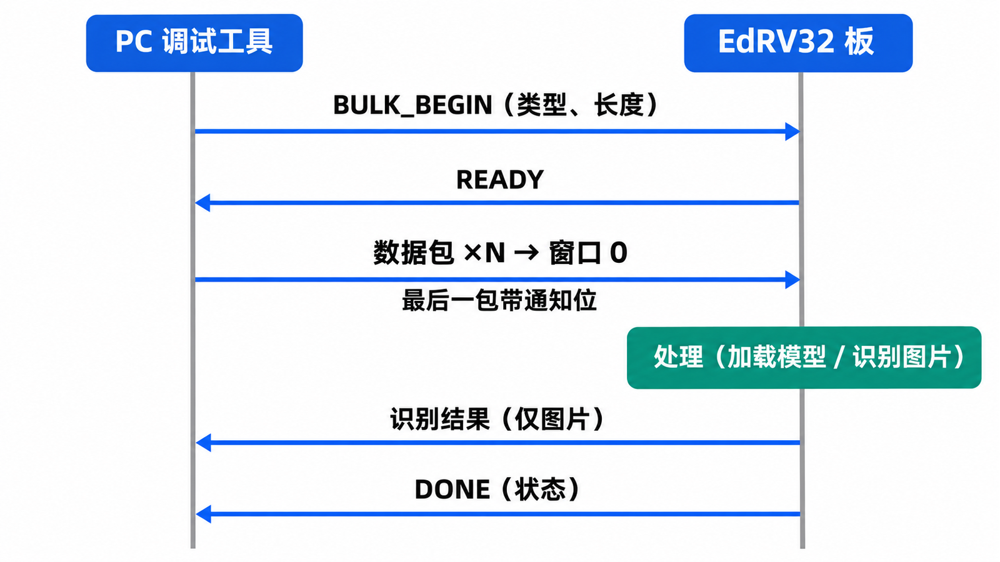

图2-11 EDSC 大块数据传输时序

**（6）PC 端调试工具**

调试工具提供串口日志终端、网口连接状态、BIOS 烧录、虚拟键盘鼠标、模型和图片上传、检测结果可视化及与 Python 参考模型的逐项比对、图像处理参数同步、游戏上传，以及 DDR 带宽等遥测数据的实时曲线（图2-12）。

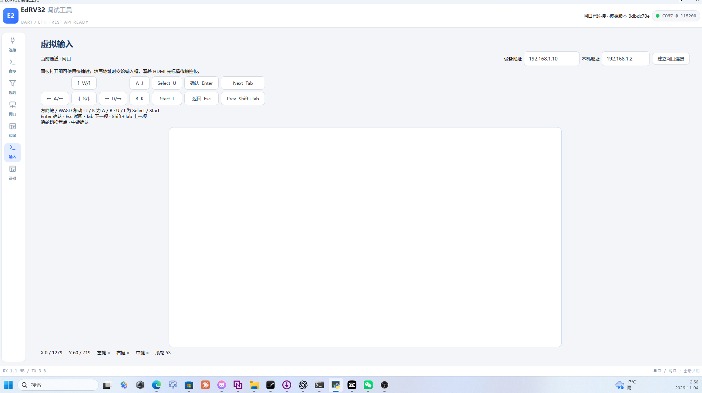

图2-12 PC端调试工具的网口虚拟输入

板端关键函数及其输入、输出见表2-2。

**表2-2 板端关键函数**

| 函数 | 输入 | 输出 | 调用者 |
|---|---|---|---|
| sched_run | 已注册的三个任务 | 按优先级执行就绪任务，记录 CPU 占用 | main |
| session_step | 请求的应用和动作 | 应用生命周期状态、资源分配 | 当前应用任务 |
| vision_service | VIN、NPU、GEO、DISP 中断事件 | 推进视觉流水线一步 | 当前应用任务 |
| start_inference / npu_start | CH2 输入槽、描述符表基址 | 写 NPU 门铃，开始一帧推理 | vision_service |
| copy_output | NPU 输出区（725 760 B） | RND COPY 到后处理缓冲 | vision_service |
| vision_post_step | INT8 检测头输出 | 候选框、NMS 后的检测结果 | vision_service |
| publish_result | 检测结果 | 交给界面绘制的检测框列表 | vision_service |
| edsc_message | 窗口 3 收到的消息 | HELLO、ACK、STATE 或状态变化 | 通信服务 |
| vision_bulk_done | 大块数据类型、基址、长度 | 加载模型或启动图片识别 | 通信服务 |
| board_eth_send | 发送描述符表 | 启动 ETH 发送（DOORBELL 被忽略时重新提交） | 通信服务、视觉流水线 |

## 第三部分  完成情况及性能参数

### 3.1 整体介绍

系统实物如图3-1所示：PG2L200H 开发板连接两路摄像头、HDMI 显示器、千兆网线和串口，PC 运行调试工具。

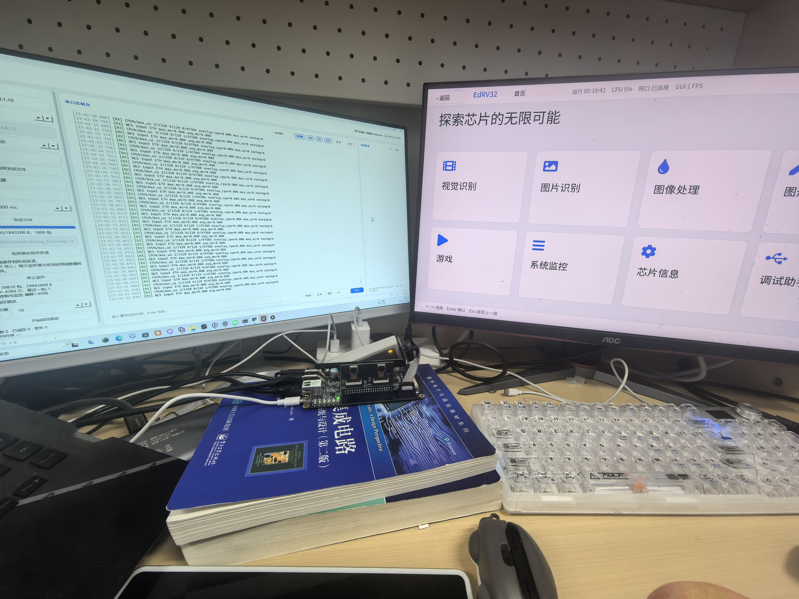

图3-1 系统实物全景

### 3.2 工程成果

#### 3.2.1 机械成果

本作品不涉及机械结构。

#### 3.2.2 电路成果

FPGA 实现结果如表3-1（PDS 2022.2-SP6.1，PG2L200H-6 FBB676）。完整版 SoC 布局布线通过，慢角 setup 各时钟域均收敛：clk_sys 125 MHz WNS +0.087 ns，clk_npu 150 MHz +0.048 ns，clk_mem 125 MHz +0.179 ns，clk_eth +1.864 ns，TNS 均为 0。内部 hold 全部满足；唯一的负裕度是 RGMII 输入的慢角 hold（−0.242 ns，5 个端点），属于板级接口项，上板收发正常。CPU 子系统的资源另列于表3-1b，统计范围为处理器核、I$和D$。图3-3 为开发板及外设连接实物照片。

**表3-1 FPGA 资源占用（完整版 SoC，clk_sys 125 MHz）**

| 资源 | 使用量 | 器件总量 | 占用率 |
|---|---|---|---|
| LUT | 87151 | 159800 | 54.5% |
| FF | 96124 | 319600 | 30.1% |
| 分布式 RAM | 2206 | 39500 | 5.6% |
| DRM | 277 | 415 | 66.7% |
| APM | 372 | 740 | 50.3% |
| IO | 137 | 400 | 34.3% |

**表3-1b CPU子系统资源占用（处理器核＋I$＋D$）**

| 资源 | CPU子系统使用量 |
|---|---:|
| LUT | 15585 |
| FF | 9564 |
| DRM | 18 |
| APM | 4 |

CPU子系统资源统计范围为处理器核、I$和D$，其中LUT使用量为15585。

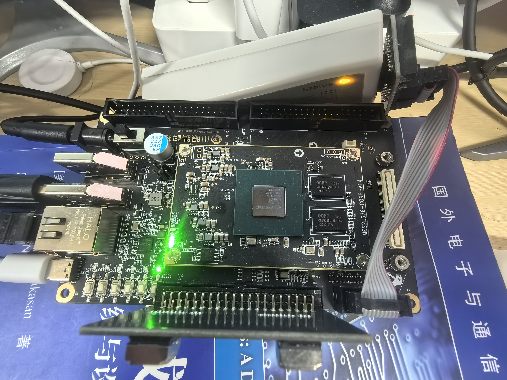

图3-3 开发板与外设连接实物

#### 3.2.3 软件成果

演示系统各页面如图3-4 至图3-11 所示，PC 端调试工具界面如图3-12。

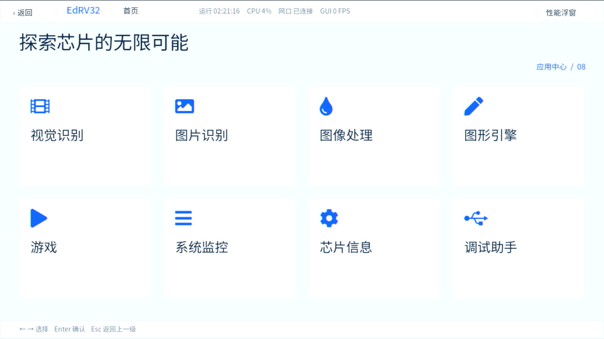

图3-4 首页

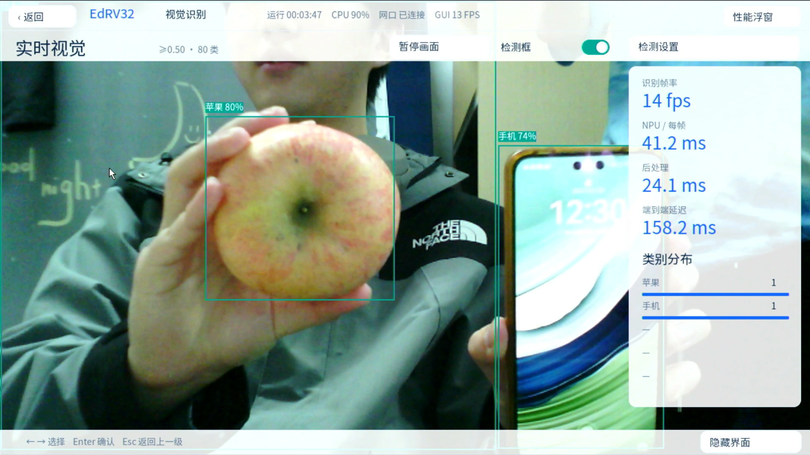

图3-5 视觉识别（实时目标检测）

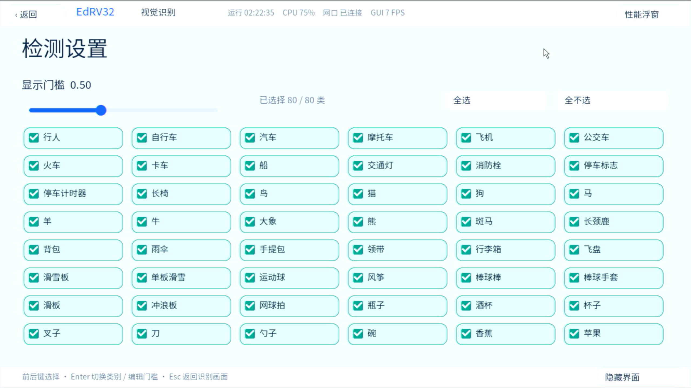

图3-6 检测设置（门槛与类别白名单）

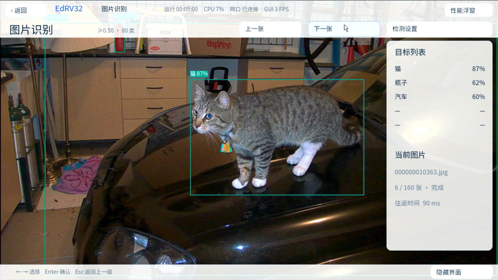

图3-7 图片识别

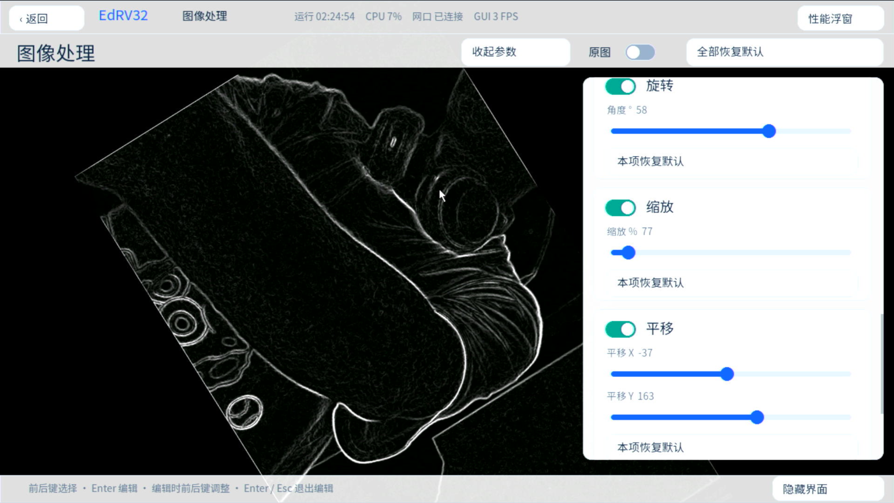

图3-8 图像处理（PIX/GEO 参数调节）

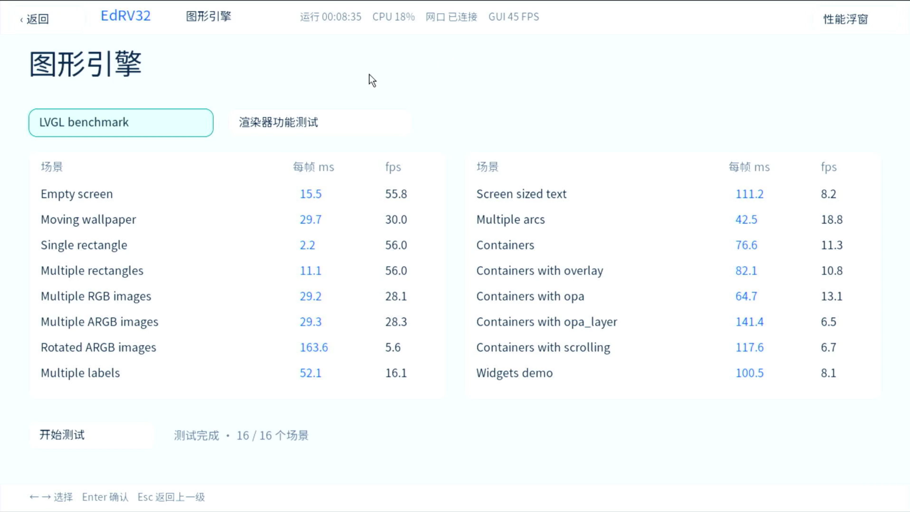

图3-9 图形引擎与渲染器功能测试

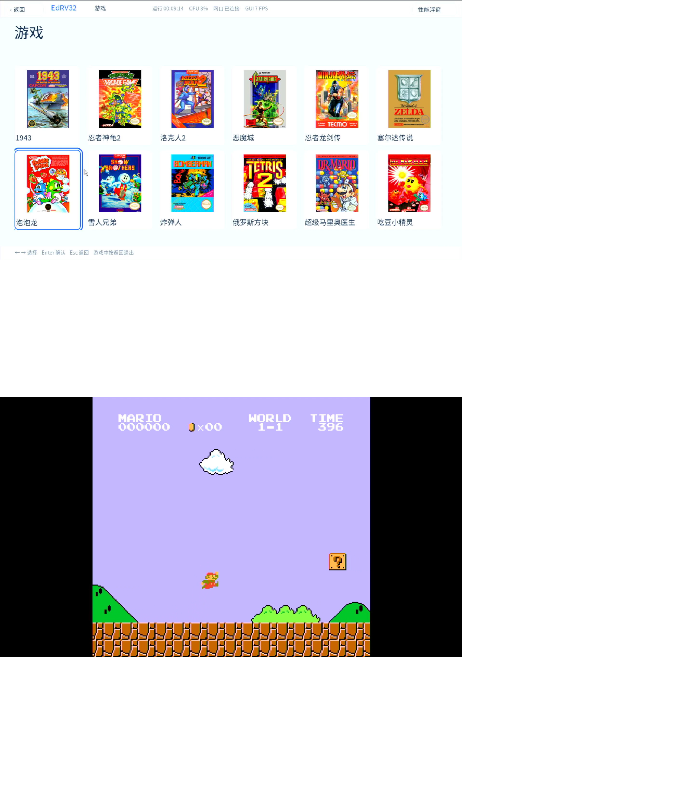

图3-10 游戏

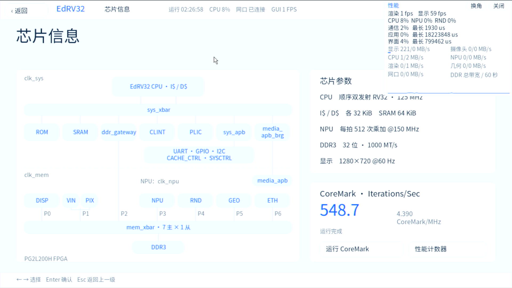

图3-11 性能浮窗与芯片信息

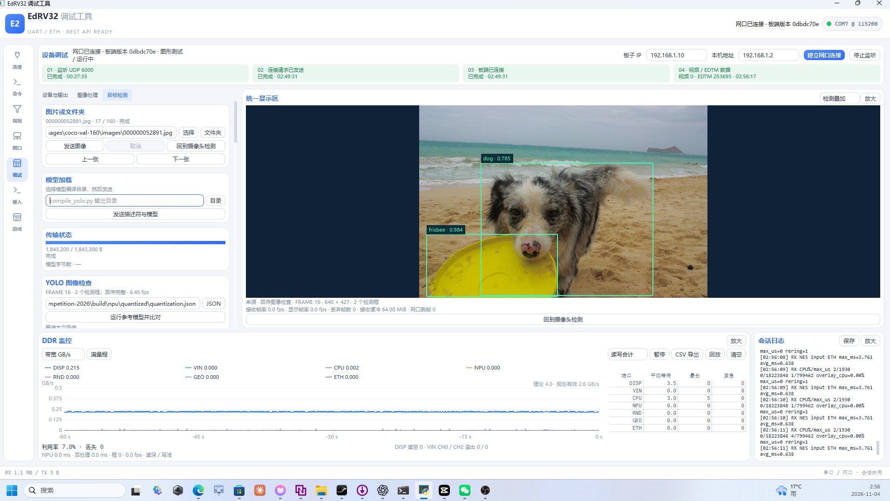

图3-12 PC端调试工具的目标检测回传

### 3.3 特性成果

表3-2 汇总了主要功能和性能的上板实测结果。NPU 在 150 MHz 下完成 YOLOv8n 推理需要 41.7 ms；CPU 后处理与下一帧推理并行，实时识别帧率由 NPU 决定。视频以 720p60 输出，界面与视频分层显示。LVGL benchmark 的16个场景结果见图3-9。图3-14的水平渐变测试中，RND与LVGL软件渲染分别耗时84 μs和1439 μs，加速比为17.13倍，像素一致率为88.19%。

**表3-2 上板实测结果**

| 项目 | 结果 | 条件 |
|---|---|---|
| CoreMark（最佳实测） | 548.7 Iterations/Sec，4.390 CoreMark/MHz | 125 MHz，上板结果见图3-13 |
| NPU 自检 | 39/39 通过，20 帧 CRC 一致 | 完整版 SoC，NPU 150 MHz |
| YOLOv8n 推理 | 41.7 ms/帧 | NPU 150 MHz，640×384 输入，演示程序实时识别中测得 |
| 实时识别帧率 | 【待实测】 fps | 摄像头 720p30 输入，推理与后处理并行 |
| 图片识别 | 88–100 ms（上传完成到结果返回） | 千兆网口上传 1280×720 RGB565 图片 |
| 渲染引擎 | 10/10 场景 CRC 与参考一致 | RND 自检程序 |
| LVGL benchmark | 【待实测】 fps（16 个场景平均） | RND 作为 LVGL 绘制后端，L1 为 ARGB8888 全屏 |
| 连续运行 | 【待实测】 15 min 无异常 | 实时识别，摄像头输入无溢出 |

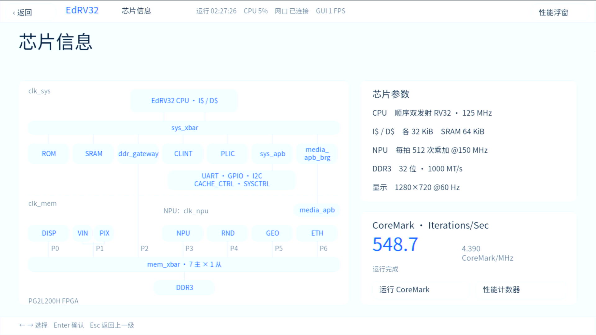

图3-13 CoreMark 跑分

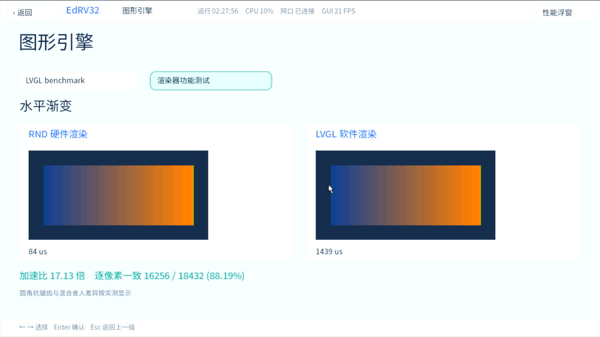

图3-14 水平渐变的硬件与软件渲染对比

表3-3 是最终编译配置下整个 CoreMark 运行期间的性能计数器统计。IPC 为 1.080，双发射退休占 27.5% 的周期；最主要的损失是槽 1 指令类型不被管线 1 支持（31.4%，管线 1 只执行 ALU 指令），其次是相关指令不能配对（12.4%）、load-use 停顿（7.9%）和前端断流（7.1%）；分支误预测率为 16.2%。因此，进一步提高性能的方向是让管线 1 支持分支和跳转、扩大 BTB 和 gshare。

**表3-3 CoreMark 运行时的流水线事件统计（100 MHz，-O3 调优编译）**

| 事件 | 计数 | 占周期比例 |
|---|---|---|
| 周期 / 退休指令 | 1,148,266,737 / 1,239,834,691 | IPC 1.080 |
| 双发射退休周期 | 316,094,455 | 27.5% |
| 单发射退休周期 | 607,645,781 | 52.9% |
| 零退休周期 | 224,528,856 | 19.6% |
| 配对失败：槽 1 类型不被管线 1 支持 | 361,065,749 | 31.4% |
| 配对失败：槽 1 依赖槽 0 的结果 | 142,081,594 | 12.4% |
| 配对失败：结构冲突 | 61,015,028 | 5.3% |
| load-use 停顿周期 | 91,280,264 | 7.9% |
| 前端断流周期 | 81,600,786 | 7.1% |
| 分支和跳转 / 误预测 | 252,531,577 / 40,800,393 | 误预测率 16.2% |
| I$、D$ 缺失 | 0 | 代码和数据都在 SRAM |

### 3.4 片上逻辑分析仪（ILA）验证

#### 3.4.1 验证目的与实验配置

本节单独给出片上逻辑分析仪的配置、原始波形和计数比对证据，用于展示处理器真实上板运行时的双发射退休行为，以及性能计数器与软件读数的一致性。实验分为运行窗口采样和冻结快照比对两部分，分别对应卡34与卡36。

实验使用 PG2L200H 上的 B1-ILA 专用工程，CPU 为 **100 MHz**，CoreMark 运行5000次，编译选项为 **-O2**，用于观察流水线行为与核对计数。

使用PDS Fabric Inserter在综合网表中插入调试核，Fabric Debugger通过JTAG布防、触发并读取采样。采样时钟为clk_sys_w的上升沿；深度1024点，不启用存储限定。观察对象是mcycle、minstret及hpm3–hpm10，每组取低40位，共400位DataPort。TriggerPort0接minstret低40位，TriggerPort1接mcycle低40位。两轮采样值均处于40位可表示范围内。

**表3-4 ILA探针与触发配置**

| 项目 | 配置 |
|---|---|
| 采样时钟 | clk_sys_w，100 MHz，上升沿 |
| DataPort[39:0] | mcycle低40位 |
| DataPort[79:40] | minstret低40位 |
| DataPort[399:80] | hpm3–hpm10低40位，按编号顺序排列 |
| TriggerPort0 / TriggerPort1 | minstret / mcycle，各40位 |
| 采样深度 / 触发位置 | 1024点 / 第102点（约10%前置采样） |
| 运行窗口触发 | TU0等于0x002AF22604 |
| 冻结补测触发 | TU0等于0x0055E44C09 |

#### 3.4.2 CoreMark运行窗口与双发射行为

在CoreMark运行中按minstret条件触发，取得1024个连续采样点。相邻采样差分形成**1023个周期区间**：mcycle每步严格增加1，总增量1023；minstret总增量1189，每周期退休增量均为0、1或2。结果如图3-15及表3-5，原始Debugger波形见图3-16。

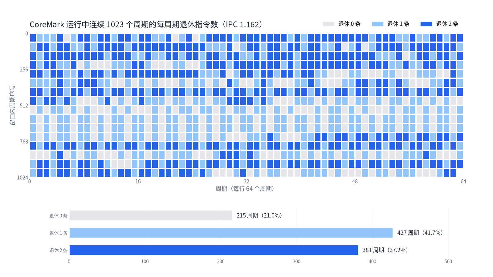

图3-15 ILA采样窗口的退休统计（1024点、1023个周期区间，-O2）

**表3-5 ILA运行窗口的退休增量**

| 每周期退休指令数 | 周期数 | 占窗口比例 |
|---|---|---|
| 0 | 215 | 21.017% |
| 1 | 427 | 41.740% |
| 2 | 381 | 37.243% |

窗口IPC为1189/1023=1.162268，且427+2×381=1189，与退休指令计数一致。hpm3–hpm5的增量分别为381、427、215，三项之和为1023，与mcycle增量一致。该窗口能够直接证明处理器在真实硬件上存在每周期退休两条指令的行为。同次运行串口整体IPC为1.038，反映整个程序运行期间的平均退休效率。

图3-16 Fabric Debugger中的CoreMark运行窗口原始波形

【待补ILA原始波形截图：figures/shot3-16.png，须显示总线名、采样轴、触发位置和游标读数，见 图片需求.md】

#### 3.4.3 两轮冻结计数与串口逐项核对

冻结实验采用条件触发，在计数恒定区间内读取快照，并与对应运行、对应轮次的串口结果逐项比对。

两轮均在第102点触发，第104–230点为10组计数同时不变的区间，共127个采样点、126个相邻周期，100 MHz下跨度1.26 μs。第1轮和第2轮来自两次CoreMark运行，分别与其实际串口输出配对。第1轮hpm3–hpm10配置为事件1–8，第2轮配置为事件9–16，两轮分别与对应事件的串口读数核对。

**表3-6 冻结区间ILA值与对应串口值（各项相等）**

| 计数器 | 第1轮：ILA=串口 | 第2轮：ILA=串口 |
|---|---|---|
| mcycle | 1387628279 | 1387628281 |
| minstret | 1441025033 | 1441025033 |
| hpm3 | 388590056 | 132493703 |
| hpm4 | 663844921 | 0 |
| hpm5 | 335193302 | 0 |
| hpm6 | 304559500 | 76466244 |
| hpm7 | 221081649 | 0 |
| hpm8 | 59437531 | 0 |
| hpm9 | 327692302 | 0 |
| hpm10 | 36742397 | 38233122 |

两轮10组计数共**20/20项一致**。第1轮还满足388590056+663844921+335193302=1387628279，以及663844921+2×388590056=1441025033，分别与周期数、退休指令数自洽。表中数值由原始WDF采样数据重建。

图3-17(a) 第1轮冻结计数波形与对应串口

【待补截图：figures/shot3-17a.png，第一轮冻结区间与对应串口计数，见 图片需求.md】

图3-17(b) 第2轮冻结计数波形与对应串口

【待补截图：figures/shot3-17b.png，第二轮冻结区间与对应串口计数，见 图片需求.md】

#### 3.4.4 验证结论与数据来源

ILA运行窗口验证了双发射退休行为和窗口内计数自洽，冻结补测验证了两轮计数与软件输出一致。

原始证据保存在结果分支：`win/20261102-34-b1-ila`的`tasks/win/20261102-34-b1-ila/`（探针、FIC、运行窗口WDF/PRN/TXT/CSV、串口及实现报告），以及`win/20261102-36-b1-ila-frozen`的`tasks/win/20261102-36-b1-ila-frozen/`（两轮冻结WDF、round1.csv/round2.csv、compare.txt及对应串口）。

## 第四部分  总结

### 4.1 可扩展之处

（1）多路视频拼接与多目标跟踪：VIN 已实现第二路写通道，可扩展为双路画面拼接，在检测结果上增加跨帧跟踪。（2）更多网络和模型：NPU 的描述符机制可以承载其他卷积网络，可扩展到分割、关键点检测和少类别专用模型。（3）处理器增强：增加压缩指令、位操作扩展和更大的分支预测器，进一步提高 CoreMark 和代码密度。（4）系统软件：移植 RTOS 或轻量 Linux，增加文件系统和网络协议栈，使平台成为通用的边缘计算节点。（5）ASIC 化：设计遵守同步设计和统一跨时钟域原语的规则，便于迁移到 ASIC 流程。

### 4.2 心得体会

本次竞赛让我们完整经历了从处理器设计到图像系统上板运行的开发过程。队长周畅负责总体规划、任务分派、CPU与YOLO加速器实现，以及软件代码编写；孙骏翔负责渲染器、摄像头采集、HDMI显示和总线调度；诸黄承负责图像处理、几何处理及上位机调试工具。各部分通过共同的接口和数据流连接，系统联调则由大家一起完成。在这个过程中，我们逐渐认识到，模块分工必须同时明确接口、依赖和验证方法，才能让并行开发的成果顺利汇合。

项目初期，我们将功能目标细化为端口、寄存器、时钟域和数据格式，再围绕这些约定开展实现和验证。CPU涉及指令执行、双发射配对、异常中断和缓存，YOLO加速器需要与模型量化和后处理配合，视频链路则要求采集、存储和显示持续协同。接口讨论越具体，后续联调越容易定位问题。对于共享DDR和跨时钟域的数据，我们也更加重视访问顺序、缓冲区归属以及完成通知的含义。

验证工作改变了我们判断设计是否正确的方式。CPU指令比对、NPU参考模型和渲染结果对照，为修改提供了明确依据。使用ILA观察CoreMark运行时，我们看到了双发射退休的实际波形，并将冻结计数与串口读数逐项核对。采样窗口、触发时刻和统计范围都需要仔细处理，这让我们体会到，一项性能结论需要由清楚的实验条件和原始数据支撑。

上板阶段给我们印象最深的是系统性能与单模块性能之间的差距。独立运行流畅的推理和图形程序，接入统一演示界面后，仍会受到缓存访问、任务调度、清屏和界面刷新开销的影响。通过拆分各阶段耗时，我们逐步调整了推理与后处理的并行方式，并利用渲染器承担图形操作。网口传输、图片切换和虚拟输入的联调，也促使我们把启动、暂停、取消、退出和恢复这些操作放在同一套流程中考虑。

从时序分析到现场演示，我们不断在功能、资源和响应速度之间作取舍。队员之间及时共享日志、波形和复现步骤，比单纯描述“卡住了”更有助于解决问题。经过这次实践，我们加深了对处理器、加速器和图像系统的理解，也学会了以系统视角组织开发：提前约定接口，分阶段验证，用测量数据安排优化，并为集成和上板调试留出足够时间。

## 第五部分  参考文献

[1] Waterman A, Asanović K. The RISC-V Instruction Set Manual, Volume I: Unprivileged ISA, Document Version 20191213[S]. RISC-V Foundation, 2019.

[2] Waterman A, Asanović K, Hauser J. The RISC-V Instruction Set Manual, Volume II: Privileged Architecture, Document Version 20211203[S]. RISC-V International, 2021.

[3] Hennessy J L, Patterson D A. Computer Architecture: A Quantitative Approach[M]. 6th ed. Cambridge: Morgan Kaufmann, 2017.

[4] Patterson D A, Hennessy J L. Computer Organization and Design RISC-V Edition: The Hardware Software Interface[M]. 2nd ed. Cambridge: Morgan Kaufmann, 2020.

[5] McFarling S. Combining Branch Predictors[R]. Palo Alto: Digital Western Research Laboratory, 1993, TN-36.

[6] ARM. AMBA AXI and ACE Protocol Specification[S]. ARM IHI 0022E, 2013.

[7] ARM. AMBA APB Protocol Specification[S]. ARM IHI 0024C, 2010.

[8] EEMBC. CoreMark: An EEMBC Benchmark[EB/OL]. https://github.com/eembc/coremark.

[9] Jocher G, Chaurasia A, Qiu J. Ultralytics YOLOv8[CP/OL]. https://github.com/ultralytics/ultralytics, 2023.

[10] Jacob B, Kligys S, Chen B, et al. Quantization and Training of Neural Networks for Efficient Integer-Arithmetic-Only Inference[C]//Proceedings of the IEEE Conference on Computer Vision and Pattern Recognition. 2018: 2704-2713.

[11] Sze V, Chen Y H, Yang T J, et al. Efficient Processing of Deep Neural Networks: A Tutorial and Survey[J]. Proceedings of the IEEE, 2017, 105(12): 2295-2329.

[12] Lin T Y, Maire M, Belongie S, et al. Microsoft COCO: Common Objects in Context[C]//European Conference on Computer Vision. Springer, 2014: 740-755.

[13] CEA-861-D. A DTV Profile for Uncompressed High Speed Digital Interfaces[S]. Consumer Electronics Association, 2006.

[14] Cummings C E. Simulation and Synthesis Techniques for Asynchronous FIFO Design[C]//SNUG San Jose. 2002.

[15] LVGL Kft. LVGL: Light and Versatile Graphics Library, v9[CP/OL]. https://lvgl.io.

[16] Snyder W. Verilator[CP/OL]. https://www.veripool.org/verilator.

[17] 深圳市紫光同创电子有限公司. Logos2 系列 FPGA 器件数据手册[Z].

[18] 深圳市紫光同创电子有限公司. Pango Design Suite 用户手册[Z].

[19] OmniVision. OV5640 Datasheet[Z].

[20] Conte M. Nofrendo: Portable NES Emulator[CP]. 2000.
